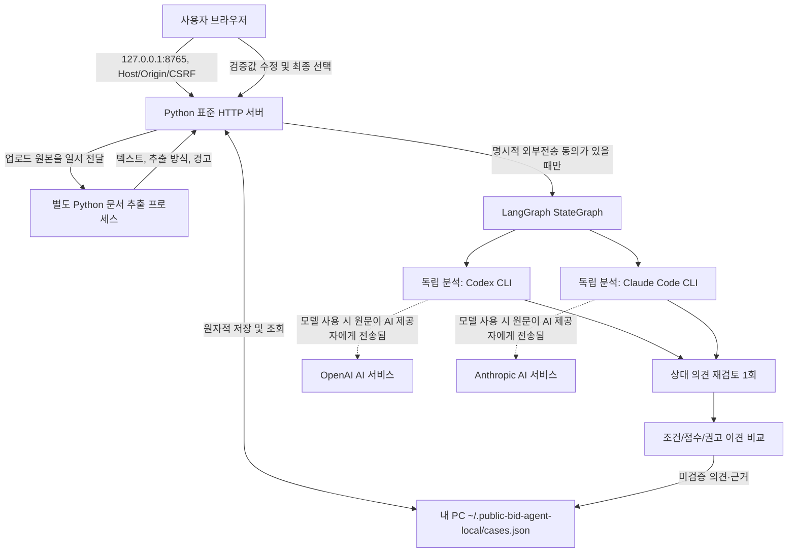

# Public Bid Agent | 공공 입찰 참여 의사결정 지원

> 구현 단계: **Windows 로컬 Python MVP 실행·RFP 로컬 운영 이관 확인**. React/FastAPI는 별도의 합성 개발 자산입니다. 외부 공개 배포·RFP 전체 의미 검증·전체 앱 최종 보안 검수는 미완료입니다.
>
> Python 기준: **CPython 3.12.x** (CI: Python 3.12). 자세한 의존성·고지 의무는 [라이선스 검토](docs/DEPENDENCIES_AND_LICENSES.md)에 기록합니다.


## 2026-10-13 실제 구현·검증 상태 (최신 기준)

**현재 기준 화면은 `http://127.0.0.1:8765/decision-preview`입니다.** 개인 Windows PC의 `local_app/server.py`가 Python 표준 HTTP 서버로 제공하며, `frontend/public/bid-decision-dashboard-preview.html`과 `frontend/public/dashboard-live.js`가 실제 API에 연결됩니다. `bid-management-preview.html`은 초기 정적 퍼블리싱 시안이며 `frontend/` React + `backend/` FastAPI는 현재 운영 서버와 별도인 합성 개발 자산/공개 서비스 장기 계획입니다.

- **10월 13일 읽기 전용 실측:** **10월 11일 마지막으로 수집된 로컬 공고 메타데이터 스냅샷 2,223건**을 조회했습니다. 최신/전수 수집, 정정·취소 반영이나 실제 참가 가능 상태를 보장하지 않습니다. 로컬 관심 부서 후보 143건, 10월 13일 평가시 마감 전 후보 109건 중 RFP 본문 추출 상태로 연결된 후보 107건/메타데이터만 있는 후보 2건입니다. 107건은 **RFP 전체 요건의 검증 완료 건수와 다릅니다**. `RULE_BASED_READ_ONLY`의 상위 30건 표시는 **상세검토 우선순위**이며 실제 AI 적격 추천·법적 자격 확정/낙찰확률이 아닙니다.
- **RFP 처리/부분 이관 구분:** 전체 RFP 작업 원장은 여전히 `PAUSED, DONE 109, PENDING 34, FAILED 0`입니다. 이와 별개로 격리 검증된 **70개 공고·127개 문서의 지정 범위**를 10월 12일 로컬 운영에 반영한 이관 저널만 `COMPLETED`입니다. 본문 저장 파일 124개와 추출 문서 기록 127개는 서로 다른 단위이며 대응 관계/중복 제거 여부는 별도 확인 대상입니다. 백업 1개 확인. 로컬 적용과 **인터넷 공개 출시**, CI 성공과 **전체 앱 독립 보안 승인**, 개별 API 확인과 **브라우저 전체 인수 테스트**는 서로 다릅니다.
- **기능 경계:** 공식 공고 메타데이터 수집/분류·일부 RFP 추출과 원문 보존·규칙 기반 순위/수기 결정은 구현되어 있습니다. 8개 필수조건과 12개 비교인자는 검토 가정이고 법적 적격성 `UNVERIFIED`입니다. 14개 문서는 44,000자 추출 한도 때문에 완전성 미검증이며 해당 문서가 위 107건과 어떻게 대응하는지도 추가 확인 대상입니다. 표·각주·정정/취소·업종·지역/첨부 누락과 실제 부서 기술·실적·가용 MM·원가 기반 과업 적합성은 추가 검증해야 합니다.
- **미완료:** 평일 오전 9시 정기 수집(현재는 화면 시안), 전체 공고 자동 AI 의미 분석/실질적 입찰 참여 추천, Google 다중 사용자 로그인·원격 계정 연결, 공식 제출/점수/낙찰 자동확인, 공개 인터넷 서비스. 개인 Codex CLI의 제한적 수동 AI 분석 실증은 별개입니다.
- **Source of Truth:** 본 문서의 최신 절과 [TASKS.md](TASKS.md)를 기준으로 하고, 아래 10월 9일 단계·각 날짜별 '이번 변경 범위' 설명은 **당시 이력**으로 해석합니다. 프로젝트 독립 최종 검수는 최신 사용자 지시대로 Codex만 사용합니다.

## 1. 이 프로젝트가 해결하는 문제

목표는 공고/RFP와 확인된 부서 정보를 근거로 *참여 자격, 기술 요구, 투입 자원, 원가, 경쟁 및 계약 리스크*를 비교해 최종 사용자가 참여·보류·미참여를 결정하도록 돕는 것입니다. 별도의 로컬 수동 AI 분석에서 사용자가 외부 전송에 동의한 경우 Codex·Claude 의견을 비교할 수 있도록 구현했지만, 전체 공고의 자동 AI 분석과 실질적인 참여 추천은 아직 제공하지 않습니다. AI 의견과 실제 법적 적격 여부, 최종 사용자 결정, 수주 결과는 분리해 기록합니다. **입찰서 자동 제출이나 실제 낙찰확률 제공을 구현하지 않았습니다.**

## 2. 현재 로컬 실행 아키텍처



- 브라우저: `local_app/index.html`, `local_app/app.js`. 프롬프트 입력·파일 선택·동의·AI 의견 및 이견 표시·영향인자 검증·최종 선택.
- HTTP 및 로컬 저장: `local_app/server.py`. loopback 전용, `cases.json` 원자적 갱신, 8개 필수조건과 12개 비교인자, 사용자 최종결정 별도 저장.
- 문서 파서: `local_app/extractors.py`. PDF/한국어 OCR, Excel, HWP/HWPX, DOCX 및 일반 텍스트. 추출 제한/경고 표시. 별도 subprocess이지만 OS 수준의 완전한 악성파일 샌드박스는 아닙니다.
- AI 워크플로: `local_app/cross_review.py`. **실제 LangGraph** 노드 `independent_analysis → peer_critique → evidence_comparison`. 상대 모델을 1회씩 재검토하고 근거/값의 이견을 정리합니다. LangChain Core `ChatPromptTemplate`를 사용합니다. 한 모델만 성공하면 가짜 합의를 만들지 않습니다.
- 외부 실행: 설치·로그인된 `codex`/`claude` CLI만 명시적 동의 후 사용. 인스턴스/토큰을 직접 수집하지 않습니다. **실제 두 모델 인증·요금제 실행 성공은 사용자 PC에서 확인해야 합니다.** 한 공급자의 CLI 실패는 명시적 실패로 표시합니다.
- 저장: 앱 업무 데이터는 사용자 홈의 JSON에만 저장합니다. 모델 사용 시 자료가 선택한 업체로 전송되고, 각 CLI 자체의 세션·캐시 저장은 앱의 통제 밖입니다.

## 3. Python 설치 및 실행

### Windows PowerShell

Python 3.12.x를 설치하고 저장소 루트에서 실행합니다. `py -3.12 --version`으로 설치 버전을 확인합니다. **2026년의 Python 3.12 보안 릴리스는 소스 배포만 제공하므로 Windows 3.12 설치 프로그램 제공 여부를 공식 다운로드 페이지에서 확인**하고, 운영 PC의 보안 업데이트 정책을 따르세요.

```powershell
py -3.12 -m venv .venv
.\.venv\Scripts\python.exe -m pip install --upgrade pip
.\.venv\Scripts\python.exe -m pip install -r local_app/requirements.txt
.\.venv\Scripts\python.exe local_app/server.py
```

### macOS/Linux

```bash
python3.12 -m venv .venv
.venv/bin/python -m pip install --upgrade pip
.venv/bin/python -m pip install -r local_app/requirements.txt
.venv/bin/python local_app/server.py
```

실행 후 `http://127.0.0.1:8765/` 방문. 종료는 터미널 `Ctrl+C`. 파일은 **`~/.public-bid-agent-local/cases.json`** 에 로컬 저장됩니다. 필요 시 `PUBLIC_BID_LOCAL_DATA` 및 `PUBLIC_BID_LOCAL_PORT` 환경변수를 설정합니다. `.venv`와 JSON은 Git에 넣지 않습니다.

### 스캔 PDF OCR 준비

별도 실행 파일 **Tesseract OCR**과 `kor`, `eng` 언어팩이 필요합니다. `tesseract --list-langs`로 확인합니다.

- Windows: Tesseract 배포판 설치 시 `kor` 선택, PATH 설정.
- Ubuntu/Debian: `sudo apt-get install tesseract-ocr tesseract-ocr-kor tesseract-ocr-eng`.
- macOS: `brew install tesseract tesseract-lang`.

## 4. 사용 순서

1. **공고 만들기**로 가상·실제 공고에 대한 로컬 검토 건을 생성합니다.
2. 설명 프롬프트를 작성하거나 **Excel(XLSX/XLS/XLSM), 일반·스캔 PDF, HWP/HWPX, DOCX, TXT/MD/CSV/JSON**을 선택해 텍스트를 추출합니다. PDF·표·OCR의 추출 한도와 누락 경고를 읽습니다.
3. 자신의 컴퓨터에 설치된 Codex/Claude Code CLI를 공식 절차로 인증하고, AI 사용 제공자를 선택합니다. **AI에 보낼 자료를 확인하고 외부 전송에 동의한 뒤** 실행합니다.
4. 모델별 독립 의견, 상대 의견 검토 및 이견 목록을 확인합니다. **2개 모델 선택 시 최대 4회 모델 요청**이 발생할 수 있습니다. API 비용·구독 이용 자격은 CLI 제공자의 계약·사용 정책에 따릅니다.
5. `AI 초안 적용` 버튼으로 미검증 영향인자를 채운 뒤 원문을 확인하여 오입력을 수정하고, 확인 항목에만 체크합니다. 자동 점수는 **실제 수주확률이 아닙니다**.
6. 최종 **참여/보류/미참여**를 직접 선택하면 사람이 선택한 결정과 이유가 JSON에 저장됩니다. AI는 최종 결정을 수정하지 않습니다.

설치·사용 방법 상세는 [local_app/README.md](local_app/README.md)와 동일 기준으로 유지합니다.

## 5. 데이터 흐름 및 저장 경계

- 원본 업로드 파일 바이너리는 업무 JSON에 넣지 않고 추출 텍스트·출처 파일명·추출 방식·경고를 기록합니다.
- JSON은 암호화되지 않습니다. PC/계정 권한, 디스크 암호화, 백업 범위는 사용자가 관리해야 합니다.
- 문서 내부에 있는 악성 프롬프트는 **비신뢰 데이터**입니다. 공식 입찰요건·금액·계약조건 등 중요한 사실은 사람이 원문과 증빙을 직접 확인해야 합니다.
- 선택한 AI 분석 요청 때에는 해당 원문 텍스트가 외부 서비스로 이동합니다. 기업 내부 문서는 회사 허가·기밀 유지 및 AI 서비스 계약을 먼저 확인하세요.
- 파일당 10MiB, 공고당 6개. 추출 텍스트 파일당 최대 44,000자, 모델 입력 90,000자, PDF 최대 40페이지/OCR 12페이지 등 현재 제한이 있습니다.

## 6. 현재 기준 화면과 별도 웹 UI 시안의 관계

`/decision-preview`는 Python 로컬 API에 연결된 실제 공고 수집·목록·상세·부서 설정·규칙 기반 순위 화면입니다. `bid-management-preview.html`은 과거 정적 화면이며 React/FastAPI와 공개 서비스는 별도의 확장 대상입니다. 09:00 정기 수집 UI는 실제 예약 수집이 아닙니다.

### 별도 정적/React 시안

별도 `frontend/`(React/Vite)과 `backend/`(FastAPI)는 합성 공고 검색/입찰관리 화면 설계 시안입니다. **현재 로컬 앱과 동일한 프로덕션 서비스가 아니며**, 실제 나라장터 API·Google 로그인·PostgreSQL/RAG·공개 운영 배포는 완료되지 않았습니다.

- [웹 입찰관리 UI 시안](frontend/public/bid-management-preview.html)
- [계정 선택 UI 시안](frontend/public/ai-account-preview.html): 진짜 OAuth 연결 아님
- [미래 확장 아키텍처](docs/02-architecture.md): 로컬 우선 결정에 맞춰 별도 목표 구조로 유지

## 7. 테스트 및 변경 시 문서 갱신

```bash
python -m unittest discover -s local_app -p 'test_*.py' -v
node --check local_app/app.js
python scripts/check_documentation_sync.py
```

**코드·의존성·UI/API 계약이 변경되는 커밋에는 `README.md`와 `local_app/README.md`를 같은 커밋에서 갱신**해야 하며, GitHub CI가 이를 검사합니다. 아키텍처·데이터 흐름·새 모델/패키지·사용법이 바뀌면 `docs/02-architecture.md` 및 [의존성 라이선스 검토](docs/DEPENDENCIES_AND_LICENSES.md), `AGENTS.md`, `CURRENT_STATE.md`와 `TASKS.md`의 관련 부분도 같이 수정합니다. 이 검사는 문서 **수정 여부**를 강제하는 것이며 사실 관계까지 자동 보증하지 않으므로 PR 리뷰에서 일치 여부를 확인합니다.

## 8. 라이선스 및 미완료 게이트

코드·문서: [Apache License 2.0](LICENSE). 주요 패키지의 허용적 라이선스 사용은 가능하지만, **의존 패키지 전체와 PDFium/OCR 바이너리를 재배포할 때 고지·라이선스 파일 동봉 의무**가 존재합니다. [라이선스 검토표](docs/DEPENDENCIES_AND_LICENSES.md)와 [NOTICE](NOTICE) 참고. 인증·상용 모델 호출 계약은 오픈소스 코드 라이선스와 구분됩니다.

- CI: 실행형 로컬 코드와 문서 형식 테스트. **모의 AI CLI 응답으로 LangGraph 테스트**하며 실제 개인 계정으로 모델을 호출하지 않습니다.
- 미완료: 기관별 실제 HWP/RFP OCR 정확도, 완전한 파일 파서 샌드박스, LangGraph 영속 체크포인트/재개, 정식 RAG, 실제 두 모델 CLI 인증/출력 E2E, 독립 최종 보안 검수와 사용자 UI 승인.
- 검수 전 개발 브랜치 `feat/sprint1-search-demo` 및 [Draft PR #1](https://github.com/son1004007/public-bid-agent/pull/1) 유지. 사용자 승인 없는 운영 배포/`main` 병합은 진행하지 않습니다.
> CI 의존성 계약: 각 Python 패키지는 `local_app/requirements.txt`에 한 줄씩 기록합니다. 2026-10-09 LangGraph 추가 시 줄바꿈 오류를 검사하고 수정했습니다.

## 2026-10-10 Codex 단독 실행 모드

Claude Code 구독이 없더라도 Codex CLI 로그인만으로 독립 영향인자 분석 1회 → 미검증 초안 → 사용자 수정/원문 대조 → 최종 Bid/No-Bid를 수행합니다. 단일 AI는 교차검토가 아니므로 합의한 것처럼 표시하지 않습니다. Windows npm 설치는 확장자 없는 `codex`가 아닌 `codex.cmd`를 실행합니다. 계정 기본 모델이 Codex에서 지원되지 않을 수 있으므로 이 로컬 앱은 `gpt-5.6-terra`를 명시하고, `--ephemeral --ignore-user-config --ignore-rules --sandbox read-only`로 실행합니다. 모델 접근 권한은 계정/버전마다 다르므로 실패 시 UI에서 오류를 확인합니다.


### Windows 실환경 Codex 단독 테스트 (2026-10-10)

회사 노트북의 **합성 공고만** 사용한 기능 확인: Windows + Python 3.12 + Codex CLI 0.154.0, ChatGPT 인증. `-m gpt-5.6-terra`와 `--ephemeral --ignore-user-config --ignore-rules --sandbox read-only`로 한 차례 모델 요청, `/api/analyze` 성공. JSON에 필수 Gate **8개**, 비교 인자 **12개**, 권고 `hold`, `ai_draft`, `cross_review.status=single_or_failed` 기록 확인. 사람의 `decision=undecided` 유지 확인, 모델 응답 **21.2초**. 실제 Claude 연동/교차반론은 수행하지 않음.

해당 Windows 사용자에게 로컬 전용 시작 바로가기 `Public Bid Agent (Local)`를 만들었으며 `http://127.0.0.1:8765/` 접근 성공. 바탕화면 바로가기는 배포 소스가 아니라 **해당 노트북의 편의 실행 설정**입니다. 앱 업무 JSON과 테스트 JSON의 위치를 분리했고 바인딩은 `127.0.0.1`로 한정합니다. 개인 Codex 설정은 변경하지 않았습니다.

## 공개된 실제 입찰공고 3건을 이용한 MVP 검증 (2026-10-10)

`local_app/fixtures/public_tenders_2026_10_10.json`에는 공개 입찰공고 **3건의 수기 전사 정보**와 **실제 회사가 아닌 가상 부서 4개 시나리오**를 저장합니다. [공고/업체 개인정보 및 재현성 검증](local_app/test_public_tenders.py)은 소스 URL과 공고번호/마감/가정 자료의 구분을 확인합니다. 공식 나라장터 원본 첨부 다운로드는 403 오류여서 직접 검증하지 못했으므로, 전재문·메타데이터 출처를 명시하고 실제 입찰 전 정정/마감 확인이 필수입니다. **실제 어니컴 부서의 인력·등록 자격·실적은 입력하거나 추정하지 않았습니다.** 이 자료는 실제 낙찰 확률의 정답 데이터가 아닙니다.

### 2026-10-10 실제 공고 검증 결과에서 나온 변경

실제 공고 3개 / 가상 부서 4개로 Codex를 실행했을 때 모델은 모두 보류 권고를 냈고 `reason`을 비워 반환했습니다. 단순 보류만 표시하면 **명시적 참가요건 불일치와 자료 부족을 구별하지 못하므로**, `local_app/decision_support.py`를 추가했습니다. `REVIEW_NO_BID_PROVISIONAL`(AI 제시 미충족), `HOLD_UNVERIFIED`, `HOLD_CONFLICT`, `READY_FOR_HUMAN` 등은 AI의 판단/사용자 결정과 별도로 저장됩니다. AI가 작성하지 않은 권고 사유는 임의로 생성하지 않고 **모델 사유 미제공** 경고로 보여줍니다. 공고 사실은 재게시 공개자료, 업체·부서 조건은 가정값임을 표시합니다.

## 2026-10-10 실공고 수기 MVP 검증 상태

**공개 입찰공고 3건 + 가상 부서 조건 4개**를 실제 Codex 구독으로 분석하고, AI 원문/하드게이트/원문 미확인/사람 결정을 로컬 JSON에 구분해 저장했습니다. 실제 AI 4건 분석과 개정 HTTP 위험 재분류에 성공했습니다. 자세한 수치와 원문 출처 제한은 [MVP 검증 보고서](docs/reviews/MVP_PUBLIC_BID_E2E_2026-10-10.md)를 참고하세요. 회사 노트북 `Public Bid Agent (Local)` 바로가기로 확인할 수 있으며 검증 사례의 회사 능력은 전부 **가상**입니다. **AGY/Codex 독립 최종 검수는 원격 권한 정책으로 막혀 `main` 병합을 보류**합니다. 권한을 우회하지 않습니다.

## 2026-10-10 독립변수 20개 확인 방법

로컬 앱에서 공고를 선택하면 **'AI 독립변수 20개 및 추출 근거 (읽기 전용, 미검증)'** 영역이 표시됩니다. Codex가 수집한 Gate 8개와 비교인자 12개의 **원본 status/score/evidence**를 수기 '초안 적용' 없이 즉시 볼 수 있습니다. 여기는 읽기 전용이며 실제 사용자 보정·확인/저장은 아래 수기 입력칸과 별도로 진행됩니다. 기존 AI 모델 출력/사람 결정은 보기 동작에서 바뀌지 않습니다. 점수는 모든 평가요인에서 '높을수록 유리'하도록 정의했고, risk=위험 통제(5점=통제 양호), bid_cost=제안비용 부담(5점=부담 낮음)을 프롬프트에 명시했습니다. 과거 AI 모델이 위험을 '위험이 클수록 5점'으로 매긴 샘플이 있어 이전 결과는 재검토 대상이며 자동 수정하지 않습니다.

## 팀장용 문서 준비 가이드와 20개 독립변수 연결 (2026-10-10)

앱 첫 화면(공고 등록 전에도 접근 가능)의 **'입찰 판단에 필요한 문서 5종과 변수별 증빙 안내'**를 열면 원본 보유 담당부서·문서 예시·추출 변수·미확인 시 질문·보안 주의사항이 표시됩니다. **1. 입찰공고문/정정공고, 2. 제안요청서·과업지시서(외부 발주기관 자료), 3. 업체등록·면허/인증, 4. 유사실적·기술·가용 인력현황, 5. 프로젝트별 원가·제안계획/위험관리(회사 내부자료)** 다섯 묶음이 추천 순서입니다. '5종'은 파일 개수 제한이 아니라 자료 범주입니다. 경쟁업체·과거 발주경향 등 일부 인자는 추가 공개자료가 없으면 미확인으로 유지합니다.

실행 화면과 CI 검사의 단일 원본은 [문서-독립변수 매핑 JSON](local_app/document_guide.json)이며, Hard Gate 8개와 12개 평가요인이 모두 어떤 자료에서 확인 가능한지 및 담당자 확인 질문을 포함합니다. 5종 전체가 법적 입찰자격 충족을 보장하지 않으며 AI 추출 근거를 사람이 원문·증빙과 대조해야 합니다. **회사 기밀 원본·인력 개인정보·원가 세부표·인증서 비밀키를 허가 없이 외부 Codex/Claude에 전송하지 않습니다.** 허가가 없으면 공개 공고문과 승인된 비식별·가상 업무 요약만 AI에 전달하고 내부조건은 수기 평가로 보완합니다. 로컬 JSON도 평문이므로 회사 승인과 PC 접근통제가 필요합니다. 앱은 문서 종류를 자동 판별해 인증하는 기능을 구현하지 않았으며, 안내·수기 업로드용입니다.

## 2026-10-10 회사 운영정보와 공고별 원가 산정 (로컬 MVP)

'회사 운영정보'는 팀장·PMO/인사/재무/영업 자료가 섞인 **기준 데이터**이므로 5번 문서 하나를 반복 업로드하는 방식으로 구현하지 않았습니다. **`operations.json`(직무별 월 총원가/가용 MM, 간접비율·위험충당률) → 공고별 `cases.json.cost_plan`(투입 MM·외주비·직접경비·제안비용·예정 공급가액) → `cost_estimate`(VAT 제외 예상 원가/사업이익/이익률·주의사항)** 구조를 제공합니다. **회사 운영정보는 LLM에 자동 전달하지 않으며**, 모델 분석과 인간의 입찰 최종결정을 보존합니다. 개인정보/개인급여/고객정보를 입력하지 않으며, 실제 운영·원가 데이터는 회사 정책 승인 전 입력·전송하지 않습니다.

업데이트 시 역할 기준의 revision이 증가하며 각 공고별 이전 견적은 구 버전 표시/재계산 필요로 처리합니다. 공수 초과와 단가 0, 공수 0 및 공급가액 미입력은 경고합니다. 공급가액은 **부가가치세 제외** 원화 정수이고, 월 총원가는 사업 인건비의 고용주 부담 총원가 기준입니다. 예정이익은 **예정 공급가액 − (직접인건비+외주비+직접경비+간접비+위험충당+제안준비비)** 로 산출합니다. 현금흐름·법정 사업대가·실제 수주확률은 계산하지 않습니다. 가용 MM은 이 화면 내 각 공고별 참조용으로, 여러 공고 또는 기존 수행 사업의 중복배정 자동 집계가 아닙니다.

### 실제 운영자료 8종의 확보·검증 상태 관리

원가 기준표 외에, 팀장·PMO·인사·재무·영업 등이 관리하는 **사업자격/인증, 수행 중 프로젝트/가용인력, 과거 수행실적/손익, 협력사·단가, 재무·수금, 제안 파이프라인, 사업전략, 계약·품질 위험**의 8개 장부를 별도의 **자료 수집·검토 상태**로 관리합니다. 화면에서 항목별 담당 부서, 상태(`미수집`/`갱신 필요`/`요약·출처 확인`), 승인된 최소 요약, 문서명과 확인일을 수기 기록합니다. 요약·출처·날짜 없이는 '검토 완료'가 저장되지 않습니다. 이는 업로드 원문을 법적 증빙으로 인증하는 기능이 아니며, 예상 원가 계산이나 Codex에 **자동 포함하지 않습니다**. 실제 인사·재무·고객 자료는 회사 승인 전 등록 금지. 다른 부서 데이터의 API 연동·정합성 검증은 추후 단계로 남깁니다.

### 운영자료 확인일 형식 검사

운영 장부 8종의 확인일은 `YYYY-MM-DD` ISO 날짜이고 **달력에 실재하는 날짜**여야 합니다. `2026-02-30` 등 잘못된 날짜는 저장 거부합니다. 원본 문서의 실제 발행일·검증 여부까지 법적으로 증명하는 기능은 아니며 담당자의 출처 대조가 필요합니다. 수정 커밋에서 루트/로컬 README를 함께 갱신하고 push 및 PR CI를 다시 확인합니다.

## 회사 운영정보 실제 검증 증거 (2026-10-10)

Windows 회사 노트북의 **가상 원가 데이터**로 회사 기준정보 저장→공고별 원가계산→JSON 분리→운영기준 변경에 따른 구버전 경고를 검증했습니다. 50개 Python 테스트·GitHub push/PR CI 통과. 원가 예시 **공급가액 50,000,000원 / 총원가 37,805,000원 / 이익 12,195,000원(24.4%)**. 담당 부서별 운영자료 8종의 검토상태도 가상 요약으로 확인했습니다. 기존 사용자 입찰 4건은 보존. [상세 검증 보고서](docs/reviews/OPERATIONS_COST_E2E_2026-10-10.md). 독립 코드 리뷰 및 사용자 화면 클릭 검증은 미완료이므로 main 병합은 HOLD입니다.

## 2026-10-10 공고 중심 참여판단 UI 재설계 — 퍼블리싱 우선

**[새 공고 수집·참여판단 대시보드 화면](frontend/public/bid-decision-dashboard-preview.html)** 을 퍼블리싱했습니다. 회사 노트북의 기존 로컬 앱 `http://127.0.0.1:8765/`에서도 **새 입찰 의사결정 화면 열기**를 선택하면 `/decision-preview`로 열립니다. 이 시안은 React/백엔드 미연동 정적 HTML이며 합성 공고 8건으로만 탐색, 필터링, 공고별/일괄 판단 버튼, **참여 판단 기준 프로필**(기술 적합도·예상 이익률·필수 자격·운영 사업 처리), **영향인자 프로필**(8 Hard Gates·12 Factors 가중치 합 100%), **불참 이유/판단 근거/사용한 프로필 버전/사람의 최종결정/이력**을 시뮬레이션합니다. 공고 수집은 '평일 09시' 설정 구상과 가상 수집 버튼으로 표시하며, 실제 스케줄링·나라장터/API 호출·모델 요청·서버 JSON 프로필 영구 저장을 수행하지 않습니다. 프로필·판별 이력은 브라우저 메모리에서만 유지하며 새로고침 시 초기화됩니다. 사용자 화면 확인 전 실제 수집·자동 추천 정책/백엔드를 구현 완료라고 주장하지 않습니다.

### 화면 시안 판단기준/영향인자 동작 보완

정적 참여판단 시안의 12개 영향인자 가중치(합 100%)를 가상 영향인자 값과 결합해 **가중 종합 적합도(0~100)** 를 계산하고, 참여판단 프로필의 최소 적합도와 비교하도록 반영했습니다. 이는 **시안용 파생 점수로 실제 LLM 판별이나 예측 정확도를 입증하지 않습니다**. 과거 판단 결과는 프로필 변경만으로 자동 덮어쓰지 않고 버튼을 다시 누를 때 판단 기준 버전을 적용합니다. **담당자 최종 불참 기록**에는 별도 불참 사유 입력을 요구하며, 원래 가상 참고판단 사유와 구분하여 이력에 저장합니다(탭 메모리 한정).

### Chrome CSP 호환 퍼블리싱 시안 (2026-10-10)

Windows 실제 Chrome 헤드리스 검사에서 로컬 서버의 `Content-Security-Policy: script-src 'self'`가 시안 HTML의 inline script를 차단함을 확인했습니다. 보안 정책을 완화하지 않고 브라우저 코드를 `frontend/public/bid-decision-dashboard-preview.js`로 분리했으며 로컬 서버가 동일출처 `/bid-decision-dashboard-preview.js`로 제공합니다. 정적 HTML 단독 파일만 복사하면 동작하지 않으므로 같은 디렉터리의 JS도 함께 배포해야 합니다. 실제 브라우저 DOM에 공고 행과 프로필 요소가 표시되는지 검증한 뒤 UI 시연 완료를 판단합니다.

### 2026-10-10 Chrome 브라우저 퍼블리싱 확인

회사 노트북 `TD-kiseok`의 Chromium 기반 Chrome headless 실렌더링에서 새 대시보드 `http://127.0.0.1:8765/decision-preview`의 **합성 공고 8행, 현황 KPI 5개, 영향인자 가중치 입력 12개**가 DOM에 생성됨을 검증. 로컬 GET HTTP 200, CSP의 같은 출처 JS 로드, Node `--check` PASS. 검증 중 inline script CSP 차단을 실제 발견하여 정적 JS 파일로 분리하고 보안 헤더는 유지. GitHub push run [38049729286](https://github.com/son1004007/public-bid-agent/actions/runs/38049729286) SUCCESS / PR run [38049733578](https://github.com/son1004007/public-bid-agent/actions/runs/38049733578) SUCCESS. **클릭 상호작용의 브라우저 자동화 E2E 및 사용자의 UI 승인 = NOT RUN**. 현재 앱은 실제 나라장터 수집·AI 판별·프로필 영구 저장을 제공하지 않는 정적 설계 시안이며 main 병합은 HOLD.

### 2026-10-10 공고 전체 상세보기 퍼블리싱

새 공고 중심 대시보드 `/decision-preview`의 목록에 독립된 **상세보기** 버튼을 추가하여 전체 폭의 **공고 상세 화면**으로 이동합니다. 4개 탭: **기본정보(기관/예산/마감/원문·첨부 수집 여부), 참가자격·과업(요구범위 및 Hard Gate 8종), 영향인자·사업성(12개 Factor, 가중치, 기술·이익률 및 프로필 버전), 참여 판단·불참 사유(가상 참고권고와 사람의 최종결정, 명시적 불참 입력 및 이력)**. 목록 복귀/재판단을 제공합니다. `상세보기` 자체는 자동 AI 호출·평가·상태변경을 하지 않습니다. 사용자 입력 상태는 브라우저 탭 메모리만, 새로고침 시 초기화되며 실제 나라장터 원문/첨부·프로필 영구저장·AI 판별·사내 민감정보 전송은 미구현입니다. 정적 HTML과 동명 JS를 함께 제공하며 로컬 CSP를 유지합니다.

### 2026-10-10 상세 시안 검증 계약

최종 불참사유 필드는 상세 판단 탭을 열 때 JavaScript가 동적으로 생성되며, 정적 테스트는 해당 생성 계약을 확인합니다. 클릭 기반 Chrome 시연은 별도 검증 후 기록합니다.

## 상세보기 UI 검증 (2026-10-10)

공고 목록→전체 상세(4탭)→참여 판단 시연→사유를 입력한 담당자 불참 결정→상세/이력 재조회 **Chrome 클릭 19개 항목 PASS**. 상세보기 클릭만으로 판단이 실행되지는 않습니다. [상세 화면 검증 보고서](docs/ui/DECISION_DETAIL_PREVIEW_E2E_2026-10-10.md). 현재 합성 시연만 제공하며 실제 API/모델·영구저장은 미구현입니다.

## 로컬 의사결정 프로필 API (2026-10-10 개발 브랜치)

`http://127.0.0.1:8765/decision-preview`에서 참여 기준 및 12개 영향인자 가중치를 저장하면 `~/.public-bid-agent-local/decision_profiles.json`에 버전 이력이 별도로 보관됩니다. GET `/api/decision-profiles`로 조회하고 POST `/api/decision-profiles/save`로 저장합니다. POST는 로컬 Origin/CSRF, `expected_revision` 낙관적 동시성 검사와 전체 가중치 100% 조건을 적용하며, 다른 창의 변경과 충돌하면 409를 반환합니다. 파일을 직접 열어 보거나 독립 시안을 실행하면 기존 화면 메모리 데모로 동작합니다. 기존 `cases.json`과 `operations.json`은 그대로 유지합니다.

**이 API는 개인 PC 루프백 전용 시연입니다.** 합성 공고 목록/가상 판단/불참 이력은 아직 서버 저장되지 않으며 실제 공고 수집, Codex 호출, 법적 입찰 자격 검증, 대외 배포가 구현됐다는 뜻이 아닙니다. 이 기능의 독립 최종 코드 검수·사용자 UI 승인은 아직 완료되지 않았고 Draft PR 병합은 보류합니다.


## 2026-10-11 새 공고 대시보드 백엔드 수직 슬라이스

`http://127.0.0.1:8765/decision-preview`에서 기존 8개 합성 시안 대신 `dashboard.json`의 수집 목록, 상세, 실제 입력한 담당자 참여·불참·보류 사유와 판단 이력을 조회합니다. 사용자 기준 프로필과 별개로 공고 조회/수집/결정 상태를 버전 관리합니다. 파일을 독립 실행한 HTML은 구버전 합성 화면 시안으로 유지됩니다.

- GET `/api/dashboard`: 공식 수집 공고·변경/판단 이력·수집 성공/오류 상태를 읽습니다.
- POST `/api/dashboard/collect`: **명시적으로 버튼을 누른 경우만** 조달청 나라장터 용역 공고를 HTTPS로 요청합니다. 자동 배치·스케줄은 아직 없습니다.
- POST `/api/dashboard/action`: 공식 원문·기업 근거 미확인 공고를 확인 보류로 기록하거나, 담당자 최종 Bid/No-Bid/보류 및 사유를 별도 이력으로 저장합니다. AI 추론이나 법적 참가자격 판정을 수행하지 않습니다.
- 공공데이터포털 [조달청 입찰공고정보서비스](https://www.data.go.kr/data/15129394/openapi.do) 활용신청·발급된 인증키가 필요합니다. 환경변수 `DATA_GO_KR_SERVICE_KEY`에 **실사용 PC 프로세스 환경에서만** 설정하며 Git·브라우저·로그에 입력하지 않습니다. 미설정이면 424 오류와 별도 수집 준비 상태를 표시하고, 합성 데이터로 위장하지 않습니다.
- 현재 수집 범위: 용역 공고게시일 기준 최근 24시간, 최대 20페이지 × 100행으로 한정. AI·SW·데이터 관련 제목 필터는 탐색 보조 용도이며 전체 공고/정정 차수 커버리지는 보장하지 않습니다. 조회가 불완전하면 실패로 처리하여 기존 공고를 유지합니다.
- 기본 수집 인증키는 **저장소에 없고 실제 개인 키 요청 검증은 별도**입니다. 공식 API의 실제 응답 스키마·정정/취소·첨부는 아직 실키 성공 샘플 및 독립 최종 검수 전입니다. 대외 공개·실입찰 법적 판정에 사용하면 안 됩니다.
- 저장: `~/.public-bid-agent-local/dashboard.json` (기본) 혹은 런처의 `PUBLIC_BID_LOCAL_DATA` 하위 별도 로컬 JSON. 기존 `cases.json`/`operations.json`은 수정하지 않습니다.
- 자세한 계약·제약: [대시보드 수집·상태 설명](docs/research/2026-10-11-dashboard-backend.md).

수집 대시보드 실행 모드에서는 상세·수집상태·화면 하단도 실제 API 상태를 기준으로 변경되어, 합성 시안 안내를 실수로 실제 공고에 적용하지 않습니다. 현재 실키 호출 검증 및 운영은 미완료입니다.

Windows에서 인증·CSRF 거절 POST의 요청 본문이 남아 연결이 강제 종료될 가능성을 줄이기 위해, 서버는 최대 본문 한도 내에서 제한시간을 두고 남은 바이트를 읽은 뒤 403을 반환합니다. 인증/인가 검사 자체는 유지합니다.


## 2026-10-11 나라장터 API 인증키 웹 등록

기존 로컬 공고 대시보드 `http://127.0.0.1:8765/decision-preview`의 **수집 관리 → 나라장터 OpenAPI 인증키 설정**에서 직접 키를 등록/공식 API 연결 확인/삭제할 수 있습니다. 활용신청 버튼은 [공공데이터포털의 조달청_나라장터 입찰공고정보서비스](https://www.data.go.kr/data/15129394/openapi.do) 공식 페이지를 새 창으로 엽니다. 로그인·활용신청·인증키 발급은 사용자 본인 계정에서만 수행하며 앱이 자동으로 대행하지 않습니다.

- 일반 인증키와 URL 인코딩 인증키 둘 다 입력 가능. 서버에서 정규화 후 Windows **현재 사용자 계정 DPAPI**로 암호화해 `%LOCALAPPDATA%/PublicBidAgent/secrets/g2b_servicekey.dpapi`에 저장합니다. 기존 공고/회사 JSON과 분리되며 GitHub·브라우저 localStorage·일반 JSON에 키 평문을 보관하지 않습니다.
- `GET /api/procurement-key`는 등록 여부·방법만 반환하고 키 값을 절대 노출하지 않습니다. `POST /api/procurement-key/save`, `/verify`, `/delete`는 localhost + Origin + CSRF 검증을 거칩니다.
- **연결 확인**은 조달청 공식 용역 API를 한 페이지 1건만 조회해 resultCode 00 여부를 판단합니다. 저장만으로 자동 대량 수집을 수행하지 않습니다. 실제 수집은 기존 **공식 공고 지금 수집** 버튼으로 별도 실행합니다.
- 앱이 사용하는 공식 파라미터는 첨부된 조달청 OpenAPI 참고자료 v1.2에 근거해 **`ServiceKey` 대문자 S/K**로 수정했습니다.
- Windows 이외에서는 웹 비밀 저장을 지원하지 않으며 기존 `DATA_GO_KR_SERVICE_KEY` 환경변수 경로는 유지합니다. Windows에서 환경변수가 설정되어 있고 저장 파일이 없으면 환경변수를 사용합니다. 삭제는 로컬 DPAPI 파일만 삭제하며 기존 환경변수는 변경하지 않습니다.
- 비밀번호 입력값을 브라우저·GitHub·채팅·콘솔 등에 복사하거나 개발자 도구 로그에 남기지 마세요. 로컬 브라우저에서는 주소가 `127.0.0.1`인지 확인합니다. 독립 보안 검수 전 외부 공개 서버에서 이 기능을 활성화하지 않습니다.

### 실제 공고 7일 이력 수집 및 화면 테스트 (2026-10-11)

인증키 정상 연결 후 최근 24시간은 주말·공휴일에 관심분야 공고가 0건일 수 있습니다. `수집 관리 → 조회 기간`에서 **최근 24시간 / 최근 7일(기본)**을 선택해 공식 용역 공고를 수동 수집합니다. 7일은 날짜별 24시간 조회를 7회 수행하여 하루 2,000행 상한과 API 응답/쿼터의 부담을 제한하며, 공고번호+차수로 중복 제거합니다. 어느 날의 조회라도 실패하면 7일을 완전 수집했다고 기록하지 않고 기존 공고/담당자 결정을 보존합니다. 기존 수집 완료 정보에는 `lookback_days`를 기록합니다. **정기 자동 배치는 여전히 미구현**입니다.

공고 수집 HTTP 회귀 테스트는 실제 Windows 사용자 DPAPI 키를 읽지 않도록 인증 공급자를 가상 환경변수로 치환합니다. 실제 키가 등록된 PC에서도 테스트를 실행할 수 있습니다.

실제 API 데이터 모드에서는 공고 KPI의 출처를 `조달청 공식 API · 제목 필터`로 표시하고, 수집 관리 제목을 `공식 입찰공고 수동 수집`으로 바꿉니다. HTML 파일 독립 시안에서는 합성 공고 표기를 유지합니다.

## 2026-10-11 제목 누락 방지·부서 관심 분야별 상세 분류

공공 API 용역 공고를 제목으로 삭제하지 않고 전체 저장합니다. 공공조달 분류, 정보화사업 여부, 공고·참가자격 등록 기한, 업종/참가 제한, 규격서명/첨부 URL과 선택적으로 추출한 RFP 본문을 기준으로 2단계 분류합니다. 법적 참가가능 여부는 실제 회사 등록/면허/실적 없이 확정할 수 없으므로 항상 미검증 상태로 표시합니다.

수집 관리에서 부서 관심 카테고리 AI, SW, DATA, SECURITY를 체크·저장할 수 있습니다. 목록은 마감 전/확인대기 및 부서 후보 중심으로 표시하며, 전체/마감·취소 포함 필터를 선택해 수집 DB에 남아 있는 다른 공고도 볼 수 있습니다. 검색은 공고명 외 조달 분류/첨부명/추출 본문에도 적용합니다. 서버는 관심 분야 설정을 별도 department_profile.json에 기록합니다.

상세 탭에서 실제 규격서 링크를 확인하고 공식 HTTPS 사이트 g2b.go.kr의 PDF/HWP/HWPX/DOCX/TXT 문서를 명시적 클릭으로 최대 8MiB 다운로드, 격리 subprocess에서 최대 12,000자 본문을 추출해 분류 근거로 활용합니다. 수집 관리에서 한 번에 최대 5건 추가 상세 확인 기능을 제공합니다. 다운로드에 실패하거나 문서가 없으면 적합/부적합으로 단정하지 않고 확인대기로 유지합니다. 외부 AI 전송·자동 입찰 제출 없음.

분류 오탐을 줄이기 위해 단독 '개발·구축·고도화' 단어는 SW 적합 근거로 사용하지 않습니다. 기본 화면은 명시적 분류 후보만 먼저 보여 주고, 검토대기 1,900여 건은 포함 옵션/필터로 접근할 수 있으며 DB에서는 보존합니다.

분야 분류는 'AI 데이터 분석 플랫폼'처럼 연속된 AI 플랫폼 표현이 없어도 의미상 명확한 복합 키워드를 감지하도록 보완합니다. 모든 기계 분류는 실제 입찰 참가자격 승인과 구분합니다.

실 브라우저 E2E의 초기 표시 1,907행은 부서 프로필 비동기 로드 전에 JS 임시 기본값에 미분류 포함이 켜져 있던 현상이었습니다. 검색어 조건식 자체에는 문제가 없었으며, 서버 기본값과 JS 초기값을 false로 동기화해 첫 화면부터 명확한 관심 후보만 표시합니다.

실 조달청 batch E2E에서 공고 5건 중 본문 4건 추출 성공, 1건 실패를 확인했습니다. 그러나 기존 검토대기 대상에는 행사/폐기물 처리 등 비대상 용역이 섞여 있어, 일괄 본문 확인은 이제 저장된 부서 프로필에 해당하는 명시적 후보(CANDIDATE)만 대상으로 하고 조달분류·RFP 파일명 근거를 우선합니다. 검토대기는 수동 공고별 추출에서 유지합니다.

### 공식 참가자격 제한 상세조회

공고 상세 탭에서 **공식 면허·지역·e발주 첨부 추가조회** 버튼을 누르면 조달청 입찰공고정보서비스의 getBidPblancListInfoLicenseLimit, getBidPblancListInfoPrtcptPsblRgn, getBidPblancListInfoEorderAtchFileInfo 세 오퍼레이션을 공고번호·차수로 각각 조회합니다. 반환된 업종/면허 제한 목록, 참가가능 지역명, 공식 e발주 첨부파일 링크를 기존 공고 상세정보에 추가합니다. 요청 중 하나라도 실패하면 기존 상세 결과를 보존합니다. 실업체의 보유 업종·등록 여부·사내 실적과 대조하는 법적 자격 판정은 별도이며 계속 미검증으로 표시합니다.

## 2026-10-11 RFP 재개형 배치 (로컬 개발 브랜치)

기존 `/decision-preview`의 **수집 관리** 화면에서 공식 RFP 순차 분석을 1·3·10·25건씩 시작, 중단, 재개하고 실패한 공고만 재시도할 수 있습니다. 작업은 1개씩 실행하고 기본 3초 간격을 둡니다. 진행률은 `GET /api/rfp-batch`에서 확인하고, 원본 공고 `dashboard.json` 외에 `rfp_batch.json`에 작업 상태를 기록합니다. 서버를 재시작하면 진행 상태를 복구하고 수동 재개할 수 있습니다. 성공 문서의 출처·SHA-256·본문 발췌는 공고 상세에서 확인할 수 있습니다. 첨부 파일과 e발주 상세는 공식 공개 사이트/API에만 접근하며 별도 LLM 전송은 하지 않습니다. 성공한 추출은 법적 참가자격 충족을 의미하지 않습니다. 설계·안전 한도는 [RFP 순차 배치 설계](docs/design/RFP_RESUMABLE_BATCH_2026-10-11.md) 참고. 배포 및 main 병합은 독립 검수·사용자 UI 승인 후에만 수행합니다.

## 검토대기 공고 재탐색 (2026-10-11)

기존 REVIEW 분류 공고에 대해 `GET /api/dashboard/discovery`에서 공식 정보화사업 여부, 조달 분류, 과업문서 링크와 사업명 신호의 근거를 저장 없이 재평가하고 상위 30건을 기존 **수집 관리** 화면에 표시합니다. 실제 공식 2,080건 중 **227건이 메타데이터 상세 검토 우선순위**에 해당합니다(규칙 초안; 사업 수행·참가자격 적합 확정 아님). 추가 발굴된 `G2B-R26BK01763641-000` 순천향대학교 통합 학습경험플랫폼(LXP) 구축(1단계) 용역은 **RFP 검토 필요**로 유지합니다. 이 과정에서 검토대기 원본/담당자 결정을 변경하지 않습니다. 운영·유지보수와 개발의 비중 확인은 상세 문서와 담당자 검토 단계에서 수행합니다.

## 비식별 인력·가정 원가 연계 (2026-10-11)

`GET /api/workforce`는 로컬 사용자 데이터 디렉터리의 `workforce.json`에서만 비식별 인력 프로필을 읽고, 역할·내부 초중고 등급·검증 전 기술 가정·가용 MM 상태·가정 연봉 원가를 집계합니다. 기존 공고 대시보드의 **수집 관리**에서 명시적인 조회 버튼을 누르면 직원 코드별 임시 담당분야와 월 원가표를 확인할 수 있습니다. 공개 Git에는 인력 명단·등급 분포·원가 가정을 업로드하지 않습니다. 개인별 가용 MM `null`은 미정이며 기존 회사 원가계획도 해당 직무를 `NEEDS_REVIEW`로 취급합니다. 인력 정보는 외부 AI로 전송하지 않습니다. 신규/기존 `operations.json` 자동 덮어쓰기 없이 로컬에서만 별도 원가표를 연결합니다. 명세: [로컬 비공개 인력 관리 설계](docs/design/WORKFORCE_PRIVATE_PROFILE_2026-10-11.md). 실무 자격·가용성·실제 매출/원가 검증과 독립 코드 검수 및 사용자 승인 전까지 공식 적합/수익 확정에 사용하지 않습니다.

### 검수 보완: 담당분야, 조회 권한, 원가 기준 (2026-10-11)

- 담당분야는 공개 코드에 정의된 범용 분류값 중에서 선택하며, 소속·실명·고객명 등의 자유서술을 인력 필드에 기록할 수 없도록 검증합니다. 로컬 매핑 자체는 공개하지 않습니다.
- `/api/workforce` 기본 응답은 총인원·역할·등급별 집계만 반환합니다. 별칭별 상세는 로컬 대시보드의 명시적 조회에서 `/api/workforce?detail=1`과 세션 내 CSRF 토큰을 함께 전달해야 접근합니다. 로컬 서버는 127.0.0.1 바인딩입니다.
- 기본 직무 `cost_basis`는 기존 월 총원가 계약 `FULLY_LOADED`와 호환하며, 사용자 제공 가상 연봉은 `SALARY_ONLY`로 별도 표시합니다. 급여만 반영됐거나 실제 공수가 미정이면 참고 노동원가는 표시하지만 `expected_profit_krw`와 `expected_margin_pct`는 `null`로 표시합니다. 법정 부담금·퇴직급여·간접비 확인 전 이익 확정은 금지합니다.
- 인력 공수는 0.01MM로 정규화하며, 등록된 사업 수행 인력이 없는 경우 가용 상태는 NOT_CONFIGURED입니다.

### 로컬 인력 상세 기본 비활성화

현재 기본 /api/workforce는 집계만 반환합니다. 직원 코드와 기술·담당 정보를 보여 주는 /api/workforce?detail=1은 로컬 서버를 PUBLIC_BID_WORKFORCE_DETAILS=1 환경변수로 명시 실행한 경우에만 유효하며, 세션 내 CSRF 토큰도 확인합니다. CSRF는 별도 로그인/권한 확인의 대체 수단이 아니므로 이 방식은 개인 PC 단일 사용자 개발 환경에 한정합니다. 업무망 공유/외부 호스팅/다중 사용자 접근에서는 상세 조회를 비활성화합니다. 새 직무 가용 MM 입력은 null(미정)으로 시작합니다.

## 2026-10-11 RFP 인력요건 예비 추출과 부서 인력 집계 비교 (개발 브랜치)

공고 상세의 **참가자격·과업 확인** 탭에서 `인력 요건 후보 확인`을 누르면 `GET /api/dashboard/staffing?id=G2B-...`가 이미 추출된 RFP 본문을 읽고, 명시적 개발자/분석가·초중고급·인원 패턴만 찾아 출처 발췌·문서 SHA-256과 함께 표시합니다. 로컬 비공개 인력 프로필의 **역할별 내부 등급 인원수 집계만** 대조하며 개인 코드·급여·담당 기술은 이 API에서 반환하지 않습니다. 추정 인원과 발주기관의 법정 인력 요건을 일치한다고 판단하거나 미등록/미탐지 사례를 부적격으로 표시하지 않습니다. RFP 미추출·명시 후보 미탐지·구형 출처의 불확실성을 분리하며, 사업별 실제 가용 공수·보유 자격·수익성은 미검증입니다. 읽기 전용·모델 외부 전송 없음. 설계: [RFP 인력 예비 추출](docs/design/STAFFING_RFP_SLICE_2026-10-11.md). 사용자 화면 승인·독립 최종 검수·운영 적용 전까지 Draft 상태입니다.

### RFP 후보 탐지 정확성·출처 한계 보완 (2026-10-11)

- `/api/dashboard/staffing`에서는 **직무·등급별 인원수만** 비교한다. 개인 코드·급여·기술정보와 내부 가용 MM은 응답에서 제외한다.
- 우대사항/예시/제안 인력 구성 구간을 필수 인력 조건으로 승격하지 않는다. 명시적 `필수 인력` 또는 `요구 인력` 항목이 재등장할 때만 탐색 구간을 복구한다.
- 문서에 기록된 SHA-256 필드의 형식은 원문 파일 결속을 증명하지 않는다. `HASH_FORMAT_PRESENT_UNVERIFIED` 상태로 낮추고 발췌 내용 자체의 SHA-256을 별도 제공한다. 원본 재다운로드 및 정확한 위치 대조는 후속 작업이다.
- 문서 증거 총수·실제 분석 수·생략 수와 **각 발췌 첫 6,000자** 제한 및 절단 여부를 API/화면에 명시한다. 후보 0건은 요건 없음이 아니다.

### 인력요건 의미 검수 추가 보완

- `2명 이상`은 `count_kind=AT_LEAST`와 함께 최소 인원으로 표시하고, 단순 `2명`은 `STATED`로 구분한다.
- 단순 `참여 인력`, `인력 구성`, `사업 수행 조직`처럼 비필수일 수 있는 제목만으로 필수 인력 후보를 만들지 않는다. `필수 인력`, `요구 인력`, `투입인력 자격요건` 등 근거가 명시된 문맥에 한한다.
- `document_evidence` 전체에서 상태·본문·해시 형식이 유효한 항목을 먼저 찾은 후 최대 2개를 선택한다. 앞의 첨부가 실패해도 뒤의 추출 성공 문서를 놓치지 않으며, 생략 원인을 비추출/형식 오류와 개수 상한으로 나누어 표시한다.
- 6,000자 범위 내에서는 줄 수 제한 없이 추출된 전체 발췌를 확인한다. 문서 evidence 배열이 `null`/객체/문자열이면 읽기 전용 API는 503을 반환하고 원본을 보존한다.
- 문서 전체·정정·표/각주·요건 없는지 확인 및 회사 자격/가용성 판정은 여전히 사람의 공식 원문 검증이 필요하다.

### 문맥·인원 및 출처 추가 검증 (2026-10-11)

- `필수 인력은 별도 요구하지 않음`, `자율 구성`, `없음` 등의 부정 문맥은 인력요건 후보 추출 구간을 종료한다. 명시적 필수/요구 헤더가 다시 나타나기 전까지 후보를 만들지 않는다.
- `100명`, `120명 이상`, `1,000명 이상`(숫자 1000 등, 구분기호 없는 표기)을 인식한다. 500명 초과는 `OUT_OF_RANGE_FOR_REVIEW` 상태로 별도 검토한다.
- 본문 추출 성공과 원본 SHA-256 기록 유효성은 별개다. 해시 미기록·형식 오류에도 본문 후보는 탐지하고 `HASH_MISSING_UNVERIFIED` 또는 `HASH_INVALID_UNVERIFIED`로 표시한다. `NO_RFP_EXTRACTED`는 실제 추출 본문 부재에만 사용한다.
- 후보마다 저장된 발췌 내 행 번호와 기록된 경우 문서 식별 해시를 반환한다. 원문 PDF/HWP의 실제 페이지·표 위치는 아직 확인되지 않았으므로, 화면에서는 **저장된 문서 발췌**로만 표기한다.
- 읽기 전용 HTTP 테스트에서 `dashboard.json`과 `cases.json`의 바이트 불변을 모두 검사한다.

### 2026-10-11 인력 필수/면제 문맥 회귀 검수

- 독립 Codex 재검수는 실제로 수행했으며 마지막 세부 문맥 검수에서 `필수 인력 자격요건: 별도 자격증 필요 없음` 다음 줄의 인원 요건이 누락되는 반례를 발견했다.
- 실제 필수 인력의 수량 부정(`2명 이상 요구하지 않음`, `2명은 필요하지 않음`)과 부수 자격증·면허 면제를 분리하고, 쉼표로 구분한 다른 역할의 부정이 첫 역할을 지우지 않도록 항목 단위에서 처리한다.
- `QUALIFICATION_EXEMPTION`은 자격증·면허·기술자격·인증서에 대한 명시적 면제만 식별한다. 문장 변형과 원본 PDF/HWP 표 구조 해석은 완전성이 보장되지 않는다. 추출 후보는 계속 `UNVERIFIED`, 실제 RFP 전체 대조와 담당자 검증은 필수이다.
- 독립 재검수 **무결점 최종 승인(REVIEWED)** 은 아직 부여하지 않는다. 발견한 반례는 재현·수정·회귀 테스트로 처리하고 원본 사용자 JSON/개인 구성은 공개하거나 변경하지 않는다.

### 2026-10-12 독립 검수에서 발견한 정형 인력요건 결함 보완

- `최대 2명` / `2명 이내` / `2명 이하` / `2명 내외`는 정확한 필수 인원으로 환산하지 않고 사람 확인 대상으로 남긴다. 인력 적격 자동 확정은 하지 않는다.
- `개발자·분석가 고급 2명`처럼 복수 직무가 인원을 공유하는 구문은 한 직무에 잘못 배정하지 않도록 정형 후보에서 제외한다.
- `필수 인력은 자격증 소지자를 요구하지 않음`은 부수 자격 증명 면제로 처리하고, 뒤에 기술된 필수 개발 인력 후보는 유지한다.
- 별도 인력요건 GET API 응답에서는 원문 자유서술 발췌와 원문 첨부파일명을 반환하지 않는다. 대신 **허용된 역할·등급·인원·기술 토큰만으로 만든 탐지 표현**, 저장 문서 번호, 발췌 행 번호, 출처 해시/문서 식별 해시를 표시한다. 이는 원문 인용이 아니므로 UI에서 그 차이를 명시한다.
- 합성 문자열과 HTTP 응답 회귀 테스트에 성명·전화번호·전자우편이 응답되지 않는지 추가했다. 다른 API의 별도 프라이버시 검증은 후속 범위다.
- 전체 RFP 의미 분석, 표/각주/정정공고, 법적 자격과 인력 가용성 판단은 기존과 같이 검증 전이다.

## 2026-10-12 RFP 배치와 대시보드의 JSON 프로세스 간 경합 보호

- 기존 `os.replace` 원자 쓰기를 유지하고, 서로 다른 로컬 Python 프로세스의 **최신 JSON 읽기 → 검증/병합 → revision 증가 → 저장** 전체를 동일 `.dashboard-rfp.lock` 파일에 대한 운영체제 잠금으로 직렬화한다. Windows는 `msvcrt.locking`, Linux는 `fcntl.flock`을 사용하며 추가 외부 패키지는 없다. 서버 내부 `threading.RLock`은 그대로 유지한다.
- 대상 경로: 공식 공고 수집 성공/실패, 상세 면허·첨부, 재분류, RFP enrichment, 담당자 최종 판단, RFP 배치 결과 및 `rfp_batch.json` 진행 원장. 외부 공공 API/첨부 다운로드 및 OCR 중에는 JSON 트랜잭션 잠금을 보유하지 않는다.
- `.rfp-batch-worker.lock`의 수명 잠금으로 다른 프로세스의 같은 배치 중복 실행을 차단하고, 별도 프로세스에서 실행한 pause의 원장 상태를 다음 문서 처리 전에 확인한다. 비정상 프로세스 종료 시 운영체제가 잠금을 해제한다.
- 공고 재수집은 이미 확보한 공식 상세 RFP 첨부 링크를 덮어쓰지 않고 URL 기준 중복 제거해 유지한다. 이전 RFP 증거·사람 결정·판단 이력은 읽기-병합 경로에서 보존한다.
- 잠금 획득 제한시간 10초 초과 시 저장 전 실패 처리(HTTP 503). 잠금 파일에는 비밀·공고·인력 데이터가 없으며 활성/비활성 잠금 파일을 임의 삭제하지 않는다. **프로그램 이외의 직접 파일 수정, 여러 컴퓨터 간 네트워크 공유 파일 시스템의 잠금 보장, 두 JSON 파일을 통째로 하나의 DB 트랜잭션처럼 커밋하는 기능은 이 변경의 범위 밖**이다.
- 검증: `local_app/test_json_transaction.py`에서 별도 Python 프로세스 2개 실제 동시 갱신의 revision/이력/원문 보존, 제한시간, 강제 종료 후 잠금 회수, 배치 중복 실행 차단·원격 pause, 재수집 후 RFP 첨부 보존을 합성 임시 디렉터리로 테스트한다. 실제 사용자 `dashboard.json`/`cases.json`/`workforce.json`은 수정하지 않는다.

## 2026-10-12 RFP 배치·대시보드 JSON 충돌 방지

- 나라장터 공고 재수집·상세조회·RFP 추출·담당자 판단이 동일 `dashboard.json`을 쓰는 경우 **프로세스 내부 잠금 + OS 프로세스 간 파일 잠금**으로 읽기·검증·갱신·원자 저장을 직렬화합니다.
- RFP 배치는 별도 작업자 수명 잠금을 이용해 다른 프로세스 또는 같은 프로세스의 중복 배치를 차단합니다. 파일 잠금은 시간 제한 안에 확보할 수 없으면 오류로 처리하고 사용자 JSON은 덮어쓰지 않습니다.
- 기존 `final` 의사결정/이력, RFP 발췌 및 공식 상세 첨부를 우선 보존하고, 네트워크 작업 뒤 최신 파일을 다시 읽어 충돌을 확인합니다. 일시중지 요청은 기존 계약대로 **현재 문서 완료 후 다음 작업 전에 정지**합니다.
- 관련 설계/검증: `docs/design/RFP_JSON_PROCESS_LOCK_2026-10-12.md`, `docs/reviews/RFP_JSON_LOCK_REVIEW_2026-10-12.md`. 개인 PC의 원본 운영 JSON·API 키를 Git에 넣지 않으며 이번 변경에서 실제 자료를 자동 수정하지 않았습니다.

### 2026-10-12 첨부 보존 경계 보완

- 기존 공식 RFP/상세 첨부를 먼저 보존하고 새 공식 목록은 남은 40개 슬롯에만 추가한다. 신규 목록 40건 때문에 기존 검증 첨부가 유실되지 않게 한다.
- 동일 URL이면 기존 파일명·출처·식별자·추가 메타데이터를 유지하고, 기존에 없거나 비어 있는 필드만 최신 공식 목록에서 보충한다.
- 40건 제한으로 신규 첨부 일부를 저장하지 못할 수 있으며, 전체 RFP 수집 완전성은 사람 검증 대상이다.
- 합성 테스트 test_rfp_attachment_preservation.py: 신규 40개에 의한 기존 RFP 누락 방지, 동일 URL 메타데이터·기존 결정/원본 불변 PASS.

- 저장된 기존 첨부는 URL이 같아도 서로 다른 문서·정정·근거 식별자가 있을 수 있으므로 두 레코드를 모두 유지한다. 신규 첨부에 한해 동일 URL 기존 첫 항목의 누락 필드를 보충한다. 합성 test_two_existing_evidence_records_sharing_url_remain_distinct PASS.

- 새로 수집한 공고도 첨부 40개 상한을 적용한다. 신규 목록에서 URL이 같아도 이름·근거 식별자가 다른 두 별첨은 서로 병합하지 않고 별도로 보존한다. 합성 회귀 테스트 2건 PASS.

- 2026-10-12 CI 문서 동기화: `dashboard_backend.py` 첨부 병합의 기존 근거 우선·동일 URL 별첨별 독립 증거·최대 40개 제한을 코드와 테스트의 불변조건으로 유지합니다.

### 2026-10-12 첨부 및 공고 메타데이터 보존 최종 정책

- 공고별 저장된 첨부는 최대 120건이며, 한도 초과 시 기존 증거를 삭제하거나 잘라 저장하는 대신 변경을 거부한다.
- 동일 URL이라도 출처/파일명이나 문서 identity가 다른 기록은 각각 보존하고, 명확히 일치하는 근거에 대해서만 누락 필드를 보충한다.
- 빈값/누락값을 반환한 부분 재수집으로 기존 공식 공고 제목·기관·마감일과 같은 유효한 메타데이터를 지우지 않는다.
- 공고 RFP 수집·재분류·관련 첨부·담당자 결정의 read-modify-write는 동일 로컬 데이터 폴더에서 프로세스 간 잠금으로 보호한다. 데이터베이스 수준의 복수 파일 트랜잭션과 NAS 파일 잠금은 별도 검증 대상이다.

### 2026-10-12 최종 첨부/evidence 보존 보완

- 첨부 저장 상한은 120개로 상향하였다. 기존 공식 상세 첨부 40개와 추가 RFP 1개가 총 41개로 저장되고 재수집 후에도 유지된다. 121번째 신규 독립 첨부는 저장 실패로 처리해 기존 첨부를 자르지 않는다.
- 동일 URL의 독립된 `identity=A/B` 근거는 둘 다 유지한다. 같은 URL에서 B를 새로 수집한 경우 B에만 누락된 정보를 보충하며 A를 변경하지 않는다.
- RFP 배치 재추출로 상위 2개 파일이 달라져도 이전 `document_evidence`의 독립 문서 식별자를 보존한다. 합성 원문이 같은 경우도 포함한다.
- 독립 Codex 최종 수정 재검수: 위 3가지 **PASS**, 심각한 신규 회귀 미발견. 입력 SHA-256 `328a2d103cc60a04bbd228bf11419bd69a1865cab6f7c50267dd838dd1dbadcc`; 출력 원문은 개인 PC `user-json/rfp_evidence_review_retest.json`에 비공개 보관.
- 최종 Windows 합성 Python 전체 **177 PASS**, JavaScript 문법/Git diff 검사 PASS, 실제 2,223건 `dashboard.json` 원본 SHA 보존 PASS. 8765 원본 서버 변경 없음. 본 변경의 범위는 협조 프로세스/로컬 파일 시스템이며 정전 내구성·임의 잠금파일 교체·대량 실 RFP 추출은 별도 검증이다.

## 2026-10-12 공식 공고 읽기 전용 우선검토 순위
- GET /api/dashboard/recommendations: 전체 공식 공고와 현재 부서 관심분야를 읽고, 현재 기한 조건에 맞는 상세검토 후보 상위 30건을 추천 순위로 표시. 분석 모드는 RULE_BASED_READ_ONLY. 실제 AI/법적 참가자격/기술 수행능력/가용인력/수익성 검증 상태는 UNVERIFIED.
- /decision-preview 기존 수집관리 화면에 순위, 공식 분류/RFP 발췌 근거유형, 원문 미확인사항, 공고 상세 확인 버튼 연결. 비공개 인력·급여·RFP 본문·API 키는 추천 응답에 포함되지 않음.
- 설계·다음 단계: docs/design/RFP_RECOMMENDATION_SLICE_2026-10-12.md. 이 기능은 자동 Bid/No-Bid 결정이 아니라 상세검토 우선순위이다.

### RFP 원문 확보 현황 (로컬 개발 화면)

- `GET /api/dashboard/rfp-coverage`는 기존 나라장터 공고와 현재 부서 관심 분야에서 본문 추출·공식 지원 링크·미지원 형식·링크 누락·실패 건수를 읽기 전용으로 집계합니다.
- `/decision-preview` 수집관리에서 전체 부서 후보 및 현재 마감 전 후보의 확보 현황을 확인합니다. 공식 첨부를 자동 다운로드하거나 원본 JSON을 수정하지 않습니다.
- 현재 추출된 본문은 부분 발췌일 수 있으며 법적 참가자격, 과업 적합성 및 최종 입찰 추천의 근거로 확정하지 않습니다. 상세 설계: [RFP 확보 현황 진단](docs/design/RFP_COVERAGE_2026-10-12.md).

## 2026-10-12 공식 RFP 긴 본문 비공개 청크 저장 (개발 브랜치)

새로 수집되는 공식 RFP의 파서 출력 본문(최대 44,000자)을 개인 PC 로컬 `rfp_fulltext/<문서해시>.json`에 문서당 4,000자 이하 청크로 저장합니다. 문서 원본 바이너리는 저장하지 않으며, SHA-256과 문자 오프셋으로 청크 무결성을 확인합니다. 기존 대시보드의 6,000자 발췌는 유지하고 별도 청크의 원문 전체 내용은 `/api/dashboard` 응답에 보내지 않습니다. 로컬 JSON은 평문으로 저장되므로 현재 개인 PC 사용자 영역 전용이며 회사 기밀/원문 개인정보의 외부 공유·공개 서비스 연동은 허용되지 않습니다.

파서의 44,000자 추출 제한 또는 스캔·표 처리 누락은 이 기능으로 해소되지 않습니다. **기존에 이미 EXTRACTED인 70건은 자동 재다운로드/소급 청크 생성되지 않습니다.** 해당 원문은 다음 검증·재처리 단계가 필요합니다. `fulltext_position_basis=EXTRACTED_TEXT_OFFSETS_NOT_ORIGINAL_PAGES`는 PDF 실제 페이지·표·각주 좌표가 아닙니다. `fulltext_truncated`는 파서의 절단 여부를 표시하며, 참이면 요구사항 전체 분석을 보류해야 합니다.

검증: 합성 Python 전체 200건 PASS, 비공개 격리 실제 공식 RFP 한 공고에서 19,779자(5청크)와 부속 문서 3,823자(1청크) 보존 및 원본 JSON SHA 불변 확인. 현재 운영 8765 서버/실사용 자료·main 미적용. [세부 설계](docs/design/RFP_FULLTEXT_CHUNKS_2026-10-12.md), [격리 실증 보고](docs/reviews/RFP_FULLTEXT_SINGLE_E2E_2026-10-12.md).

## 2026-10-12 기존 RFP 청크 소급 보완 경로 (개발 브랜치)
- `local_app/rfp_backfill.py`: 기존 EXTRACTED 문서의 공식 첨부를 재다운로드한 뒤 첨부 URL/파일명 identity, 바이너리 SHA-256, 파서 글자수, 기존 6,000자 발췌 접두부를 모두 대조한다. 동일 문서만 비공개 전체 텍스트 청크에 보존하고 evidence metadata를 보완한다.
- 문서 변경/파서 불일치/공식 다운로드 실패/첨부 식별 모호는 서로 다른 보류 상태로 기록하고 기존 본문·담당자 결정을 변경하지 않는다. `rfp_backfill.json` 원장으로 1/3/10/25개 문서씩 안전 재개한다.
- 현재는 개인 PC **비공개 격리 작업 사본의 검증 기능**이다. 기존 8765 서버와 원본 파일, 공개 GitHub에는 실제 공고/RFP 내용을 반영하지 않았다. 정정·취소 공고의 최신성 검증, 파서 44,000자 한도 및 전체 RFP 의미 검토/AI 추천은 후속 단계다.
- [안전 이관 설계](docs/design/RFP_BACKFILL_VERIFIED_2026-10-12.md) / [회귀 테스트](local_app/test_rfp_backfill.py).

## 2026-10-12 개인 PC 로컬 8765 안전 배포

검증된 70개 공고와 127개 RFP 문서 청크는 scripts/promote_verified_rfp_stage.py로 로컬 데이터에 병합한다. 코드 실행 전 운영 서버 중지, 검증 사본 준비, 신규 백업 디렉터리와 사용자 판단 보존이 필수다. 기본 실행은 dry-run, --apply --backup은 오프라인 병합, --recover --backup은 중단된 JSON 이중 쓰기의 복구, --rollback --backup은 후속 편집이 없는 배포의 복원이다. 배포 저널이 PREPARED인 동안 서버는 실행을 거부하며, 백업과 청크 파일은 자동 삭제하지 않는다. 독립 검수는 사용자 지시대로 Codex만 수행한다. 원문 44,000자 상한 및 공고 최신 자격 검증은 미완료이다.


## 2026-10-13 로컬 RFP 배포 안전성 보강 (개발 브랜치)

Codex NO_GO 지적의 4개 범위에 대해 서버 수명 독점 잠금, SQLite 동기식 PREPARED/COMPLETED 복구 의도, Windows 파일교체 MoveFileExW WRITE_THROUGH 및 POSIX 디렉터리 fsync, Windows CreateFileW 디렉터리/상위경로 핸들(GENERIC_READ, FILE_SHARE_DELETE 비허용, OPEN_REPARSE_POINT)을 유지해 경로 이름 변경을 차단하고 reparse 검사·파일 동일성도 재확인, 중단된 부분 백업의 원본 SHA 확인 후 재개 절차를 추가했습니다. 복구 의도 SQLite는 `PRAGMA synchronous=FULL`과 DELETE 저널을 사용합니다. 원래 `.rfp-release-transaction.json`도 유지합니다. SQLite가 PREPARED인 동안 서버 시작과 요청을 차단합니다. 로컬 서버가 실행 중이면 오프라인 배포/롤백/복구 도구는 별도 OS 프로세스 잠금 충돌로 거부됩니다.

배포 작업은 로컬 Windows 사용자 데이터와 별도 백업 경로가 있어야 하며 서버 종료 뒤 실행합니다. 부분 백업 재개는 `.backup-intent.json`의 기존 운영 JSON 해시가 동일하고 알 수 없는 파일이 없는 경우만 허용합니다. `recover`는 텍스트 저널이 사라졌어도 SQLite PREPARED 의도로부터 두 파일을 검증된 세대로 복구합니다. 버전이 다른 JSON은 제공하지 않고 서버가 실패하도록 설정했습니다.

**제한:** Windows 파일시스템·장치의 물리적 전원 장애를 여기서 직접 시험하거나 완전한 영속성을 보장하지는 않습니다. Microsoft MoveFileExW의 WRITE_THROUGH는 파일 이동을 플러시하지만, 모든 같은 볼륨 메타데이터 영속성의 증명은 아닙니다. SQLite FULL의 내구성도 OS/디스크의 fsync/FlushFileBuffers 계약에 의존합니다. 실제 종료 및 완전한 검수 전까지 공개 운영 배포와 main 통합은 별도 승인 대상입니다.

실행: `python -m unittest discover -s local_app -p 'test_*.py'` 및 독립 Codex 읽기 전용 재검수. 실제 사용 데이터의 손상·이력 보존은 테스트 폴더와 별도 원본 해시 점검으로 확인합니다.


## 2026-10-13 Windows 로컬 공식 공고 예약 갱신 (개발 기능)

- `local_app/scheduled_collection.py`: 사용자 DPAPI 조달청 인증키를 이용하여 공식 전체 용역 공고를 **7개 연속 24시간 구간**으로 조회. 오래된 순서에서 최신 순서로 동일 공고 식별자를 병합하고, 기존 담당자 판단·판단이력·저장 RFP 추출 본문은 변경하지 않음. 제목 키워드로 원천 공고를 제외하지 않음.
- `--data-dir "<사용자 비공개 데이터 폴더>" --days 7`은 원천 API 조회만 하는 **dry-run**이며, `--apply`를 붙일 때만 로컬 `dashboard.json`을 공통 다중 프로세스 잠금 후 병합 저장. `collection.mode=SCHEDULED_INCREMENTAL`, `lookback_days`, `window_end`를 기록함.
- 공식 API 한 일자라도 실패하거나 페이지 총건수 불일치 시 전체 적용을 중단. 조회 과정의 실패는 `collection.status=ERROR`로 기록할 수 있지만 기존 공고·사람 판단은 보존. 외부 API 키·원본/비밀 데이터는 로그에 출력하지 않음. **일시적인 공식 API 연결 실패는 동일 구간을 한 번 재시도하며, 상세 RFP 원문 자동 갱신은 아직 미구현**.
- Windows Task Scheduler: `powershell -NoProfile -ExecutionPolicy Bypass -File scripts/install_local_collection_schedule.ps1 -Action Install`을 실행하면 **매일 오전 09:00 (PC 로컬 시각)**, 로그인된 현재 Windows 사용자로 7일 중첩 갱신을 수행하도록 등록. 기본 설정은 노트북 배터리 허용, 일정이 누락되면 가능할 때 실행, 중복 인스턴스 방지, 최대 60분. PC 로그인 세션이 없는 경우에는 실행되지 않음.
- 작업 확인/해제: 같은 스크립트에 `-Action Status` 또는 `-Action Remove` 지정. 키는 해당 사용자 Windows DPAPI 보관소에 있으며 스케줄러 인수/파일에 포함되지 않음. 실제 정정/취소의 자동 판별과 RFP 근거 무효화·AI 추천은 후속 구현 및 검증 대상.
- 로컬 웹서버는 기존 `127.0.0.1:8765` 실행 상태와 공통 JSON 잠금을 공유하며 서버를 강제로 종료하지 않음. 배포 `PREPARED` 저널 상태일 때 갱신 요청을 거부함.


### 2026-10-13 예약 수집 등록·실검증 상태
Windows SID 동등성으로 예약 작업 소유자를 확인하도록 등록 스크립트를 보완했습니다. 개인 PC `TD-kiseok`에 **매일 09:00** 현재 사용자 로그인 세션으로 예약 작업을 등록했으며 다음 실행은 **2026-10-14 09:00**입니다. 실제 API 7일 DRY_RUN 3,053건 성공, 첫 7일 APPLY는 ProviderError로 안전 중단 후 1일 APPLY 826건 신규 저장 성공, 기존 공고는 2,223건에서 총 3,049건으로 증가했습니다. 기존 사람 판단 이력과 RFP 보호 필드 13종 불변, 나머지 비공개 JSON 4개 해시 동일, Chrome 목록·상세·수집관리 PASS. 실제 Task Scheduler 예약 실행은 아직 이루어지지 않았으며, 7일 예약 배치의 운영 안정성은 추가 확인 대상입니다. 상세 근거: [자동 수집 검증](docs/reviews/AUTO_G2B_COLLECTION_2026-10-13.md).


## 2026-10-13 공식 정정·취소 공고 반영
- 조달청 공식 목록 API의 `bidNtceNo`(공고번호), `bidNtceOrd`(차수), `ntceKindNm`(공고종류)만으로 취소 및 후속 차수의 존재를 판별합니다. 제목에 취소·변경 표현이 있다는 이유만으로 확정하지 않습니다. 같은 공고번호의 숫자 차수가 더 높으면 과거 차수는 `notice_lifecycle=SUPERSEDED`, 공식 공고종류에 취소가 명시되면 해당 최신 차수를 `CANCELLED`로 보관합니다. 추가 원문 정정 이력 API의 전수 조회는 이번 범위 밖입니다.
- 공고 JSON과 기존 사람 최종 결정, `history`, 저장된 RFP 원문·SHA·첨부 증거를 삭제하지 않습니다. 저장 문서가 있는 공고의 공식 중요 메타데이터·신규 첨부 또는 후속 차수 변경은 `rfp_review_status=STALE`로 표시하고 수동 최신성 검증이 필요함을 UI에 안내합니다. 기존 추출 증거로 자동 입찰 적격 확정이나 재검증을 하지 않습니다.
- 규칙 기반 추천은 `CANCELLED`, `SUPERSEDED`, 차수 중복 검토 상태 `REVIEW`, RFP 최신성 `STALE`을 제외합니다. 보관된 공고 목록과 과거 판단 이력은 유지하고 공식 링크·후속 차수와 근거를 화면에서 확인할 수 있습니다.
- 기존 로컬 데이터 확인(미변경): `python local_app/notice_lifecycle_cli.py --data-dir <개인 JSON 폴더>`. 결과를 적용하려면 `--apply`를 추가합니다. 현재 저장된 공고를 공식 메타데이터로 재분류하며 API나 AI를 호출하지 않습니다. 이후 일상적인 API 수집 결과에도 동일 규칙을 적용합니다. 모든 저장은 기존 잠금·배포 가드를 사용합니다.
- 한계: 동일 공고번호의 정정 정보가 최근 7일 API 목록에 보이지 않으면 새로운 변경을 탐지하지 못하며, 원공고가 다른 공고번호로 재공고되는 경우 자동 동일성 판정을 하지 않습니다. 다음 작업의 RFP 의미 분석·AI 추천과 별도입니다.
