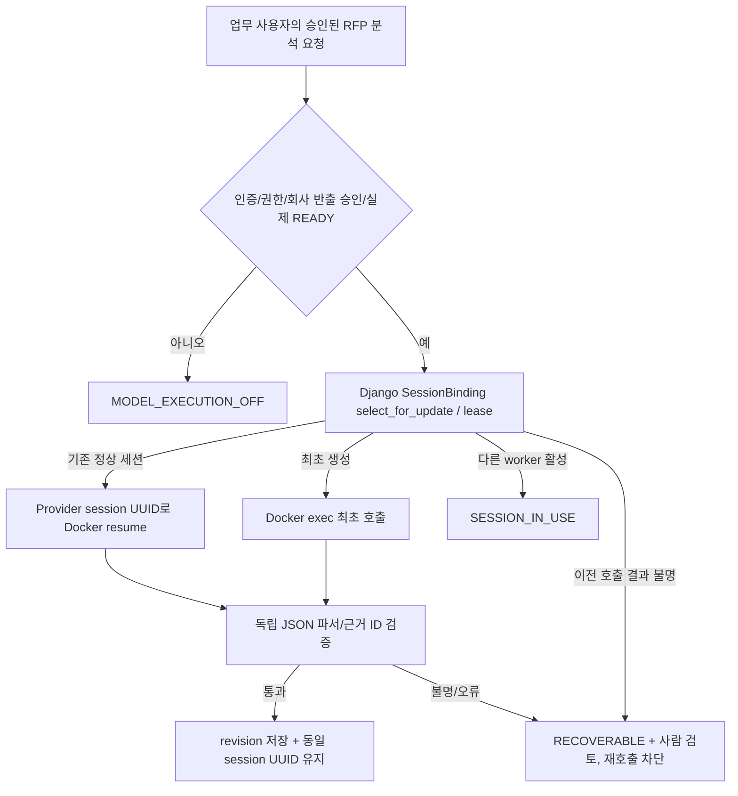

# AGW-02/04/06 | NAS Docker Codex 세션 재개 E2E 및 작업 구현 증거

- 기준: 2026-11-20 KST
- 대상: 개인 Synology NAS, 비승격 SSH 계정 `son1004007`
- 대상 저장소: `son1004007/public-bid-agent`, 개발 브랜치 `fix/bid-security-20261116`, **Draft PR #5**
- 상태: **PERSONAL_NAS_DOCKER_REAL_CODEX_SESSION_RESUME_PASS / DJANGO_LEASE_IMPLEMENTED_CI / APP_RUNNER_NOT_DEPLOYED**
- 비공개 사내 문서, 회사 data1, 내부 DB/급여, 인증 토큰, 실제 공급자 session UUID 및 RAW 대화는 GitHub에 저장하지 않음.
- 기존 [device-control NAS 런타임](https://github.com/son1004007/device-control/blob/main/docs/SYNOLOGY_AGENT_RUNTIME.md)의 격리 기준을 유지한다. 전역 [CONTROL](https://github.com/son1004007/ai-agent-workflow-playbook/blob/main/CONTROL.md) 및 [AGW 전체 목차](README.md) 우선.

## 1. 실제 NAS Docker 실행 증거

| 점검 | 실제 결과 |
| --- | --- |
| 비승격 NAS SSH 계정 | `son1004007` |
| 기존 Container Manager 이미지 | `device-control/codex-runtime:0.163.0` 존재 및 실행 확인 |
| 호스트 계정 Codex 로그인 | `codex login status` → `Logged in using ChatGPT` |
| Node/Codex 버전 | Node.js `v22.23.4`, Codex `0.163.0` |
| Docker 외부 격리 옵션 | `--read-only`, `--cap-drop ALL`, `--security-opt no-new-privileges:true`, `--memory 1g`, `--tmpfs /tmp`, `--user UID:GID`, 승인된 좁은 bind mount |
| 최초 모델 호출 | 합성 자격 요건 `R1`: 4개 실적 필요, 합성 증빙 `E1`: 3개 → `NOT_MET`. `exit 0`, 정상 JSONL/스레드 ID |
| 첫 컨테이너 종료 → 두 번째 컨테이너 `exec resume` | `exit 0`, **동일 provider session UUID**, `R1`의 4/3 및 `NOT_MET` 그대로 재현 |
| 실사용 계정 auth 영구 사본/세션 변경 | 테스트는 자기 계정의 공식 인증파일을 사용자 전용 `umask 077` 임시 디렉터리에 복사해 **서로 다른 두 컨테이너에서만 재사용**한 후 임시 폴더를 정리. 장기 서비스 등록/운영 DB 세션 연결은 하지 않음 |
| 실패 전처리 | Synology 커널이 Docker `--cpus 1` CPU CFS 제한을 지원하지 않아 컨테이너 `exit 125`; **해당 옵션만 제거**하고 다시 실행해 두 요청 성공 |
| 추가 주의 | `--pids-limit`도 DSM 커널에서 효과 없이 무시될 수 있음. **강제 CPU/PID 제한을 달성했다고 주장 금지.** 별도 worker 동시성 제어 및 egress 보호가 필요 |

**계약**: `codex --dangerously-bypass-approvals-and-sandbox`는 **읽기 전용 Docker 루트/마운트·권한 제거가 이미 적용된 외부 격리 컨테이너 내부에서만** 사용. NAS 호스트에서는 절대 해당 플래그를 적용하지 않는다. Docker socket, 전체 홈, 사내 원문/운영 secrets, DB, backups, prod Docker-compose를 mount하지 않았다. 이 테스트는 **합성 텍스트** 기반이므로 악의적인 RFP 프롬프트 인젝션에 대한 운영 안전 인증이 아니다.

## 2. GitHub 실제 구현

- [`nas_docker_codex.py`](../../../server/ai_gateway_core/nas_docker_codex.py): Docker 고정 argv, UID/GID·계정 UUID·개별 `identity_root/<web-user-id>/codex` 홈 결속, 디렉터리·인증 파일 소유자/0700·0600 권한 검사, symlink 차단, immutable workspace read-only mount, session ID resume, JSONL 최종 결과 parser, timeout 및 실패 코드, 외부 호출 재시도 없음. 공급자 계약/명시 실행 요청 외에 `user_os_mapping_verified`, `egress_restricted_verified`, `model_tool_policy_verified` **3개 runtime 승인 flag를 추가로 요구**하여 기본 실행 차단.
- [`session_service.py`](../../../server/bid_server/ai_gateway/session_service.py): 기존 Django `SessionBinding`/계정·공고를 재사용하여 **프로필 READY·Auth Epoch·최신 공고 버전·소유자 확인** → 트랜잭션 row lock + lease/fencing token → 새/기존 session ID 사용 → 성공 시 같은 UUID 저장/해제. 실패 시 session ID 보존, TIMEOUT/임대 만료는 `RECOVERABLE`, session mismatch는 `RESET_REQUIRED`; **무단 유료 retry·silent new session 방지**, 명시적으로 검토된 recovery만 재사용.
- [`test_nas_docker_codex.py`](../../../server/tests/test_nas_docker_codex.py): Docker 옵션, UUID별 private HOME, symlink/ownership/권한, 정책 기본 거부, 호출 mock, 오류/timeout 누출·중복 없음. Synology/Unix-only fixture는 Windows에서 SKIP.
- [`test_ai_gateway_session.py`](../../../server/tests/test_ai_gateway_session.py): synthetic Django + PostgreSQL에서 사용자 범위, 최신 RFP, two-provider 목적 분리, same-session resume, fencing, 임대 만료·timeout, session mismatch, 승인 recovery를 검증. CLI 호출 없이 트랜잭션/상태만 테스트.
- 기존 `ai_gateway_core/codex_cli.py`(일반 실행 프로토콜)와 `ai_gateway/models.py`(메타데이터 DB)에 추가했다. 실제 `AnalysisRun/AnalysisRevision` 업무 결과 영속화와 worker orchestration은 미구현.

## 3. 정상 흐름과 잠금 처리

**현재 구현 경계:** 위 도식 중 C~E의 구성 요소와 SessionBinding의 잠금·상태 전이는 **각각 코드로 존재**하지만 **실제 Django Job/Run/Revision과 Docker worker를 결합한 외부 모델 자동 호출 API는 아직 없다**. F의 현재 JSONL 구문 파싱은 제공되지만 RFP 근거·법적 참가자격·회사 원가에 대한 실제 DB 정합성 검증은 미완료. G의 **revision 저장도 미완료**. 임의의 웹 요청이 현재 공식 CLI를 호출할 수 없다.

## 4. 운영 전 필수 게이트 (P0)

1. NAS의 **웹 사용자별 별도 OS UID/GID**와 공급자별 인증·세션 홈의 운영 정책. `son1004007` 1개 계정의 로그인으로 다른 회사 사용자를 대신하는 방식 금지.
2. 공식 공급자 **구독/상업적 호스팅 조건** 확인. 본인 미변조 CLI 로그인, 계정별 권한/쿼터 검증, 사용자 퇴사/권한 회수 처리.
3. 비공개 회사 자료 외부 반출 원천 차단. 공개 RFP 및 합성 내부 역량만 먼저; 사람 승인 및 부서 ACL 필요.
4. **네트워크 egress / model tool 실행 제어 검증**: 읽기 전용 bind mount만으로 외부로의 기밀 전송/사설망 접근을 막지 못함. Docker 기본 bridge 연결을 다중 사용자·적대적 RFP용 격리로 인정하면 안 됨.
5. 프로세스 CPU/PID 커널 한계를 감안한 **worker 동시성 제한, 취소·timeout 이후 외부 side effect 조정 및 session lease 복구**.
6. SQLite/Pg 합성 테스트만으로 NAS 운영 DB·컨테이너 executor·세션 backup/restore를 인수 완료로 판정하지 않음. 추후 승인된 테스트 사용자/실제 서비스 경로 E2E 필요.
7. 실제 구현에 연결할 **사용자별 SessionBinding DB revision과 provider output JSON validator**, idempotent JobAttempt/outbox. 2개 READY일 때 독립 분석 후 서버 근거 비교.

## 5. 다음 작업 및 상태

- **P0 NEXT**: [AGW-05 evidence packet](AGW-05-evidence-packet-and-json-schema.md) + [AGW-09 immutable result](AGW-09-result-json-and-immutability.md) 구현 후 Django Job에서 `session_service`→`nas_docker_codex`를 안전하게 연결하고, 하나의 업무 run ID에 실제 session UUID/유효 근거를 묶는다.
- [AGW-03 login readiness](AGW-03-login-and-readiness.md): NAS 사용자별 본인 로그인·status probe 등록. OS UID·정책 gate 미확인 동안 adapter runtime flags는 False로 유지.
- [AGW-07 Claude](AGW-07-claude-executor-adapter.md): 사용자별 로그인/계약 및 독립 세션 Docker executor; 초기 분석 결과는 서로 공유하지 않음.
- **P1**: [AGW-10 비교](AGW-10-evidence-first-cross-validation.md) + [AGW-11 이슈](AGW-11-disagreement-issue-session.md), 실제 운영 비용·정확도 검증.
- 소스 정본 상태는 [TASKS](../../../TASKS.md), [CURRENT_STATE](../../../CURRENT_STATE.md); CI 증거는 최신 실제 commit과 workflow 결과로만 확인한다.

공식 참고: [Docker run security options](https://docs.docker.com/reference/cli/docker/container/run/), [Codex as a platform](https://developers.openai.com/blog/codex-as-a-platform).
