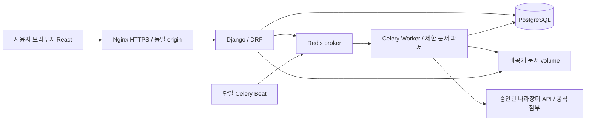

# 02. 기술 스택과 서버 아키텍처

[전체 목차](README.md)

## 1. 확정 방향과 현재 구현 구분

| 영역 | 현행 운영/자산 | 서버 전환 목표 |
|---|---|---|
| 실행 | Windows 개인 PC/localhost | Linux 서버, Docker Compose |
| 실제 UI | HTML/CSS/일반 JavaScript | React + TypeScript + Vite |
| API | Python 표준 HTTP 서버 | Django + Django REST Framework |
| DB | 로컬 JSON·청크 파일 | PostgreSQL + Django ORM/Migration |
| 사용자 | PC 소유자 경계 | DB 계정 + 세션 + 역할/데이터 범위 |
| 예약 | Windows 작업 스케줄러 | 단일 Celery Beat + Celery Worker |
| 작업 전달 | 로컬 스레드/배치 상태 | Redis broker, PostgreSQL 작업/시도/결과 원장 |
| 파일 | PC 비공개 파일 | 서버 비공개 영속 volume, 권한 검사 후 전달 |
| 웹 진입 | 127.0.0.1 | Nginx + HTTPS + 동일 origin |
| 검증 | Python/Node/Chrome·GitHub Actions | 기존 업무 회귀 + PostgreSQL/다중 사용자/서버 E2E |

기존 React/Vite와 FastAPI 코드는 별도 시안/합성 데모 자산이다. FastAPI가 현재 실제 운영 백엔드인 것으로 오해하지 않는다. 목표 백엔드는 Django/DRF이며 FastAPI와 이중 운영하는 구조를 기본으로 만들지 않는다.

Python은 우선 현재 검증 기준 CPython3.12를 유지한다. Django는 지원 중인 안정/LTS 계열을 구현 시점에 호환성 검증 후 고정한다. React/Node/PostgreSQL/Celery/Redis도 그 시점의 지원·라이선스·보안 조건을 확인해 잠금 파일/이미지 digest에 고정하며 이 문서를 최신 버전 목록으로 사용하지 않는다.

## 2. 구성과 배포 단위

React는 빌드한 정적 파일을 Nginx로 제공한다. Django 웹과 작업 워커는 같은 검증된 업무 모듈/이미지 버전을 사용하되 프로세스·자원 제한은 분리한다. OCR/문서 파서는 워커 하위 격리 프로세스에서 크기·시간·메모리·파일 형식을 제한한다. Redis를 업무 결과의 유일한 저장소로 쓰지 않는다.

초기에는 단일 서버 Compose로 관리한다. 고가용성 보장은 없으며 장애/백업 책임을 명시한다. DB/Redis 포트는 외부 공개하지 않는다. Kubernetes·마이크로서비스·별도 Next.js 서버는 요구가 생기기 전 추가하지 않는다.

## 3. 웹 라이브러리와 재사용

라우팅은 React Router, 서버 상태는 TanStack Query를 기본 선택한다. UI 컴포넌트 라이브러리는 접근성/라이선스/기존 시안 재사용을 비교 후 별도 결정한다. 공개 검색 SEO 요구는 현재 없다.

기존 공고 정규화/취소 보존/분류, 공식 URL 검증, 추출기, fulltext/SHA, BID06 지표·사람 검수 계약 및 합성 회귀를 재사용한다. JSON 경로와 HTTP Handler 결합을 서비스/저장 어댑터로 분리하고 계산 결과의 의미를 바꾸지 않는다. 사용자 PC는 로그인·파일 선택·검수만 수행하며 PC 전원/스케줄러가 서버 수집의 선행조건이 되지 않게 한다.

## 4. 서버 전환 시 별도 결정

실제 서버·접근망·도메인/TLS·메일/알림·스토리지 용량·백업 위치/보관기간·최대 파일/작업 수·운영 계정/권한은 아직 미정이다. 개인 PC의 DPAPI API 키/CLI 인증을 컨테이너에 복사하지 않는다. 나라장터 키는 승인된 비밀 전달 경로로 재설정하며 AI 공급자의 서버 사용 권한·비용·문서 전송은 별도 확인한다. Kubernetes나 외부 AI가 설치돼 있다고 가정하지 않는다.
