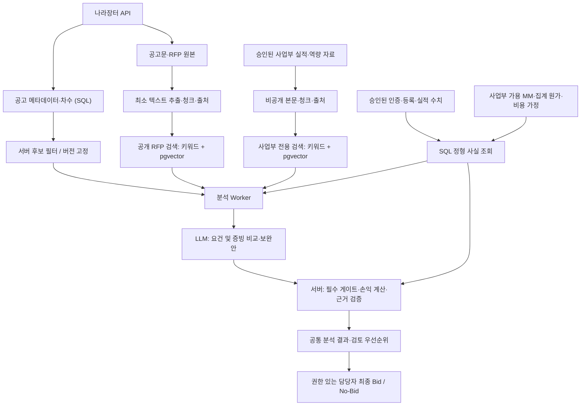
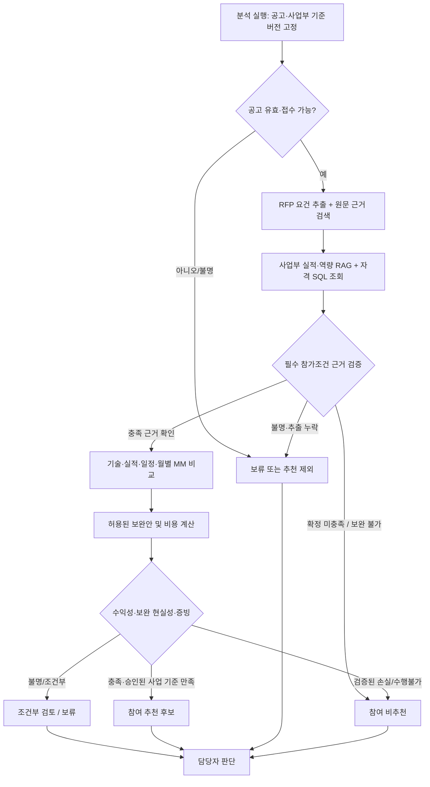

> **2026-11-20 다중 공급자 연동 후보:** [13 GPT·Claude·Gemini Provider Router 설계](13-multi-llm-provider-routing.md)는 기존 LLM 노드의 교체 가능 인터페이스와 승인/비용/데이터 전송 경계를 추가한 **미구현 제안**이다. 공급자 API·회사 데이터 전송·계정 연결은 아직 승인되지 않았다.

> **2026-11-20 조직 범위 확장:** [12 전사 역량·부서 협업 설계](12-enterprise-capability-hybrid-rag.md)가 조직 모델·검색 범위·공유 자원·지원 상태·시나리오 손익의 최신 상세 정본이다. 아래 기본 계약은 유지하되 사업부 corpus는 해당 법인 공통 및 승인된 타 부서 요약까지 권한 검증 후 검색한다. 비용은 전사 경제성과 주관 부서 손익을 분리한다. 지원 승인 없이는 가용 확정 금지.

# 10. Hybrid RAG 입찰 의사결정 지원 — 기술 설계

- 기준일: 2026-11-20 KST
- 상태: DESIGN_DRAFT / NOT_IMPLEMENTED (독립 AI 리뷰 NOT_RUN_OPTIONAL) (기존 기능은 CURRENT_STATE가 정본)
- 사용자 방향: 사업부 실적·역량까지 RAG로 검색하고 원가·가용 인력을 SQL로 조회하여 입찰 판단을 지원한다. 문서 구조 복원보다 실제 판단 기능을 우선한다.
- 업무용 쉬운 설명: [11 사업 담당자 안내](11-hybrid-rag-business-guide.md)
- 실행 정본: [TASKS](../../TASKS.md) · [DECISIONS](../../DECISIONS.md) · [CURRENT_STATE](../../CURRENT_STATE.md)
- 기존 계약: [ADR-003](../adr/ADR-003-evidence-retrieval.md), [ADR-007](../adr/ADR-007-analysis-state-evaluation.md), [ADR-008](../adr/ADR-008-profile-privacy.md), [09 집계 원가](09-aggregate-cost-and-shared-review.md), [BID-07](../implementation/DEPARTMENT_BID_NOW_EXECUTION_2026-10-18.md). 의사결정 범위/불변조건을 변경하지 않는다.

## 1. 목표 및 범위

질문은 "현재 참여 가능한 공고 중 사업부가 수행하고 수익을 남길 만한 것은 무엇인가?"이다. 유사도나 과거 발주처 일치 자체를 수주 가능성으로 오해하지 않는다. 공고와 회사 증빙 양쪽을 검색하며, 법적 자격, 수행 가능성, 예상 손익, 권한 있는 사람의 결정은 각각 분리한다.

기존 Django/DRF + PostgreSQL + 웹 화면/worker를 재사용한다. PostgreSQL 확장 pgvector를 우선 검토(설치/버전/리소스/백업은 별도 사전 검증), 새로운 독립 Vector DB, 모델 학습, 멀티 에이전트, 그래프 DB, 완전한 표 복원은 MVP 범위 밖. 기존 원본 및 버전 이력 보존. 현 NAS의 전용 PostgreSQL은 별도 서비스와 분리한 상태를 유지한다. 특허/기술사 DB 및 MCP 공유 금지. 실제 투찰/서명/자동 입찰 실행 금지.

## 2. 시스템 구성

Hybrid search(lexical + dense vector)와 structured lookup(SQL)을 결합한 RAG이다. LLM에는 DB 접속권/임의 SQL/URL/명령 실행권을 주지 않는다. DB는 정본, embedding은 재생성 가능한 파생 인덱스다. 비용 계산은 LLM이 아닌 Decimal 기반 기존 cost_service를 재사용한다.

## 3. 자료 수집·등록 계약

| 종류 | 최소 입력과 출처 | 이용 경로 |
|---|---|---|
| 공식 공고 | 공고번호/차수, 제목, 기관, 접수·마감, 예산, 상태, 링크 | 기존 Notice/NoticeVersion SQL |
| 공식 공고문·RFP | 원본 파일, 해시, 관측시각, 차수, 추출 범위/실패, section/page 및 청크 | 기존 DocumentVersion/ExtractionRun/Chunk + 검색 인덱스 |
| 사업부 수행 실적 | 승인된 사업 요약, 수행기간·역할·과업·적용 기술·성과, 실적 증빙 유효 범위, 공개 여부 | 사업부 전용 RAG + 검증된 실적의 수치/기간 SQL |
| 기술 역량 | 승인된 기술/업무분야, 숙련·공급 가능성, 실적 연결, 확인일/만료일 | 사업부 전용 RAG |
| 참가 자격 | 업종·등록·면허·인증·지역 등 해당 공고별 조건을 검증할 증빙 참조/범위/만료일 | SQL exact match + 사람 확인 |
| 가용 인력 | 월별·필요시 역할별 익명 집계 가용 MM, 확정·예약량, 기준일/유효기간, 승인 | SQL, 소그룹 비노출 |
| 비용 | 기존 사업부 총인건비/동일 기간 배부 MM, 표준 외주/인프라/간접비/위험충당금, 예상 VAT 제외 공급가액(가정) | SQL, 기존 집계 정책 |

회사 공식 홈페이지/공개 자료는 출처 및 사용조건을 검토한 후 공개 주장으로 등록할 수 있다. 공개 홍보 실적은 입찰에 제출할 수 있는 증명서와 동일하지 않다. 실제 비공개 회사 자료 수집·저장·embedding·LLM 전송은 별도 회사 승인 전 금지. MVP는 실제 공개 RFP + 명시적인 합성 사업부 프로필로 먼저 시연한다. 개인별 급여/단가/HR 원장/개인 해상도의 원가를 수집하지 않는다. 금액·가용 인력은 근거 없이 0/충족으로 추정하지 않는다.

## 4. 논리 데이터 모델 (후속 migration 후보)

| 논리 엔터티 | 관계·주요 필드 | 메모 |
|---|---|---|
| 기존 Notice / NoticeVersion | 논리 공고 1:N 차수/버전 | 최신성/취소/마감 계약 유지 |
| 기존 DocumentVersion / ExtractionRun / Chunk | 공고 버전 1:N 문서 → 추출 실행 → 청크 | 원본 SHA, scope, 추출 범위 |
| DepartmentEvidenceVersion / DepartmentEvidenceChunk (신규) | department FK, type PROJECT/CAPABILITY, source_ref, 내용/해시, valid_from/to, approval, revision, scope, chunk locator | 기존 CostDepartment/Membership 재사용; 승인된 업무 증빙 전용 |
| RagPassageIndex (신규 논리) | 원문 청크 FK 또는 사업부 청크 FK 중 정확히 하나, source_version, extractor_version, normalized content hash, scope, embedding model revision/dimension, vector | 공개/사업부 물리 분리 테이블 또는 동등한 강제 제약; FK/unique, 변경시 새 인덱스, 과거 분석 보존 |
| DepartmentQualification / VerifiedExperience (신규) | department, 증빙 종류·코드/유효기간·검증 상태, 경험 범주 및 검증된 기간/금액/역할(필요할 때만), 승인자·버전 | SQL 사실 조회; 증빙 미확인 UNKNOWN |
| DepartmentCapacityPeriod (신규) | department, 기간·안전한 역할 그룹, 총 가능 MM/확정 배정/예약 MM, 승인·version | 중복/겹침·동시성 검증; 개별 직원 자료 금지 |
| 기존 DepartmentCostBasis / SharedBidReviewEvent | 승인 기준·권한·의견/최종 판단 | 기존 cost/shared service 재사용, 새 사본 원장 만들지 않음 |
| AnalysisRun / RequirementAssessment / EvidenceLink (신규 또는 기존 분석/Job 모델 확장) | notice_version, corpus/profile/qualification/capacity/cost snapshot versions, actor/scope, model/config, state, requirement priority/kind, assessment, evidence IDs, 검증 상태, 비용/리스크 snapshot | ADR-003/007 및 기존 job lease/epoch/idempotency 계약, 결과 불변. 화면은 승인된 안전 projection만 |

유일성 예: (청크 ID, text hash, embedding model revision); 모델 변경 시 인덱스 세대를 따로 생성·검증하고 atomically 전환. 다른 차원/모델 벡터 혼합 금지. FK 스코프/문서 부모/현재 버전/사용자 권한을 쿼리 전·결과 저장 전 점검. 삭제/권한 철회가 검색·캐시·백업 정책에 반영되도록 설계하되 과거 결과의 제한된 감사 증거는 보존 정책에 따른다.

## 5. 수집과 검색

1. 기존 공식 API 증분 수집/버전 확인. 공식 공고문 및 RFP 다운로드; 지원 라이브러리로 안전한 최소 텍스트 추출. 페이지/표/각주 누락·OCR 필요는 PARTIAL/UNKNOWN으로 표기. 구조 파서 자체 개발은 필수 요건이 아님.
2. 기존 청크를 읽어 인덱스용으로 의미 단위 묶음/중복 제거. 초기 실험 기본값 약 300~800 tokens, 10~15% overlap, 제목·섹션·원문 ID 유지(토크나이저/한국어에 맞춰 측정 후 조정). 기존 원문/청크 ID를 덮어쓰지 않는다.
3. 임베딩은 한국어·영어 기술용어 검색 성능, 모델/라이선스·weights hash·dimension, CPU/RAM/시간을 실제 비교한다. 로컬 모델 우선 후보; 승인 없는 외부 임베딩/LLM 요청 금지. pgvector 설치됨을 가정하지 않는다. 실제 모델 없이 random/hash 벡터를 실데이터 결과로 사용하지 않는다.
4. 필터를 먼저 적용(현재 공고 차수/문서 유효성, 사업부, 소유권·공유 승인, 모델 세대). 법적 자격 코드·금액·기간·명시 숫자/문구는 SQL 및 exact lexical search. 한국어 띄어쓰기/업종코드/기술어에 맞춰 lexical baseline 및 필요 시 pg_trgm 비교. dense cosine exact search부터 시작하며, 규모·지연·recall 실측 후 HNSW 고려. 두 랭킹을 RRF 또는 검증된 결합 방식으로 병합, 공고별/요건별 검색 예산과 다양성 관리. 공고 corpus와 사업부 corpus는 각각 검색하여 결합한다.
5. RFP에서 필수조건을 찾을 때 top-k만 믿지 않는다. 공고문/제안요청서의 자격·제출·예외 섹션 전수/coverage 체크와 정확 키워드 재검색·상충 근거를 병행. 검색 실패는 UNKNOWN, "요건 없음"이 아니다. 증빙 인용은 실제 허용된 passage ID/원문 버전/위치/해시와 결속.
6. 현재 5개 실제 HWPX, 14,594 기존 구절(11/19 검증 수치, 실행 전 재조회): 먼저 작은 평가셋으로 사용. 4개 text-only는 표/각주 완전성 미검증. 모두 적합 판정 가능한 상태라는 뜻이 아님.

공식 참고: [pgvector upstream](https://github.com/pgvector/pgvector) (exact/ANN, PostgreSQL full-text hybrid, RRF); [PostgreSQL 16 pg_trgm](https://www.postgresql.org/docs/16/pgtrgm.html). 구체 버전/설치법은 HBR-01에서 이미지 호환성과 공식 원문 재확인.

## 6. 분석 실행 및 판정

- LLM 출력은 schema에 맞는 RequirementCandidate(priority, kind, raw statement, normalized condition, rfp_evidence_ids), CapabilityMatch(assessment, internal_evidence_ids, gaps, mitigation_options), Explanation이다. 각 법적 요건은 원문·공식 등록/증명 등 승인된 사실로 검토한다. 기술 의미 검색 결과는 일치 후보일 뿐 실제 수행능력의 보증이 아니다. 공동수급·하도급·채용/외주 보완 허용 여부는 공고 기반 검증. 과거 동일 발주처를 확률 가중치로 자동 부여하지 않는다.
- 서버는 typed 조회 함수 get_notice_snapshot, search_rfp, search_department_evidence, get_qualification_status, get_capacity(period, role_group), calculate_cost(scenario)만 노출한다. SQL은 ORM/parameterized allowlist, 모델이 임의 쿼리·권한·외부 실행을 생성하지 않는다.
- LLM은 PROPOSED, 서버는 존재/버전/스코프 검증 시 STRUCTURALLY_VALIDATED만; 의미 검증은 ADR-003 승인 경로만. 근거가 반대/누락된 항목에서 만족 판정 금지.
- 법적 참가 eligibility_verdict, technical_fit_verdict, 경제성, staffing, source_freshness, run_execution_status를 독립 보존한다. ADR-007 overall_verdict (SUITABLE/NEEDS_REVIEW/UNSUITABLE/NOT_EVALUATED) 변경 없음. 추가 업무 추천 projection (RECOMMEND_REVIEW / CONDITIONAL_REVIEW / HOLD / DO_NOT_RECOMMEND)은 적합 확정 및 실제 Bid/No-Bid와 다르다. 필수조건 UNKNOWN/추출 PARTIAL/미검증 근거는 SUITABLE 금지. 보완 불가인 검증된 MANDATORY 충돌은 UNSUITABLE, 법적 요건은 이익으로 상쇄 불가. 선택요건만 부족하면 기술·수익성을 보완 검토. 조건부 추천은 미확인 필수요건을 충족으로 표시하지 않는다. 수익 기준/승인 임계치가 없으면 가정별 손익만 표시; 자동 추천 확정 금지.
- 추천 순서는 검증 상태/실행 가능성, 근거 확인 필요, 예상 손익의 보수 시나리오를 분리해서 비교한다. 승인된 가중치/학습 근거 없이 종합 90점이나 수주 확률을 출력하지 않는다. 이미 수행한 발주처 등의 이유만으로 수주확률을 높이지 않는다.

### 원가·가용 MM 산정 (기존 09)

월별 가용 MM = 승인된 공급 가능 MM - 확정 투입 - 예약 MM(중복 배정 제외); 기술 그룹 가용량도 안전한 승인 집계로만 확인하고 합산 중복을 검증한다. 전체 MM이 충분해도 특정 월/역할 부족이면 보완 필요. 필요 MM은 공고 명시 또는 LLM 제안 초안/담당자 승인 가정으로 라벨을 구분한다.
평균 MM 원가 = 승인 총인건비 / 동일 기간 배부 MM. 내부 인력비 = 내부 투입 MM × 평균 원가. 외주로 대체한 MM을 내부 원가에서 중복 계상하지 않는다. 예상 총원가 = 내부 인력비 + 외주비 + 인프라/직접경비 + 미포함 간접비 + 위험충당금. 예상 이익 = VAT 제외 예상 공급가액 - 총원가, 이익률 = 이익 / 공급가액. 공고 예산과 예상 낙찰/공급가액은 다르다. 낙찰률·외주단가·최소이익 기준은 승인 가정/범위만 사용하고 미확인 시 null. 서버 계산 결과와 사용 가정을 버전으로 저장하고 사용자에게 근거를 제공한다. 실제 수주 확률 산정은 별도 데이터/검증 과제.

## 7. API·UI·실행 경계 (후속 계약 초안)

- 기존 Django Job/Worker 기반으로 개발; POST /api/v1/notices/{id}/analysis-runs (version, idempotency key), GET /api/v1/analysis-runs/{id} (상태/권한), GET /api/v1/notices/{id}/analysis-summary (공통 안전 projection); 권한 있는 승인자용 사업부 기준 등록/승인 API와 기존 공동 검토/결정 API 재사용. 정확한 API 경로는 구현 전 기존 URL/OpenAPI와 대조해 확정.
- 화면: 공고 목록에 최신 분석 상태/참가요건/기술/가용/예상 이익 범위/보완안/갱신 시각; 상세 화면에 RFP 요건별 근거/회사 증빙 상태/누락/산식/공급가액 가정/원본 링크, 분석 실행/재분석, 최종 승인·의견 버튼. 민감 원문 및 세부 원가는 권한 밖 비노출; 가용·손익 공유는 기존 안전 집계 정책.
- 단계: receive → claim leased job → snapshot → retrieve → model draft → validate → calculate → save immutable result → authorized review. GET 요청은 읽기만. 타임아웃/중단/정정/권한 철회/만료 시 fail closed. 원문 정정/모델/사업부 기준 변경 시 새 분석 결과를 생성하며 기존 결정 이력은 덮지 않는다.
- 기존 ADR-007 예산/lease/fencing/취소/재시도 바운드를 준수. 공급자 연결은 공식 지원 인증/라이선스/요금/토큰 상한 검증 후 승인; fake/disabled와 실제 실행을 명시적으로 분리. 로컬 추론 우선 후보이며 외부 전송 별도 승인. 문서의 프롬프트 인젝션은 비신뢰 데이터로 취급; 출처 텍스트의 지시를 실행하지 않는다. 외부 공유/실자료 이관 금지, 로그에는 요약 상태만(본문/키/회사 수치 금지).

## 8. 평가 및 출시 게이트

- P0 표본: 현재 실제 공개 5개 RFP에서 사람이 근거/요건을 라벨링하는 작은 gold set; 합성 사업부 자격/실적/가용/원가로 충족·부족·누락·예외·금지 하도급·정정 사례 구성. 키워드, dense, hybrid를 동일 질의/정답/예산에서 비교. 필수요건 Recall@K 및 누락, evidence precision, 답변 근거 정확성, UNKNOWN 처리, 시간/RAM/비용을 측정. 문서별 분리 집계, 작은 표본의 전체 대표성 주장 금지. 측정 전 정확도 목표/점수/수주확률을 발명하지 않는다.
- 불변조건 회귀: 미확인 필수요건 긍정 확정 0건, 권한 밖 문서 leakage 0건, 모델 임의 SQL/URL/명령 금지, 원문 정정/취소/만료와 분석 stale, SQL Decimal 원가 검증 및 동시 배정/혼합 기간/이중계상 금지, 변조 파일/유실 임베딩/모델 변경/DB 복구, 재실행 중복 0. 반드시 테스트로 확인해야 하는 기준이며 지금 달성했다는 의미 아님.
- 실제 사내 자료/모델 이용 승인, 검색·분석 품질 검증, 해당 버전 CI/별도 문맥 독립 검수 및 운영/복구/기존 열린 보안 조치 후에만 사내 시범 확대. 현재 공개 Git draft PR #5의 REVIEW_DEBT/NO_GO를 해제하지 않는다.
- 상세 순서는 [TASKS](../../TASKS.md) HBR-00~08. 먼저 기존 5개로 end-to-end vertical slice를 만든 다음 수집 형식/백로그 확대.
