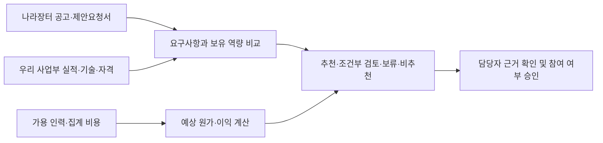

# 11. 사업 담당자가 보는 AI 입찰 검토 시스템

- 2026-11-20, 설계 설명용(아래 숫자는 합성 예시, 실제 회사/공고 값 아님).
- [전사 역량·부서 협업 전체 도식](12-enterprise-capability-hybrid-rag.md) · [기술 설계](10-hybrid-rag-bid-decision.md) · [실행 계획](../../TASKS.md)

## 어떤 문제가 해결되나요?

입찰 담당자가 매번 공고를 읽고 회사의 실적·인력·예산을 다시 따져보는 시간을 줄입니다. AI가 공식 공고에서 요구하는 자격과 기술을 찾고, 법인 공통 및 주관·지원 부서의 승인된 실적/기술 자료와 비교합니다. 부족한 역량은 사내 협업 또는 외부 보완 대안을 검토하며, 실제 지원 승인이 없으면 조건부입니다. 인력과 원가는 회사가 제공한 집계 기준대로 시스템이 계산합니다. AI는 검토 후보를 추천하고 사람은 참여 여부를 결정합니다.

## 결과 예시 (전부 가상)

| 항목 | 분석 결과 | 필요한 확인 |
|---|---|---|
| 사업 | 데이터 기반 시스템 구축, 공고 예산 3억 원 | 최신 공고 차수·마감 |
| 참가자격 | 충족 근거 확보를 가정 | 등록/증명서 원본 및 기한 |
| 기술·실적 | 데이터 수집과 웹 구축 경험 있음, 특정 기술 추가 보완 | 승인된 수행 실적과 예외 조건 |
| 인력 | 필요 30 MM, 내부 가능 24 MM, 외부 6 MM 가정 | 월별 배정 및 외주 허용 |
| 예상 공급가액(VAT 제외) | 2억 8천만 원 | 실제 낙찰 금액 아님 |
| 내부 원가 | 24 MM × 500만원 = 1억 2천만원 | 승인된 평균 MM 원가 |
| 외주비 및 기타 | 외주 4,800만원 + 기타/위험 3,200만원 | 별도 검증된 가정 |
| 예상 이익 | 8천만원, 이익률 약 28.6% | 사업부 승인 기준 확인 |

예시 추천: **조건부 검토**. 필요한 외주 확보 및 허용 여부를 확인하고 이익 기준을 충족하면 사람에게 참여를 추천합니다. 불명확한 필수 자격은 보류, 위반이 확인되고 적법한 보완이 불가능하면 제외합니다. 수주 확률은 임의로 만들지 않습니다.

## 회사에서 준비할 정보

| 등록 항목 | 최소 자료 |
|---|---|
| 수행 실적 | 사업 요약·기간·수행 역할·과업·기술·승인된 증빙 참조 |
| 기술 역량 | 보유 기술/업무분야·경험 근거·확인일 |
| 법적/행정 자격 | 업종·등록·인증 등 유효기간/승인 상태 |
| 인력 | 월별 가용 MM 및 승인된 역할 단위 집계 |
| 비용 | 기간별 사업부 총인건비·배부 MM, 추가 비용 가정 |

개인별 급여를 등록하지 않습니다. 실제 사내 자료의 저장/AI 이용은 회사 승인 후 진행합니다. 승인된 업무 사용자는 공통 분석 결과를 확인하며, 기준 변경과 최종 참여 결정은 별도 업무 권한으로 관리합니다.

## 단계별 도입

먼저 실제 공개 공고 5건과 가상의 사업부 프로필로 화면/검색/판단/계산이 연결되는지 검증합니다. 이후 회사 확인 자료로 제한된 승인 환경에서 시범 운영하고, 실제 문서 형식과 공고 수집 대상을 확대합니다. 아직 AI 기반 판단과 실적 자료 연동은 구현 전입니다.

## 전사 협업 확장

법인 공통 실적·자격과 실제 수행 부서의 경험을 구분합니다. 타 부서가 기술을 보유해도 지원 가능한 월별 MM과 승인 여부를 확인해야 합니다. 자체 수행, 사내 협업, 외부 보완 및 혼합 후보의 예상 손익·일정·위험을 비교합니다. 전사 경제성과 주관 부서 배부 손익은 별도 표시합니다. [전체 흐름과 합성 예시](12-enterprise-capability-hybrid-rag.md)를 참조합니다.
