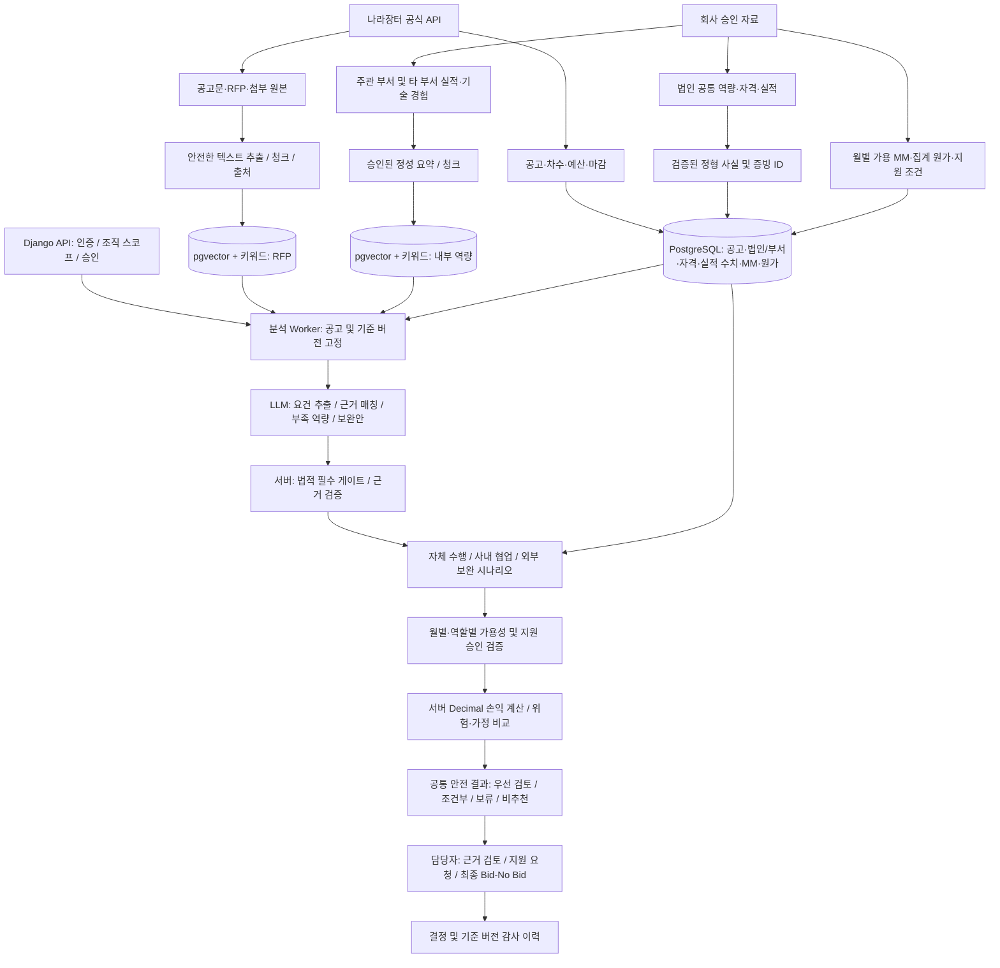
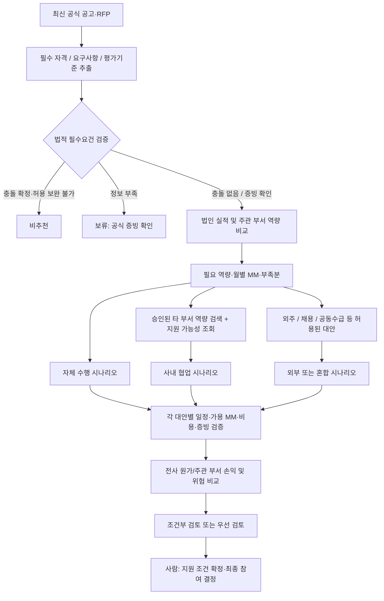

# 12. 전사 역량·부서 간 협업 기반 Hybrid RAG 입찰 의사결정

- 기준일: 2026-11-20 KST
- 상태: DESIGN_DRAFT / NOT_IMPLEMENTED. [TASKS](../../TASKS.md) HBR-00~08에 통합한다. 별도 플랫폼/작업 원장 없음.
- 사용자 방향: 정량·정성 역량을 결합하고 주관 사업부가 부족한 역량은 타 부서 지원으로 보완할 수 있게 한다.
- 상위 [Hybrid RAG 기술 설계](10-hybrid-rag-bid-decision.md), [사업 담당자 설명](11-hybrid-rag-business-guide.md), [집계 원가 정책](09-aggregate-cost-and-shared-review.md), [ADR-003](../adr/ADR-003-evidence-retrieval.md), [ADR-007](../adr/ADR-007-analysis-state-evaluation.md), [ADR-008](../adr/ADR-008-profile-privacy.md). 본 문서는 조직 범위/협업/비용 확장 정본이며 기존 근거·보안·검증 계약을 유지한다.
- 설계 제안 사항: 조직 범위 모델, 협업 요청 상태, 시나리오 비교 산식. 실제 회사 조직 구조·부서 원가·배부 방식·승인자·이익 기준은 미확정. 공개 저장소에는 추상 모델과 합성 사례만 사용한다.

## 1. 업무 목적과 범위

입찰 대상은 법인, 제안/수행 주체는 주관 사업부다. 같은 법인의 승인된 타 부서 역량과 지원 가능성을 비교하며, 필요하면 합법적 외주·채용·공동수급을 검토한다. 전사 역량 검색이 전사 원문 조회권, 인력 배정권, 타 법인 실적 사용권을 자동 부여하지 않는다. 법인과 조직은 분리 모델링한다. 계열사/타 법인 자격은 자사 자격으로 병합하지 않는다. 법인 실적과 실제 수행 부서 경험은 구별하고, 동일 사업을 중복 합산하지 않는다.

역량 존재, 공식 입찰에 인정되는 증빙, 현재 투입 가능성, 지원 승인 여부는 독립적으로 기록한다. 예: 타 부서가 AI 모델 개발 경험을 갖고 있어도 가용 MM이 미확인 또는 지원 미승인이면 조건부 검토이지 확정 수행 가능이 아니다.

## 2. 전체 아키텍처

기존 PostgreSQL + pgvector, Django/DRF, 기존 웹 및 worker를 활용한다. 논리적 검색 코퍼스와 권한 경계를 분리하며 신설 서버/Graph DB/최적화 솔버/HR 시스템은 MVP 필수 아님.

## 3. 역량 입력과 조회

| 데이터 | 정량 / SQL | 정성 / 벡터·키워드 | 귀속/검증 |
|---|---|---|---|
| 법인 자격 | 등록코드·종류·유효기간·인정 범위 | 증빙 요약 및 예외 설명 | 실제 법인 기준, 공식 확인 |
| 사업실적 | 검증 계약금액·기간·실적 수량·수행 역할 코드 | 과업·성과·난이도·기술·경험 | 법인/수행 부서 연결, 사업 식별 키 중복 제거 |
| 기술·업무 능력 | 기술 분류·승인 인원 집계·경험 구간(필요 시) | 기술 적용 경험·문제 해결·보유 솔루션 | 보유 부서, 근거 출처/검증·만료 |
| 인력 공급 | 월/역할별 가능 MM·확정·예약·지원 가능량 | 승인된 전문 분야 요약 | 부서 및 자원 풀, 중복 합계 금지 |
| 비용 | 기간별 총인건비/배부 MM, 승인된 지원 단가 또는 비용 범위, 외부 견적 가정 | 비용 산정 범위 및 계약 조건 설명 | 승인 기준 버전, 민감 수치 노출 제한 |
| 지원·외부 보완 | 필요/가능 MM·기간, 유효기간·승인 상태·비용 범위 | 지원 업무·조건·위험 | 제공 부서/외부 유형, 승인 근거 |

같은 실적 ID/증빙에서 검증된 정형 필드와 정성 청크를 연결하며 벡터 유사도는 증빙 충족 또는 인력 가용의 증거가 아니다. 원천이 복수이면 출처·권한·검증 상태와 충돌을 표시한다. 빈 값은 UNKNOWN. 개인 급여·직급/역할별 원가·HR 원장·직원별 평가 수집 금지. 공개 홈페이지 실적과 공식 실적증명은 분리. 내부 자료와 파생 임베딩은 별도 승인된 환경에서만 저장/처리. 기존 개인 NAS에 실제 회사 비공개 자료를 보관하지 않는다.

### 최소 데이터 모델 (논리 계약, 기존 모델 재사용 우선)

| 엔터티 | 키/관계 및 불변조건 |
|---|---|
| LegalEntity / Department | 법인 1:N 조직. 기존 CostDepartment를 조직 ID에 연결하거나 확장; 중복 조직 원장 금지 |
| CapabilityEvidence / EvidenceChunk | 법인·owning department nullable(공통), 공유 승인 범위, evidence ID, source/hash/revision/type/validity; 기존 DepartmentEvidenceVersion 계약 확장 |
| ProjectExperience / ProjectContribution | 법인 실적 ID 유일, N개 부서 역할/참여 기록, 공식 인정 범위와 지분/기간·금액 증빙. 회사 실적 건수/금액은 중복 합산 금지 |
| QualificationFact | legal_entity, qualification code, validity, provenance, verification state; 부서/인력 자격은 별도 scope와 요구조건 검증 |
| CapabilityFact / CapacityBucket | 부서·월·공급 풀·역할별 승인 집계 및 version. 한 자원 풀을 여러 역할에서 재사용할 때 중복 가용량 금지 |
| SupportOffer / SupportRequest | 공급/주관 부서, 공고·scenario·월별 pool/필요 MM, 범위, 비용 basis ref, 상태/만료/version, 권한 있는 승인자 |
| CapacityReservation | 공급 풀·월·scenario·요청·상태, idempotency 및 CAS; 실제 승인/예약과 분석 가정 분리 |
| Scenario / ScenarioAllocation | 공고 및 분석 run, 주관·자원 공급 부서/외부 유형, role/month/MM, 근거, 비용 기준, 조건, 위험; 시나리오 간 실제 예약 공유 금지 |
| ScenarioCost / AnalysisRun | 전사 경제성과 주관 부서 손익을 분리, cost/qualification/evidence/capacity/offer snapshot, evidence links, verdict axes; 기존 분석·원가 서비스 활용 |

신규 모델명은 구현 후보며 기존 schema와 대조해 최소 증분 migration으로 확정한다. 초기 공급 풀은 서로 배타적인 승인 집계 또는 전체 풀 제약과 역할별 상한을 사용한다. 가용량이 검증되지 않으면 수량 확정 금지. 실제 사람 식별자가 필요한 운영 인력 배치 시스템은 이 MVP 범위 밖.

## 4. 분석과 역량 보완 순서

순차 탐색(자체→타 부서→외부)은 부족분 파악용 기본값이지 첫 충족 방안을 무조건 선택하는 규칙이 아니다. 자체 수행, 사내 협업, 외부 보완, 혼합 등 허용된 후보를 함께 비교한다. 내부 인력의 기존 계약·운영 유지 부담 및 전환 비용도 가정으로 반영한다. 공동수급/하도급/외부 인력의 인정 여부·한도·등록기한은 각 공고 근거에서 검증하고, 필수 자격 충돌은 수익으로 우회하지 않는다. 평가항목별 근거·배점이 확보된 경우만 비교하며 승인된 평가식 없이 수주 확률을 만들지 않는다.

### 부서 지원과 가용량

- 역량 검색 범위: 주관 부서 + 동일 법인 공통자료 + 명시적으로 공유 승인된 타 부서 역량 요약. 원문 열람권과 요약 검색권 분리. 서비스/LLM에는 허용된 청크·최소 facts만 제공.
- 지원 요청은 명시적 담당자 POST로만 생성. 추론은 계획/조건만 제안하며 자동 신청·승인·배정 금지. 상태 후보 DRAFT → REQUESTED → APPROVED / REJECTED / EXPIRED / CANCELLED. 승인도 확정 예약 여부와 구분한다. 승인/예약/취소는 제공 부서 권한, 만료·용량·버전 재검증.
- 월별 pool 가용 MM = 승인 공급량 - 확정 투입 - 유효 예약 (동일 예약 이중 차감 금지). 한 풀이 여러 역할/사업을 지원하면 합계 제약, 트랜잭션 row lock/CAS, 중복 idempotency. 분석 후보끼리는 예약하지 않는다. 미승인 지원 또는 외부 견적은 가정, 확정 배정으로 표시하지 않는다.
- 추천 결과에는 지원 필요 역할/기간/MM, 지원 상태, 비용 가정, 제약, 증빙 및 대안이 표시된다. 조건이 바뀌면 새 분석 revision.

## 5. 시나리오 손익

전사 관점과 주관 사업부 관점을 분리한다. 공고 예산과 예상 VAT 제외 공급가액은 다르다.

- 전사 예상 원가 = 각 공급 부서 내부 투입 MM × 각 승인 집계 평균 원가(동일 기간/범위) 합계 + 외부 비용 + 직접·간접·위험 비용(중복 제외). 평균 원가를 승인받지 못하면 집계 범위/추정 상태 표시.
- 주관 부서 예상 손익 = 승인된 배부 매출 - 주관 부서 내부 원가 - 승인된 사내 지원 배부 비용 - 주관 부서 부담 외부/기타 비용. 지원 배부 금액은 내부 거래이므로 전사 비용에 다시 더하지 않는다. 배부 정책 미승인이면 주관 부서 손익 UNKNOWN.
- 외주 MM은 내부 MM 원가와 중복하지 않고, 채용/외주 시작일·교육·인수인계·공고 허용 여부를 검증한다. 최소 이익/이익률 및 위험 기준은 사용자/회사 승인 전 확정하지 않는다. 민감 원가와 작은 부서의 지원 단가가 역산되지 않도록 안전 projection/범위/승인 집계 사용.

합성 예시: 공급가액 2.8억, 필요 30 MM, 주관 가능 18 MM, 동일 법인 타 부서 지원 후보 8 MM, 외부 후보 4 MM. 18×500만원 + 8×550만원 + 4×800만원 + 기타 3,400만원 = 전사 예상 원가 2억원, 이익 8천만원(28.57%). 타 부서 지원이 미승인이면 조건부이며 승인된 배부 금액 없이는 주관 부서 이익을 확정하지 않는다. 모든 숫자는 설명용이며 실제 회사 수치 아님.

## 6. 화면/API 및 정책

- 공고 화면: 주관 부서 선택(권한 범위 한정) → AI 분석 실행 → 자격/실적/기술/가용/수익성 독립 표시 → 시나리오 비교 → 근거·부족분·지원 요청 → 담당자 참여 결정. 전사 공통 자격과 수행 부서 기여를 시각적으로 분리.
- 기준정보 메뉴: 법인 공통 자격/실적, 부서 역량, 월별 자원 풀, 지원 제공 조건, 집계 원가. 회사 승인자/각 부서 책임자/일반 조회자/최종 결정자를 역할별로 분리. 슈퍼유저 자동 업무 권한 부여 금지.
- typed read tools get_legal_entity_facts, search_capability(scope, requirement), get_capacity(pool, periods), get_support_offers, calculate_scenario(scope, approved_facts). 모델 SQL/임의 URL/shell/쓰기 금지. 사용자 ID·법인·부서·승인 범위 및 버전을 서버에서 적용. API 계약은 기존 Django/DRF와 대조 후 HBR-03/05에서 확정.
- 검색 corpus: 공개 공고, 법인 공통 승인 요약, 각 부서 승인 요약/제한 문서의 ACL 필터. 다른 법인/부서 비공개 본문/비허용 벡터, 원가 세부 및 역산 가능한 결과 금지. 결과 저장 전/조회 시에도 권한 철회 점검. 승인 범위 밖 실제 자료/외부 LLM 전송 금지.
- AI 출력은 후보 설명/보완안/참조 evidence ID. 서버는 근거와 권한 및 산식을 검증. 전체 verdict 및 업무 추천 상태는 기존 ADR-007 유지; 필수요건 UNKNOWN / PARTIAL을 SUITABLE로 승격 금지. 참여 결정은 업무 권한자가 수행.

## 7. 구현·검증 범위

HBR-01/02 유지(공개 RFP/pgvector). HBR-03에 법인/부서와 정량·정성 통합, 권한·공통 실적 dedup 추가. HBR-04에 전사 범위의 근거 검색과 부족분/대안 제안. HBR-05에 월별 공유 풀 및 지원 상태, 시나리오 손익 추가. HBR-06에 화면/담당자 승인·지원 요청 및 실제 E2E. HBR-07 문서 확대, HBR-08 승인된 실제 회사 데이터/시범 운영. 먼저 실제 공개 RFP + 합성 법인/복수 부서 자료로 검증. 역할별 공급량과 실제 지원 업무 승인 전에는 합성 시연만.

필수 테스트: 전사 공통 자격 vs 계열사/별도 법인 자격, 공유 요약 허용 vs 원문/벡터 leakage, 동일 프로젝트·역할·MM 중복 방지, 한 풀의 동시 지원 승인 경쟁/만료, 타 부서에서 기술만 있고 지원 불가, 법적 하도급 금지, 조건 충족/불명/충돌, 외주와 사내 지원 비용 중복 제거, 전사 원가/주관 손익 구분, 소그룹 차분/역산, 원문·승인 철회 stale, 누락/실패 보류, 모델 프롬프트 인젝션, 비용/시간/검색 근거 평가. UI는 가정과 승인 상태를 구분한다.

2026-11-20 최신 전역 정책에 따라 개인 개발의 별도 AI 품질 검토는 선택(NOT_RUN_OPTIONAL). 필수 자체 검토/테스트/실제 실행 검증, 객관적 보안 결함, 회사 정책·업무 승인 및 운영 게이트는 유지. 본 변경은 문서만 작성하며 실행 테스트/운영 변경 없음.
