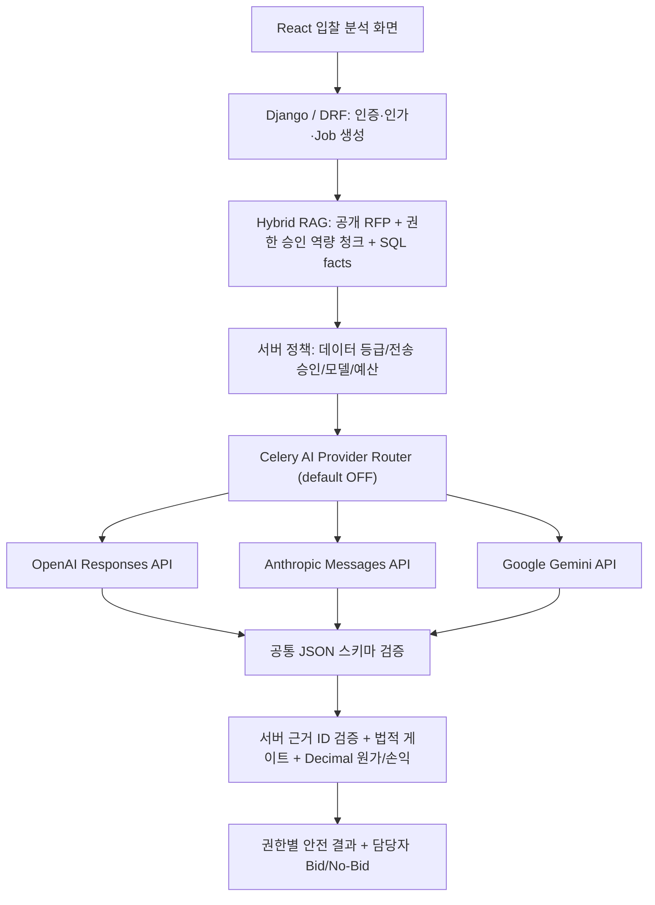

# 13. Multi-LLM Provider 연동 후보 — GPT / Claude / Gemini

- 작성일: 2026-11-20 KST
- 상태: DESIGN_PROPOSAL / NOT_IMPLEMENTED / PROVIDER_NOT_APPROVED
- 배경: 사용자가 GPT 연동 방식을 질문하고 Claude·Gemini도 향후 필요할 수 있다고 제안함. **세 공급자 사용 확정이나 외부 AI 호출 승인으로 해석하지 않는다.**
- 연결 문서: [Hybrid RAG 기술 설계](10-hybrid-rag-bid-decision.md), [전사 역량·협업 설계](12-enterprise-capability-hybrid-rag.md), [결정사항](../../DECISIONS.md), [작업 원장](../../TASKS.md)
- 기존 제품의 `HBR-01~08` 흐름을 확장하며 별도 작업 원장을 만들지 않는다. 멀티 모델 = 선택 가능한 모델 공급자이며 멀티 에이전트 병렬 실행이 아니다.

## 1. 연결 원칙

- 브라우저는 모델 업체와 직접 통신하지 않으며 API 키를 전달받지 않는다. 데이터 취급 정책과 비용 제한을 서버에서 강제한다.
- **공통 인터페이스**: `analyze(request: AnalysisRequest) -> AnalysisResult`. 입력에는 `notice_version`, 허용된 `evidence_ids`, 범위/스냅샷 식별자, 요구사항, `approved_provider`, 응답 스키마 버전. 출력에는 판정 **후보**, 근거 ID, 빠진 요건, 불확실성, 공급자/모델/사용량/경과시간/상태를 담는다.
- `OpenAIAdapter`, `ClaudeAdapter`, `GeminiAdapter`를 분리하고 업체별 messages/content/JSON schema/token usage/retry/error 특성을 어댑터에서 정규화한다. 범용 SDK가 공식 API의 제약을 숨기지 않도록 업체별 계약 테스트를 둔다.
- `provider=OFF`는 AI 미사용/미승인 상태이며 시스템은 검색·규칙 기반 결과만 노출한다. 새로운 공급자는 명시적 enable 전까지 사용 불가. 첫 MVP는 승인된 **단일 공급자**로 좁게 E2E 검증하고 나머지는 교체 가능 구조부터 구현한다.
- 명시적 허용 목록에서 사용자/관리자가 공급자를 선택할 수 있다. 기본적으로 응답을 여러 공급자에 **동시에** 전송하지 않고, 실패 시 타 공급자 **자동 재전송도 금지**한다. 변경된 전송 대상은 별도 정책/승인/기록 필요.
- RFP 청크의 출처·권한·문서 버전·추출 불완전성을 보존한다. 모델은 SQL, 임의 URL, shell, 쓰기·지원 승인/인력 예약/입찰 제출 권한을 갖지 않는다. 법적 요건 검증·원가 계산·손익률·최종 결정은 서버/사람이 수행한다.
- 임베딩은 별도의 교체 가능한 로컬 모델을 우선 평가하고 `pgvector`에는 모델/차원/인덱스 세대를 고정한다. GPT/Claude/Gemini가 바뀐다고 기존 임베딩을 자동 교체하지 않는다.

## 2. 공급자별 공식 연동

| 공급자 | 서버 측 사용 경로(후보) | 주의 |
|---|---|---|
| OpenAI | Responses API, `OpenAIAdapter` | ChatGPT 계정/구독과 일반 API 과금 별개. `Sign in with ChatGPT`은 별도 승인·이용자 권한 흐름이며 회사 원격 웹 서비스에 자동 적용 금지 |
| Anthropic | Claude Messages API, `ClaudeAdapter` | Claude 채팅 구독은 일반 API 사용권을 포함하지 않음 |
| Google | Gemini Developer API / Google GenAI SDK, `GeminiAdapter` | Gemini 소비자 구독만으로 타사 서버 API 호출 권한·예산이 확보된다고 간주하지 않음 |

API 인증정보는 회사가 승인한 서버 측 비밀 저장소/주입 방식으로만 보관하고, 공개 Git·DB 응답·브라우저·일반 로그·분석 결과에 노출하지 않는다. 개인 로그인 세션/CLI/OAuth를 회사 다중 사용자 백엔드에 재사용하지 않는다. 기존 개인 NAS·개인 구독·AGY 자동 위임으로 회사 자료를 우회 처리하지 않는다.

공식 출처:
- OpenAI [Responses](https://developers.openai.com/api/reference/resources/responses/methods/create), [API 요금 분리](https://help.openai.com/en/articles/9039756-managing-billing-for-chatgpt-and-the-api-platform), [원격 사이트 SIWC 조건](https://developers.openai.com/siwc/website)
- Anthropic [Messages API](https://platform.claude.com/docs/en/build-with-claude/working-with-messages), [구독과 API 구분](https://support.anthropic.com/en/articles/9876003-i-subscribe-to-a-paid-claude-ai-plan-why-do-i-have-to-pay-separately-for-api-usage-on-console)
- Google [Gemini API 시작](https://ai.google.dev/gemini-api/docs/get-started), [가격](https://ai.google.dev/gemini-api/docs/pricing)

## 3. 승인·보안·운영 계약

1. **데이터 경계**: 공개 공고/RFP와 비공개 회사 실적/집계 원가를 구분. 실제 비공개 회사 자료 및 파생 청크·임베딩의 외부 공급자 전송은 사내 정책·계약·공급자별 보관/학습 설정 등 검토와 명시적 승인 전 금지. 승인된 부서 공유 요약만 쿼리 전 필터링하고 결과 저장/조회 시 재검증.
2. **비용/성능**: 공급자별 예산, 동시성, 입력/출력 토큰 한도, 타임아웃, 429/5xx 제한 재시도, 차단/서킷 브레이커, 호출 비용/지연·성공률을 기록. 실제 토큰/원화 환산은 공식 계측/현재 요율 기준. 임의 재시도·fallback으로 무단 중복 과금하지 않는다.
3. **답변 신뢰성**: 공급자별 응답 공통 스키마/Pydantic 검증, 근거 passage ID·문서 버전 매칭, 불확실성 `UNKNOWN`/부분추출 `PARTIAL`, 법적 필수 요건 및 금액 계산의 결정론적 검사. LLM 자유 서술을 SQL 사실·수익성 결론으로 승격 금지.
4. **감사/복원**: 분석 요청 주체/부서/허용 범위, 공급자·모델 버전, 프롬프트 템플릿 버전, 입력된 근거 ID/해시, 사용량/오류 상태, 결과 revision을 기록. 비밀·회사 원문·전체 프롬프트는 일반 감사 로그에 남기지 않는다. 재실행은 같은 snapshot과 명시적 동의.
5. **비활성 기본값**: 사용자 승인 없이 Gemini/AGY를 조사·검수·구현 도구로 자동 위임하지 않는다. 전역 CONTROL의 2026-11-19 정책을 유지한다. 이를 제품의 `GeminiAdapter` 미래 지원 가능성과 혼동하지 않는다.
6. **운영 게이트**: API 계약·업체 약관/데이터 처리·인증/네트워크 egress·기밀 분류·회사 승인/실제 API 예산·키 주입·복구 검증이 준비되기 전에는 `OFF` 유지. 새 서버/도메인 공개, 실제 운영 배포, 실자료 업로드를 승인받은 것으로 간주하지 않는다.

## 4. 최소 구현/검증 순서 (기존 HBR 원장 내)

- HBR-01/02: 로컬 임베딩/실제 공개 RFP 기반 Hybrid 검색을 먼저 검증한다. 여기서는 외부 모델을 요구하지 않는다.
- HBR-04 시작: `ProviderRouter` + 공통 DTO + `OFF`/stub + mock 테스트 → 공급자 어댑터 계약 → 업체별 현재 API/SDK 검증. 승인된 업체가 있을 경우 한 곳만 실제 공개 RFP + 합성 부서 자료로 bounded E2E; 나머지는 나중에 추가한다.
- HBR-06: 권한 있는 사용자를 위한 공급자 선택/활성 여부/예상 비용·분석 이력 표시. 승인되지 않은 provider는 비활성 상태이며 보안/기본 근거 검증 우회 불가.
- HBR-08: 실제 회사 데이터 연동은 별도 사내 승인 및 안전한 배포·접근 통제·호출 계측 확보 후. 업체별 실제 데이터 전송 허용 범위 별도 관리.

필수 검증: `OFF`에서 외부 요청 0건, 미승인 공급자 차단, 타 부서 접근 거부, 원문/키 로그 누출 방지, 429/timeout/중복 요청, JSON schema 및 근거 ID 오염/프롬프트 인젝션, 비용 제한, 중단·재시도·결과 불변성, 공급자 전환 후 이전 모델의 기록 보존.

현재 상태는 **설계 제안**이며 API 키 발급/저장, 외부 모델 실제 호출, 운영 컨테이너/DB/데이터 변경, 테스트 실행, 배포를 수행하지 않았다.
