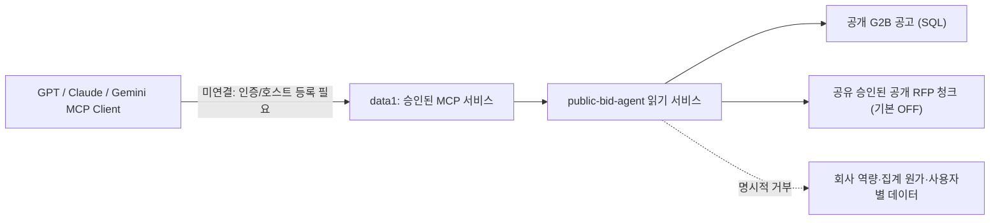

# 14. 공개 입찰 MCP 연결 — 단계별 구현과 검증

- 기준일: 2026-11-20 KST
- 상태: **소스 구현 후보 / 원격 연결·운영 배포 NOT_CONNECTED / 회사 자료 OFF**
- 연결 문서: [13 Multi-LLM Provider](13-multi-llm-provider-routing.md), [Hybrid RAG](10-hybrid-rag-bid-decision.md), [원장](../../TASKS.md).
- 의도: GPT·Claude·Gemini가 `public-bid-agent`가 제공한 표준 MCP 도구를 재사용할 수 있도록 한다. **MCP는 데이터/도구 연결 규격이지 모델 자체를 호출하는 API가 아니다.** 모델 호출은 승인된 각 공급자의 모델 API/사용자 앱이 담당한다.

## 1. 현재 사용 가능한 범위



신규 Python 소스: `server/bid_mcp/server.py` (공식 `mcp==2.3.0` SDK, `stdio`). 기존 Django 조달 모델을 사용하고 별도 코드/DB 사본을 만들지 않는다.

| MCP tool | 내용 | 기본 상태 |
|---|---|---|
| `search_public_notices(query, limit)` | 공식 G2B 현재 공고 제목/기관/금액/마감. 최대 10건 | 환경 플래그·읽기 전용 DB 계정 준비 시 |
| `get_public_notice(notice_number)` | 공개 공식 공고 번호로 현재 메타데이터 조회 | 위와 같음 |
| `search_public_rfp_passages(notice_number, query, limit)` | 현재 공고에 결속되고 소유자 없음·명시적 공유 승인·현재 유효·최신 성공 추출인 공개 RFP 일부(1000자/건) | **별도 OFF** |

모든 도구는 기본 `BID_MCP_ENABLED!=1` 또는 `BID_MCP_PUBLIC_ONLY!=1`이면 **DENIED**. `BID_MCP_PUBLIC_RFP_ENABLED=1`은 신뢰·공유 승인을 따로 검토한 경우에만. 기술적 플래그가 회사/보안 승인 자체를 대체하지 않는다. 공고는 출처 `G2B_OFFICIAL_API` 정확 일치, 현재 차수 일치, 10건 제한. 모델의 지시·입력은 DB 원본을 갱신하거나 검색 범위를 확장할 수 없다.

실제 비공개 회사 실적·법인 자격·부서 원가·MM·개인 증빙 자료를 MCP에 공개하지 않았다. 사내 조회가 필요해지면 사용자별/부서별 OAuth2.1 토큰의 subject, audience, scope 및 업무 RBAC를 **각 호출마다** 검증하는 별도 Streamable HTTP 서비스가 필요하다. 서비스 계정으로 모든 부서 권한을 대체하지 않는다.

## 2. 로컬 격리 검증 (현재 운영 설치 아님)

```bash
# Python 3.12 전용 임시 venv, 회사 운영 환경과 완전히 분리
python3.12 -m venv /tmp/bid-mcp-venv
/tmp/bid-mcp-venv/bin/python -m pip install --only-binary=:all: mcp==2.3.0
PYTHONPATH=server /tmp/bid-mcp-venv/bin/python -m unittest server.tests.test_mcp_public_scope -v
PYTHONPATH=server /tmp/bid-mcp-venv/bin/python server/tests/smoke_mcp_protocol.py
```

스모크는 실제 DB/외부 AI를 사용하지 않고 SDK in-memory transport로 도구 목록/기본 거부/인수 및 호출 계약을 검증한다. 인증/인가 실제 E2E, data1 설치, 공개 URL/TLS, GPT·Claude·Gemini 각 호스트 등록은 **별도 미검증**.

향후 *관리자 승인된* 로컬 stdio 배포는 CPython 3.12 전용 venv에 기존 `server/requirements.lock` 및 별도 hash-locked MCP 종속성을 설치하고, 다음 환경을 **운영자 전용 비공개 런처**에서 주입한다. 실제 DB 계정은 `SELECT` 전용 및 공개 자료 접근만 허용하고 statement_timeout 적용; OS 계정/볼륨/네트워크도 최소권한으로 제한. 아래 예시는 **실행 계약**이지 무단 활성화 명령이 아니다.

```text
BID_MCP_ENABLED=1
BID_MCP_PUBLIC_ONLY=1
BID_MCP_PUBLIC_RFP_ENABLED=0
DJANGO_SETTINGS_MODULE=bid_server.settings.base
python -m bid_mcp.server            # PYTHONPATH=server 또는 server 디렉터리에서
```

`stdio`는 **로컬 자식 프로세스 연결**이며 원격 ChatGPT/Claude 웹사이트가 data1에 직접 붙는 방법이 아니다. 회사 IDC 원격 사용을 위해서는 인증된 HTTPS Streamable HTTP 또는 공급자가 지원하는 승인된 프라이빗 터널과 회사 네트워크 정책, 클라이언트 등록이 필요하다. 공개 포트 열기나 임시 무인/무인증 터널은 금지한다.

## 3. 연결 대상 구분

| 클라이언트 | 연결 방식 (향후) | 현재 |
|---|---|---|
| ChatGPT / OpenAI API | 승인된 MCP 원격 도구 URL + 사용자/조직 권한 | 실제 MCP URL 미등록 |
| Claude / Claude Code | 원격 커스텀 MCP 또는 로컬 stdio 명령 + 사용자/조직 권한 | 미등록 |
| Gemini SDK / CLI | SDK MCP/함수 도구 또는 로컬 stdio 클라이언트 | 미등록 |

회사 내부 데이터는 **업체별 외부 전송 승인**이 별도 필요. MCP 연결을 허용한다고 GPT·Claude·Gemini에 데이터를 동시에 보내지 않는다. 정책상 AGY/Gemini 자동 위임 중지는 계속 적용되며 `Gemini` MCP 클라이언트 호환성 설계로 자동 실행 권한을 얻지 않는다.

## 4. 검증·운영 게이트

1. CI SDK 스모크 + 공개 조회/비공개 데이터 제외 테스트 PASS.
2. 별도 격리 DB에서 공식 공개 공고와 소유자·공유 승인·현재 추출 경계의 **실행 기반** DB 테스트 PASS.
3. data1 기존 서비스 보존, 신규 전용 서비스 계정/읽기 전용 DB 권한, 자원/포트/방화벽/로그 경계 및 공급자별 이용 계약 승인.
4. HTTPS/인증된 MCP Streamable HTTP 서버+리소스 서버 audience/scope 검증. 인증 누락·타 부서 접근·무단 자료 반출 시 401/403 실측.
5. GPT·Claude·Gemini 각 승인된 호스트에서 `tools/list` 및 `tools/call` 실제 왕복, 0 unauthorized calls, 근거 인용·비용/로그 검증.

**완료 기준:** 원격 호스트에서 실제 도구를 1회라도 호출하고, 허가 범위 내 결과와 로그를 확인한 경우에만 `CONNECTED`로 표시한다. 소스 Push/SDK mock 스모크만으로 완료 처리하지 않는다.

공식 참고:
- [MCP Python SDK v2](https://github.com/modelcontextprotocol/python-sdk)
- [MCP HTTP 인증 Resource Server](https://py.sdk.modelcontextprotocol.io/run/authorization/)
- [OpenAI MCP](https://developers.openai.com/api/docs/guides/tools-connectors-mcp)
- [Claude 원격 MCP](https://platform.claude.com/docs/en/agents-and-tools/mcp-connector)
- [Gemini GenAI SDK](https://googleapis.github.io/python-genai/)
