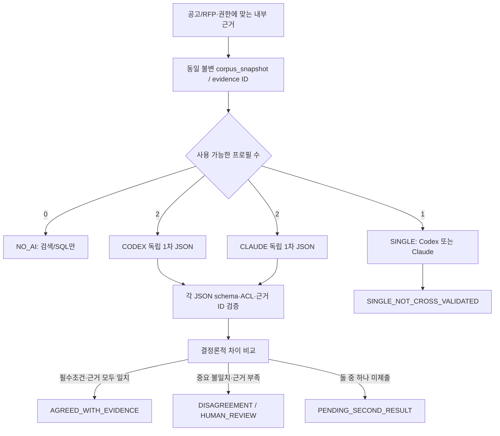
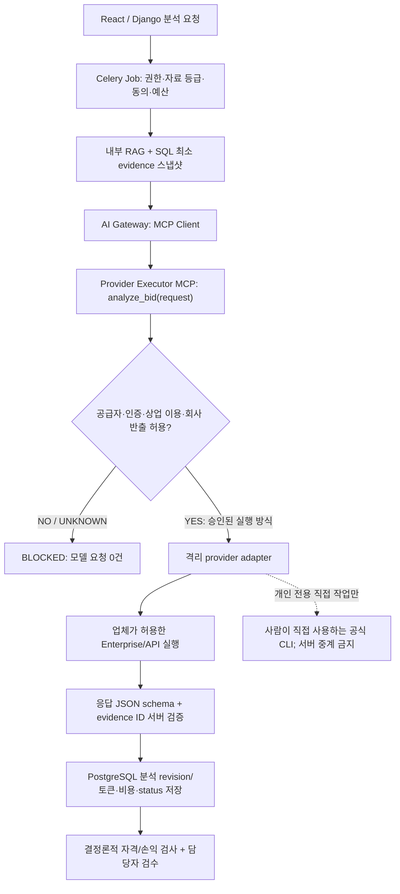

> **2026-11-20 업데이트 — 최신 실행·세션/교차 검증 정본은 [16](16-user-cli-session-and-blind-cross-check.md)입니다.** 사용자 요구가 '서버에서 각 사용자 로그인 후 공식 CLI 실행, 기존 분석 세션 resume'로 확장되어 아래 수동 JSON 업로드/ANALYSIS+ISSUE 검토는 보조 계약이다. 2개 AI 모두 READY면 독립 병렬 1차 분석, 서로의 전체 대화 기록 공유 금지, **의견 차이가 있을 때만** 별도 ISSUE_REVIEW session에 구조화 근거를 제한 공유한다. 자동 실행은 공식 계약/허용 사용자별 인증/회사 반출 승인 확인 전 OFF.

> **2026-11-20 최신 조건부 교차 검증 요구 (최우선):** Codex와 Claude Code를 각각 독립 등록한다. **사용 가능한 실행기 1개면 단독 분석, 2개면 두 AI가 서로의 결과를 보지 않고 동일 스냅샷을 독립 분석한 후 근거 기반 교차 검증**, 0개면 AI 비활성화. 개인 구독 사용자 직접 CLI와 회사 공용 서버의 합법적인 자동 실행을 구분한다. 아래의 '한 번에 하나 선택'은 이 신규 조건부 교차 검증 설계에 의해 대체된다.

## 최우선 설계 — 0/1/2개 등록·가용 상태에 따른 교차 검증

### 1. 등록과 실제 가용 상태 분리

- `ProviderProfile`: `profile_id`, `provider_id=CODEX_CLI|CLAUDE_CODE`, `owner_user_id`, `enabled`, `execution_mode=MANUAL_IMPORT|AUTHORIZED_EXECUTOR`, `last_verified_at`, `availability_state=UNKNOWN|READY|UNAVAILABLE|DISABLED`, `availability_reason`, `schema_version`. **개인 암호/토큰/OAuth/CLI 세션은 DB/공개 설정에 저장하지 않는다**.
- 등록 또는 `enabled=true`만으로는 `READY`가 아니다. `READY`의 필수 조건은 등록·활성, 유효한 서비스 계약과 데이터 전송 권한, 해당 실행 모드에서 수행 가능한 사용자/실행기, 환경·모델 접근성/허용량/시간대, 실행 전 건강 상태 확인이다. 프로필별 가용 상태는 스냅샷 시각·근거를 남긴다.
- `MANUAL_IMPORT`에서는 서비스가 사용자 기기의 CLI에 자동 접속하거나 구독 쿼터를 원격 탐색할 수 없다. 따라서 `READY`는 **해당 사용자가 직접 실행 가능하다고 확인한 상태**이며 서버가 무인 호출을 수행할 수 있다는 보장은 아니다. 실제 JSON 수신 전에는 실행 완료로 표시하지 않는다.
- `AUTHORIZED_EXECUTOR`는 업체가 회사/사용자별 자동 실행을 명시적으로 허용한 계약·인증·네트워크·데이터 범위가 확인된 경우에만 활성화. 회사 공용 서버가 개인 Claude/Codex 구독 세션을 중계하는 방식은 금지한다.
- 사용 가능 여부는 **요청 생성 직전**에도 재평가. 중간 실패/할당량 소진/로그아웃은 승인되지 않은 타 provider로 자동 재시도하지 않는다.

| Codex | Claude Code | 분석 계획 `plan_mode` | 완료 상태 |
|---|---|---|---|
| 미등록/UNAVAILABLE/DISABLED | 미등록/UNAVAILABLE/DISABLED | `NO_AI` | AI 중지, RAG+SQL만 |
| READY | 미등록/UNAVAILABLE/DISABLED | `SINGLE_CODEX` | 1회 분석; `SINGLE_NOT_CROSS_VALIDATED` |
| 미등록/UNAVAILABLE/DISABLED | READY | `SINGLE_CLAUDE` | 1회 분석; `SINGLE_NOT_CROSS_VALIDATED` |
| READY | READY | `DUAL_INDEPENDENT` | 독립 결과 2개 수신 후 검증; 미수신이면 `PENDING_SECOND_RESULT` |
| 둘 다 READY였으나 한쪽 실행/업로드 실패 | - | 최초 계획 `DUAL_INDEPENDENT` 유지 | `DEGRADED_SINGLE`; 자동 교차 검증 PASS 금지 |

**기본 정책:** 가용 실행기가 둘이라면 두 AI 교차 검증을 제안/계획하되, 별도 API 비용이나 사용자 수동 작업이 발생하는 경로에서는 **실제 두 번째 실행 전 실행자에게 예상 비용·요금제/할당량과 데이터 전송 대상을 확인**한다. 수동 가져오기 MVP에서 '자동'은 **두 독립 작업을 생성하고 두 결과가 도착한 즉시 비교하는 동작**이며, 서버가 개인 CLI를 대신 호출하는 의미가 아니다.

### 2. 독립 실행과 비교 단계



1. 두 AI에는 **같은 `notice_version_id`, `corpus_snapshot_id`, `prompt_version`, 허용된 `evidence_ids`, 출력 스키마**만 제공하고 서로의 1차 응답은 공개하지 않는다. `provider`, `model`, `actor`, `data_classification`, `submitted_at`, `digest`는 실행 이력에 기록한다.
2. 수동 실행 MVP: 사용자는 각각의 공식 CLI에서 요청 파일을 **직접 실행**하고 `codex.json`, `claude.json`을 순서에 관계없이 업로드한다. **두 결과의 업로드 순서는 자유**이며, 한 개 도착 상태는 `PENDING_SECOND_RESULT`, 기한 만료·실행 불가에서는 `DEGRADED_SINGLE`으로 명시.
3. 권한 검사: 업로드 사용자가 해당 snapshot/notice/version 및 허가 evidence에 접근할 수 있는지 다시 평가. `run_id`, provider, schema, snapshot/hash, 중복 업로드/idempotency, JSON 크기 제한 및 정규화 여부를 검증한다. 회사 비공개 자료를 개인 구독 CLI에 업로드하거나 외부로 보내는 작업은 별도 회사 승인 이전 금지.
4. 각 AI의 **필수 자격/면허/입찰 조건**, RFP 필수 과업과 납기, 증빙 가능한 회사/부서 실적, 누락/모순/불확실성, 추천 수행 시나리오를 **근거 ID 단위**로 비교한다. 표현이 달라도 `requirement_id`와 `evidence_id`가 같은 동일 사실이면 동의로 인정. 숫자·원가·MM·마진은 LLM이 아니라 서버의 `Decimal`/정형 SQL 스냅샷 값으로 재계산.
5. 결과 분류는 `AGREED_WITH_EVIDENCE`, `PARTIAL_AGREEMENT`, `DISAGREEMENT`, `INSUFFICIENT_EVIDENCE`, `PENDING_SECOND_RESULT`, `DEGRADED_SINGLE`, `SINGLE_NOT_CROSS_VALIDATED` 등으로 명시. **두 AI가 같은 결론을 냈다는 이유만으로 사실 검증 PASS가 아니며**, 근거 부족/상충 시 최종 자동 Bid 판정 금지.
6. `DISAGREEMENT` 발생 시 차이 유형(자격/필수요건/실적/비용/증빙/불확실성), 원문 근거와 양쪽 주장을 같은 화면에 표시한다. 정형 SQL·공식 RFP로 확정되는 사실은 서버가 우선, 판단·검증되지 않은 것은 `UNKNOWN`. 사용자/승인권자가 필요하면 **별도 명시적 선택으로만** 대상 AI에게 근거를 재질의한다.
7. 독립 분석·검증 이력은 immutable revision으로 저장하고 비교 결과는 두 입력 revision ID에 결속. 한쪽 실패 시 다른 쪽 결과를 보존하지만 교차 검증된 것으로 표기하지 않는다. 개발 프로세스의 '독립 AI 검토 선택' 전역 정책과 구분: 이 조건부 교차 검증은 **제품 사용자 선택 기능**이며 모든 개발 검수의 필수 절차가 아니다.

### 3. JSON 및 상태 계약 (개념)

```json
{
  "schema_version": "bid_analysis_v1",
  "run_id": "<server-issued-uuid>",
  "provider": "CODEX_CLI",
  "notice_version_id": "<uuid>",
  "corpus_snapshot_id": "<uuid>",
  "prompt_version": "bid_v1",
  "requirements": [
    {
      "requirement_id": "RFP-REQ-001",
      "assessment": "MET",
      "evidence_ids": ["<server-known-passage-id>"],
      "reasoning_summary": "공식 근거 요약"
    }
  ],
  "unknowns": []
}
```

- `provider`는 Codex/Claude 각자 고정된 등록 ID이며 **모델이 생성한 문자열을 그대로 신뢰하지 않는다**. 서버가 요청 시 결속한 프로필과 업로드 경로/실행자 권한을 비교한다. 입력에 임의 비밀·로컬 절대경로·개인 계정 정보를 포함하지 않는다.
- `analysis_run`: `plan_mode`, `profiles_selected`, `corpus_snapshot_hash`, `input_policy`, `created_by`, `created_at`. `analysis_revision`: `run_id`, `provider_profile_id`, `output_hash`, `validated_json`, `status`. `comparison`: `left_revision_id`, `right_revision_id`, `result_state`, `field_level_diffs`, `human_resolution`, `updated_at`. 모두 사용자·부서 권한으로 조회 제한.
- 교차 검증 자동화는 서버 내 비교/검증에만 적용한다. 모델 호출은 `MANUAL_IMPORT`이면 사용자 직접, `AUTHORIZED_EXECUTOR`이면 회사·업체 승인 조건 하의 개별 호출.

### 4. 인수 테스트 (합성·격리)

| # | 테스트 | 기대 결과 |
|---|---|---|
| 1 | 아무 프로필도 없음 | `NO_AI`, 모델 호출 0 |
| 2 | Codex만 READY | `SINGLE_CODEX`, 단독 상태 |
| 3 | Claude만 READY | `SINGLE_CLAUDE`, 단독 상태 |
| 4 | 두 개 모두 READY | `DUAL_INDEPENDENT`, 서로의 1차 결과 비공개 |
| 5 | 등록됐으나 만료/미승인/사용 불가 | READY 대상에서 제외 |
| 6 | dual 계획, 첫 결과만 업로드 | `PENDING_SECOND_RESULT`, 교차 검증 PASS 아님 |
| 7 | 두 결과 동일 결론+유효 근거 | `AGREED_WITH_EVIDENCE`, 서버 사실 게이트 별도 |
| 8 | 두 결과 같은 결론+근거 부재 | `INSUFFICIENT_EVIDENCE` |
| 9 | 법적 자격/필수요건/비용 주장이 충돌 | `DISAGREEMENT`, 사용자 확인 필수 |
| 10 | 두 번째 실행 실패/한도 초과 | `DEGRADED_SINGLE`, 무단 fallback·무단 과금 없음 |
| 11 | 다른 사용자/부서 snapshot 업로드 | 403, 비밀/원문 응답 없음 |
| 12 | 변조한 snapshot·evidence·JSON·중복 업로드 | 원인별 4xx, 모델 판단 확정 금지 |
| 13 | MCP 자동실행 계약 미승인/비활성 | 개인 OAuth 호출·외부 요청 0 |

**상태:** 설계만 변경한다. DB migration·실행 화면·실제 CLI·MCP 실행·회사 data1 배포/테스트는 미수행이다.

> **2026-11-20 최신 사용자 방향:** Google AI Pro에서 본인이 확인한 CLI 대상 모델은 Gemini 3.8 Flash뿐이므로 Google/AGY는 이번 MVP 제외. **Codex·Claude Code 두 개를 각각 등록해 원하는 한 쪽만 사용자 직접 실행하고, 결과 JSON을 업로드·검증·DB에 보관하는 우선 설계**로 변경한다. 자동 Multi-LLM Router/MCP를 통한 개인 구독 무인 호출은 보류한다. 아래의 3-provider MCP executor 그림·비교는 과거 검토 대안이며 현재 실행 1순위가 아니다.

## 이전 구현 제안 — 독립 실행 프로필 (상단 최신 0/1/2 조건부 교차 검증 설계로 대체)

| 등록 프로필 | 사용자 작업 | 시스템 처리 | 최초 이용 경로 |
|---|---|---|---|
| `CODEX_CLI` | 본인에게 허용된 Codex CLI에 직접 로그인하여 공개 RFP·합성 프로필로 분석, JSON 파일 생성 | Codex 결과로 출처·모델·버전·근거 스냅샷·JSON 검증/저장 | 개인 직접 실행 / 구독 한도 내 |
| `CLAUDE_CODE` | 본인의 공식 Claude Code CLI에서 직접 로그인·실행, JSON 파일 생성 | Claude 결과 동일한 schema로 검증/저장 | 개인 직접 실행 / 구독 한도 내. 계정/요금제 보유 여부 별도 |

1. **설정 UX:** 분석 화면에서 `AI 실행 방식 = 직접 분석 / Codex CLI / Claude Code` 중 하나 선택. Codex/Claude 모두 사용자가 별도로 '활성화'하는 **프로필 등록**이지 서버가 개인 구독 토큰을 입력받는 로그인 UI가 아니다. 각 프로필은 `profile_id`, `owner_user_id`, `display_name`, `execution_mode=MANUAL_IMPORT`, `enabled`, `schema_version` 등의 최소 정보만 관리한다. 활성화/비활성화·계정 연동 상태를 허위로 표시하지 않는다.
2. **입력:** 선택 시 서버에서 공개 RFP 및 **실제 회사 비공개 자료를 제외한 합성/전송 승인 자료**만 담은 `analysis_request.json`과 `output.schema.json` 다운로드. 문서의 ID·해시·차수·기간·자료등급을 기록. 사용자는 자신의 공식 CLI·앱에서 직접 분석한다.
3. **결과:** 사용자가 결과 JSON 파일을 직접 업로드하면 서버가 엄격한 schema·버전·자료 소유/접근권·요구사항별 `evidence_id` 검증, 불확실 `UNKNOWN`/부분추출 표기, 원가 계산 재검증 후 immutable 분석 revision으로 저장한다. **텍스트 출력만으로 확정된 입찰 판단을 하지 않는다.**
4. **중복/비용:** 동일 `(notice_version, corpus_snapshot, prompt_version, profile_id, model)` 요청은 별개 revision으로 명시적으로 다시 분석하지 않는 한 중복 저장 방지. Codex와 Claude의 비교는 사용자가 명시적으로 각각 수행한 2건의 결과만 나란히 표기; 자동 중복 호출·자동 fallback 없음.
5. **향후 자동 실행:** 회사의 정식 이용 계약으로 허용되면 **프로필별 독립 Executor**를 붙일 수 있다(MCP 또는 공급자 공식 SDK/app-server 등). 개인 구독 인증정보를 회사 서버 공용 서비스가 대신 사용하지 않으며 Anthropic 인증 중계 제한을 우회하지 않는다.
6. **검증:** 2개 프로필 등록/비활성, 서로 다른 사용자의 결과 업로드·조회 권한 차단, 비공개 corpus export 차단, 잘못된 JSON/근거 ID 차단, 큰 파일·중복 결과·프롬프트 인젝션 검증, 분석 이력 보존. 실제 CLI 로그인/외부 회사 자료 전송 테스트는 하지 않는다.

**왜 MCP가 필수가 아닌가?** 로컬 CLI를 본인이 직접 실행하고 JSON 파일을 가져오는 초기 흐름에서는 별도 AI 실행 MCP가 없어도 된다. 기존 공개 공고 조회 MCP는 필요할 때 그대로 유지. 실제 사용자별 CLI 서비스 호출이 공식 허용된 경우에만 프로필에 MCP Executor를 추가한다.

공식 검토:
- [OpenAI Codex SDK/app-server와 `codex exec`](https://developers.openai.com/blog/codex-as-a-platform)
- [Anthropic Claude Code 인증/호스팅 조건](https://code.claude.com/docs/en/legal-and-compliance)
- [Anthropic Claude Code CLI 사용법](https://code.claude.com/docs/en/cli-usage)

# 15. MCP Provider Executor 검토 — 구독 CLI·기업용 AI 실행 경계

- 기준일: 2026-11-20 KST (공식 공급자 문서 및 출시일 조회)
- 상태: **RESEARCH_VERIFIED / ARCHITECTURE_PROPOSAL / NOT_IMPLEMENTED**
- 사용자의 최신 의도: `AI Gateway / Provider Router`가 GPT·Claude·Gemini 분석 요청을 실행 주체에 보내고 JSON 결과를 받아 저장한다. 별도 종량제 API 비용보다 합법적인 구독 CLI·웹 워크플로를 먼저 검토하되 **MCP로 연결하고 싶다**. API 전용 구조를 유일한 목표로 고정하지 않는다.
- 기존 [13 API Provider 설계](13-multi-llm-provider-routing.md)는 가능한 운영 채널 중 하나일 뿐이고, 이 문서의 **MCP 실행 계층 검토를 우선**한다. 기존 [14 공개 RFP MCP](14-bid-mcp-interface.md)는 **AI가 데이터를 조회하는 역방향 도구**로 유지한다. 두 역할은 다르다.

## 1. 기술적으로 가능한 구조와 현재 정책



- **MCP는 모델 추론을 무료로 만드는 프로토콜이 아니다.** 서버가 MCP client가 되고 승인된 backend tool을 MCP server로 감싸는 구성이 가능하다. 실제 추론의 과금·계정·약관은 내부 provider 구현에 종속된다.
- `analyze_bid`는 입력 `analysis_run_id`, `notice_version_id`, `snapshot_id`, `evidence_ids`, `schema_version`, `provider_mode`, `max_output`만 수신. 실제 프롬프트와 원문은 사용자의 데이터 권한/회사 전송 정책을 서버가 검사한 후 최소 범위로 합성한다. 임의 쉘·SQL·URL/파일 읽기·쓰기·투찰·수정 도구 노출 금지.
- 모델 실행을 위해 `codex exec`, `claude -p`, `agy -p`를 래핑하는 것은 **기술적 아이디어**일 뿐. **개인 구독을 공용 SaaS/회사 서비스 백엔드로 재판매·중계해도 된다는 승인이 아니며**, 아래 공급자별 제약을 만족하지 못하면 실제 연결 금지.
- 사내 업무/원가/RFP 원문은 기존 회사 승인·부서 권한·데이터 반출 경계를 적용한다. 브라우저 자동화로 개인 ChatGPT/Claude/Gemini 웹 UI를 조작하거나 개인 쿠키·OAuth를 서버에 이관해 API 호출을 우회하지 않는다.

## 2. 2026-11-20 Google 구독·모델·CLI 공식 확인

1. **Gemini CLI(`gemini`)**: Google은 2026-06-18부터 개인 무료·Google AI Pro/Ultra 계정 인증 지원을 종료하고 개인 사용자를 **Antigravity CLI(`agy`)**로 이전했다. 현재 개인 Google AI Pro 구독으로 별도 공식 `gemini` CLI를 사용하는 경로는 없다. 구 Gemini CLI 기업 라이선스/API 키 인증은 별도.
2. **Gemini 3.8 Flash보다 상위 후보**: 2026-11-18 공개된 **Gemini 4 Neon**이 유료 AI Pro의 Antigravity CLI에 제공되며 **Gemini 4 Argon**, **Gemini 4 Hydrogen**도 Pro 대상(조건별로 유료 구독 필요). **Gemini 4 Carbon**은 Ultra/Enterprise 전용. 개별 계정에서 실제 사용 가능한 모델/할당량은 본인 `agy models`, `/usage`로 확인해야 한다.
3. 같은 **Google AI Pro**의 Antigravity 모델 메뉴에는 조건부로 **Claude Sonnet 5.5/Opus 5.5**도 포함된다. 이는 별도 **Claude Code 개인 구독**이나 서버 배포권을 제공한다는 의미가 아니다. 제3자 모델 사용에는 해당 공급자의 약관도 적용된다.
4. 공식 `agy -p ... --output-format json` 헤드리스는 **직접 스크립트/CI 워크플로**를 지원하지만, Google FAQ는 **개인 구독의 `agy`를 타사 애플리케이션/코딩 에이전트로 감싸거나 계정 순환 자동화하는 것을 지원하지 않음**을 명시한다. Antigravity 추가 약관도 제3자 소프트웨어를 통한 서비스 접근을 금지한다. **따라서 이 회사 입찰 서비스의 MCP provider executor로 개인 AI Pro 세션을 연결하지 않는다.**
5. 공식 허용 경로는 **Gemini Enterprise / Google Cloud·AI Studio API** 등 회사 명의의 계약·인증/대금 경로다. 다만 비용이 발생할 수 있으며 데이터 처리/학습/기록 및 별도 회사 승인을 검토해야 한다. 개인 계정의 Antigravity 상호작용은 데이터 개선/검토 정책을 특히 확인한다.

공식 근거:
- [Google: Gemini CLI → Antigravity CLI, 2026-06-18](https://developers.googleblog.com/an-important-update-transitioning-gemini-cli-to-antigravity-cli/)
- [Google Antigravity: 모델별 요금제](https://antigravity.google/docs/models)
- [Gemini 4 Neon 발표, 2026-11-18](https://blog.google/innovation-and-ai/models-and-research/gemini-models/introducing-gemini-4-neon/)
- [Google Antigravity: 가격·Pro 포함 모델](https://antigravity.google/pricing)
- [Google FAQ: 제3자 래핑·계정 회전 제한](https://antigravity.google/docs/faq)
- [Google Antigravity 개인 추가 약관](https://antigravity.google/terms)
- [Google Antigravity CLI: headless/JSON](https://antigravity.google/docs/cli/headless/)

## 3. Codex / Claude Code 기술·계약 분리

| 후보 | 기술적 기계 판독 수단 | 개인 구독을 회사 공용 Gateway로 연결? |
|---|---|---|
| Codex CLI | `codex exec --json` / `--output-schema` 또는 공식 SDK·app-server | 공식 비대화형 실행 지원은 별개이며, 소비자 계정을 직원 전체의 서버 공용 세션으로 사용·자동 Output 추출하는 것은 이용 계약 별도 확인 전 **NO** |
| Claude Code | `claude -p --output-format json` / `--json-schema` | Anthropic 공식 정책상 개인 Pro/Max OAuth를 타사 서비스가 다른 사용자 대신 라우팅 **불가**. 원래의 미수정 Claude Code 바이너리에 **각 사용자 본인이 직접 로그인**하는 허용 조건은 별개 |
| Antigravity CLI | `agy -p --output-format json` / `stream-json` | Google AI Pro 개인 구독의 제3자 앱 래핑 **지원 안 함**, 이 Gateway 경로 **차단** |

공식 근거:
- [Codex 실행 인터페이스](https://developers.openai.com/blog/codex-as-a-platform) · [OpenAI 소비자 이용약관](https://openai.com/policies/terms-of-use/)
- [Claude Code CLI JSON](https://code.claude.com/docs/en/cli-usage) · [Claude Code OAuth·재판매/중계 제한](https://code.claude.com/docs/en/legal-and-compliance)
- [Google FAQ](https://antigravity.google/docs/faq)

## 4. 실행/수집 방안

### 경로 A: 사내 공용 서비스 (실제 목표)

- `Provider Executor MCP`를 **인증·허가된 기업용/API 연결만** 제공하는 경계로 구현. `OFF` 기본값. 공급자별 약관과 실제 회사 자료 반출 가능 범위·가격/예산이 결정된 provider만 활성화.
- 일회성 RFP 비교 업무는 `idempotency_key=(notice_version,snapshot,prompt_version,provider,model)`로 중복 호출/비용 방지. 호출 중복·timeout·provider quota·에러 코드를 기록하고 재요청 전 사용자 동의 필요.
- 응답 `status`, `provider`, `model`, `schema_version`, `requirements[]`, `evidence_ids[]`, `unknowns[]`, `scenario_candidates[]`와 `usage`를 파싱·엄격한 JSON schema로 검증해 서버 DB에 새 immutable revision 저장. 타 부서 비밀·원문 전체 및 개인 세션 token은 로그/결과에 저장 금지.
- 사람의 Bid/No-Bid 최종 권한 유지; 자격·수익률 계산은 서버에서 결정론적으로 수행.

### 경로 B: 개인 직접 실험 (공용 서비스가 아님)

- 운영자가 **자신의 공식 CLI/웹 UI**에서 공개 RFP 또는 합성 데이터만 직접 분석하고 도구가 생성한 `JSON` 파일을 별도 검증·수동 업로드하는 방식은 검토 가능하다. 앱이 로그인 세션/CLI를 래핑하거나 결과를 자동 스크래핑하지 않는다. 개인 구독의 CLI/웹 이용약관과 데이터 처리 정책을 준수.
- 개인 구독으로 회사 전체의 무인 AI Gateway를 구동하는 방식을 이 경로와 혼동하지 않는다. 스케줄/계정 공유/브라우저 자동제어는 승인 없이 구현하지 않는다.

## 5. 다음 작업 우선순위 / 검증

- P0: 사용자 요구 정정: `AI Gateway -> MCP client -> provider executor`. 기존 14의 `AI agent -> data MCP`는 별도 유지. 사용 사례별 입력·출력 JSON 계약 및 mocked provider executor만 설계.
- P0: 요금제·약관·회사 전송 허용 여부 결정 전에는 **개인 구독 CLI 래핑과 기업 자료 전송 구현/호출 0건**.
- P1: 공개 RFP + 합성 부서 자료 기반 로컬 deterministic/mock MCP 왕복 → JSON 저장/근거 스코프/중복 호출 검증. 허용된 기업/개발자 API 계정이 확인되면 최소 실제 외부 호출 E2E.
- P1: 사용자 본인의 계정/기기에 설치된 `agy` 모델 목록(`models`), 버전, 요금제/쿼터를 **사용자 요청으로만 읽기 전용 확인**. 소비자 OAuth나 세션 복제/CLI 자동 위임 금지. 현재 직접 실행 증거 없음.
- 사용자 방향 연구 단계이며 업체 사용·새 과금·계정 가입·data1 설치/배포·비공개 원문 업로드·외부 모델 호출을 이번 조사로 승인하지 않는다.
