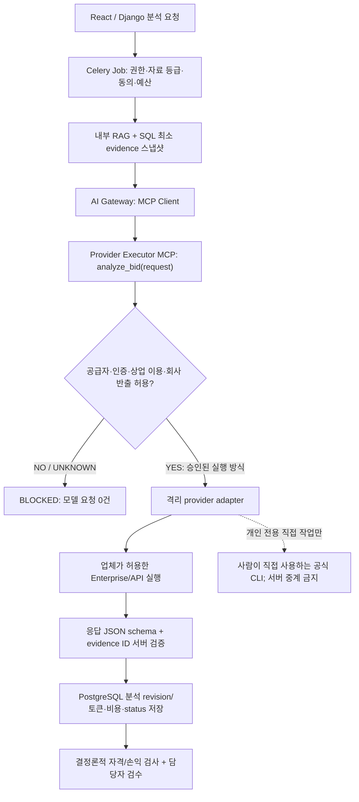

# 15. MCP Provider Executor 검토 — 구독 CLI·기업용 AI 실행 경계

- 기준일: 2026-11-20 KST (공식 공급자 문서 및 출시일 조회)
- 상태: **RESEARCH_VERIFIED / ARCHITECTURE_PROPOSAL / NOT_IMPLEMENTED**
- 사용자의 최신 의도: `AI Gateway / Provider Router`가 GPT·Claude·Gemini 분석 요청을 실행 주체에 보내고 JSON 결과를 받아 저장한다. 별도 종량제 API 비용보다 합법적인 구독 CLI·웹 워크플로를 먼저 검토하되 **MCP로 연결하고 싶다**. API 전용 구조를 유일한 목표로 고정하지 않는다.
- 기존 [13 API Provider 설계](13-multi-llm-provider-routing.md)는 가능한 운영 채널 중 하나일 뿐이고, 이 문서의 **MCP 실행 계층 검토를 우선**한다. 기존 [14 공개 RFP MCP](14-bid-mcp-interface.md)는 **AI가 데이터를 조회하는 역방향 도구**로 유지한다. 두 역할은 다르다.

## 1. 기술적으로 가능한 구조와 현재 정책

- **MCP는 모델 추론을 무료로 만드는 프로토콜이 아니다.** 서버가 MCP client가 되고 승인된 backend tool을 MCP server로 감싸는 구성이 가능하다. 실제 추론의 과금·계정·약관은 내부 provider 구현에 종속된다.
- `analyze_bid`는 입력 `analysis_run_id`, `notice_version_id`, `snapshot_id`, `evidence_ids`, `schema_version`, `provider_mode`, `max_output`만 수신. 실제 프롬프트와 원문은 사용자의 데이터 권한/회사 전송 정책을 서버가 검사한 후 최소 범위로 합성한다. 임의 쉘·SQL·URL/파일 읽기·쓰기·투찰·수정 도구 노출 금지.
- 모델 실행을 위해 `codex exec`, `claude -p`, `agy -p`를 래핑하는 것은 **기술적 아이디어**일 뿐. **개인 구독을 공용 SaaS/회사 서비스 백엔드로 재판매·중계해도 된다는 승인이 아니며**, 아래 공급자별 제약을 만족하지 못하면 실제 연결 금지.
- 사내 업무/원가/RFP 원문은 기존 회사 승인·부서 권한·데이터 반출 경계를 적용한다. 브라우저 자동화로 개인 ChatGPT/Claude/Gemini 웹 UI를 조작하거나 개인 쿠키·OAuth를 서버에 이관해 API 호출을 우회하지 않는다.

## 2. 2026-11-20 Google 구독·모델·CLI 공식 확인

1. **Gemini CLI(`gemini`)**: Google은 2026-06-18부터 개인 무료·Google AI Pro/Ultra 계정 인증 지원을 종료하고 개인 사용자를 **Antigravity CLI(`agy`)**로 이전했다. 현재 개인 Google AI Pro 구독으로 별도 공식 `gemini` CLI를 사용하는 경로는 없다. 구 Gemini CLI 기업 라이선스/API 키 인증은 별도.
2. **Gemini 3.8 Flash보다 상위 후보**: 2026-11-18 공개된 **Gemini 4 Neon**이 유료 AI Pro의 Antigravity CLI에 제공되며 **Gemini 4 Argon**, **Gemini 4 Hydrogen**도 Pro 대상(조건별로 유료 구독 필요). **Gemini 4 Carbon**은 Ultra/Enterprise 전용. 개별 계정에서 실제 사용 가능한 모델/할당량은 본인 `agy models`, `/usage`로 확인해야 한다.
3. 같은 **Google AI Pro**의 Antigravity 모델 메뉴에는 조건부로 **Claude Sonnet 5.5/Opus 5.5**도 포함된다. 이는 별도 **Claude Code 개인 구독**이나 서버 배포권을 제공한다는 의미가 아니다. 제3자 모델 사용에는 해당 공급자의 약관도 적용된다.
4. 공식 `agy -p ... --output-format json` 헤드리스는 **직접 스크립트/CI 워크플로**를 지원하지만, Google FAQ는 **개인 구독의 `agy`를 타사 애플리케이션/코딩 에이전트로 감싸거나 계정 순환 자동화하는 것을 지원하지 않음**을 명시한다. Antigravity 추가 약관도 제3자 소프트웨어를 통한 서비스 접근을 금지한다. **따라서 이 회사 입찰 서비스의 MCP provider executor로 개인 AI Pro 세션을 연결하지 않는다.**
5. 공식 허용 경로는 **Gemini Enterprise / Google Cloud·AI Studio API** 등 회사 명의의 계약·인증/대금 경로다. 다만 비용이 발생할 수 있으며 데이터 처리/학습/기록 및 별도 회사 승인을 검토해야 한다. 개인 계정의 Antigravity 상호작용은 데이터 개선/검토 정책을 특히 확인한다.

공식 근거:
- [Google: Gemini CLI → Antigravity CLI, 2026-06-18](https://developers.googleblog.com/an-important-update-transitioning-gemini-cli-to-antigravity-cli/)
- [Google Antigravity: 모델별 요금제](https://antigravity.google/docs/models)
- [Gemini 4 Neon 발표, 2026-11-18](https://blog.google/innovation-and-ai/models-and-research/gemini-models/introducing-gemini-4-neon/)
- [Google Antigravity: 가격·Pro 포함 모델](https://antigravity.google/pricing)
- [Google FAQ: 제3자 래핑·계정 회전 제한](https://antigravity.google/docs/faq)
- [Google Antigravity 개인 추가 약관](https://antigravity.google/terms)
- [Google Antigravity CLI: headless/JSON](https://antigravity.google/docs/cli/headless/)

## 3. Codex / Claude Code 기술·계약 분리

| 후보 | 기술적 기계 판독 수단 | 개인 구독을 회사 공용 Gateway로 연결? |
|---|---|---|
| Codex CLI | `codex exec --json` / `--output-schema` 또는 공식 SDK·app-server | 공식 비대화형 실행 지원은 별개이며, 소비자 계정을 직원 전체의 서버 공용 세션으로 사용·자동 Output 추출하는 것은 이용 계약 별도 확인 전 **NO** |
| Claude Code | `claude -p --output-format json` / `--json-schema` | Anthropic 공식 정책상 개인 Pro/Max OAuth를 타사 서비스가 다른 사용자 대신 라우팅 **불가**. 원래의 미수정 Claude Code 바이너리에 **각 사용자 본인이 직접 로그인**하는 허용 조건은 별개 |
| Antigravity CLI | `agy -p --output-format json` / `stream-json` | Google AI Pro 개인 구독의 제3자 앱 래핑 **지원 안 함**, 이 Gateway 경로 **차단** |

공식 근거:
- [Codex 실행 인터페이스](https://developers.openai.com/blog/codex-as-a-platform) · [OpenAI 소비자 이용약관](https://openai.com/policies/terms-of-use/)
- [Claude Code CLI JSON](https://code.claude.com/docs/en/cli-usage) · [Claude Code OAuth·재판매/중계 제한](https://code.claude.com/docs/en/legal-and-compliance)
- [Google FAQ](https://antigravity.google/docs/faq)

## 4. 실행/수집 방안

### 경로 A: 사내 공용 서비스 (실제 목표)

- `Provider Executor MCP`를 **인증·허가된 기업용/API 연결만** 제공하는 경계로 구현. `OFF` 기본값. 공급자별 약관과 실제 회사 자료 반출 가능 범위·가격/예산이 결정된 provider만 활성화.
- 일회성 RFP 비교 업무는 `idempotency_key=(notice_version,snapshot,prompt_version,provider,model)`로 중복 호출/비용 방지. 호출 중복·timeout·provider quota·에러 코드를 기록하고 재요청 전 사용자 동의 필요.
- 응답 `status`, `provider`, `model`, `schema_version`, `requirements[]`, `evidence_ids[]`, `unknowns[]`, `scenario_candidates[]`와 `usage`를 파싱·엄격한 JSON schema로 검증해 서버 DB에 새 immutable revision 저장. 타 부서 비밀·원문 전체 및 개인 세션 token은 로그/결과에 저장 금지.
- 사람의 Bid/No-Bid 최종 권한 유지; 자격·수익률 계산은 서버에서 결정론적으로 수행.

### 경로 B: 개인 직접 실험 (공용 서비스가 아님)

- 운영자가 **자신의 공식 CLI/웹 UI**에서 공개 RFP 또는 합성 데이터만 직접 분석하고 도구가 생성한 `JSON` 파일을 별도 검증·수동 업로드하는 방식은 검토 가능하다. 앱이 로그인 세션/CLI를 래핑하거나 결과를 자동 스크래핑하지 않는다. 개인 구독의 CLI/웹 이용약관과 데이터 처리 정책을 준수.
- 개인 구독으로 회사 전체의 무인 AI Gateway를 구동하는 방식을 이 경로와 혼동하지 않는다. 스케줄/계정 공유/브라우저 자동제어는 승인 없이 구현하지 않는다.

## 5. 다음 작업 우선순위 / 검증

- P0: 사용자 요구 정정: `AI Gateway -> MCP client -> provider executor`. 기존 14의 `AI agent -> data MCP`는 별도 유지. 사용 사례별 입력·출력 JSON 계약 및 mocked provider executor만 설계.
- P0: 요금제·약관·회사 전송 허용 여부 결정 전에는 **개인 구독 CLI 래핑과 기업 자료 전송 구현/호출 0건**.
- P1: 공개 RFP + 합성 부서 자료 기반 로컬 deterministic/mock MCP 왕복 → JSON 저장/근거 스코프/중복 호출 검증. 허용된 기업/개발자 API 계정이 확인되면 최소 실제 외부 호출 E2E.
- P1: 사용자 본인의 계정/기기에 설치된 `agy` 모델 목록(`models`), 버전, 요금제/쿼터를 **사용자 요청으로만 읽기 전용 확인**. 소비자 OAuth나 세션 복제/CLI 자동 위임 금지. 현재 직접 실행 증거 없음.
- 사용자 방향 연구 단계이며 업체 사용·새 과금·계정 가입·data1 설치/배포·비공개 원문 업로드·외부 모델 호출을 이번 조사로 승인하지 않는다.
