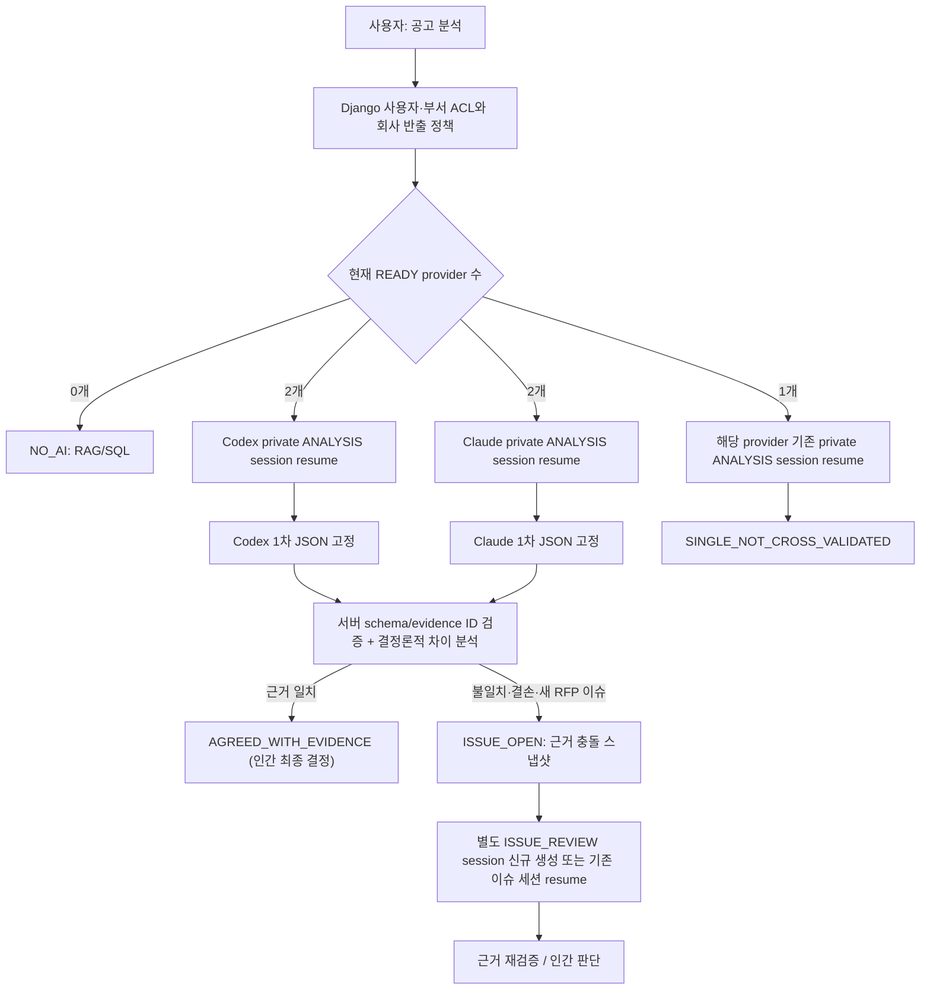

# 16. 사용자별 CLI 로그인·Resume 세션과 증거 중심 교차 검증

- 기준: 2026-11-20 KST
- 상태: **DESIGN_ONLY / NOT_IMPLEMENTED / NOT_DEPLOYED**
- 최신 사용자 요구: 서버에 Codex/Claude Code 공식 CLI를 설치하고 각 웹 사용자 **본인의 공식 공급자 계정으로 로그인**하여 실제 이용 가능한 provider만 실행. 동일 분석 과제의 세션은 `resume` 재사용이 기본. 실패·오염·충돌 등 이슈 발생 시에만 새 세션. 0/1/2개 가용 profile에 따라 AI 미사용/단독/교차 검증으로 동작.
- 사용자 추가 판단 요청: 두 AI가 대화를 **처음부터 공유하는지**, 독립 분석 후 **부분 공유하는지**의 정확도·속도. 기본 결론은 **독립 1차→서버 근거 비교→불일치 시에만 제한된 반박 근거 공유**, 전체 대화 기록 자동 공유 금지.
- [15 구독/Provider 계약](15-mcp-provider-executor-subscription-policy.md), [12 Hybrid RAG 권한·손익](12-enterprise-capability-hybrid-rag.md), [현재 우선순위](../../TASKS.md)와 함께 적용한다.

## 1. 선택 이유: 정확도·속도·구독 사용량

| 방식 | 첫 분석 속도 | 핵심 위험 | 제품 적용 |
|---|---|---|---|
| 한 AI가 분석하고 나머지 AI에 전체 대화 공유, 순차 협업 | `T_C+T_L` 이상의 순차 지연, 재작성 비용 발생 가능 | 초기 잘못된 주장 전파/앵커링/조기 합의, 과거 로그 노출 | 기본 제외 |
| Codex와 Claude가 **동일 RFP/evidence를 병렬 독립 분석**, 서버가 구조적 비교 | 대략 `max(T_C,T_L)+T_compare`(런타임 리소스·quota 영향), 요청량 2배 가능 | AI 간 결론이 같아도 공동 오류 가능 | **기본 경로** |
| 독립 결과 간 불일치만 별도 교차 반박 | 문제가 있는 경우 추가 모델 round/지연 | 반박을 과신하면 틀린 답으로 수렴 가능 | **이슈 발생 시에만** |

공식·학술 근거 (실제 입찰 도메인 효과를 직접 검증한 수치는 아님):
- [NeurIPS 2025 Debate or Vote](https://papers.nips.cc/paper_files/paper/2025/file/934252acd87f254d5d4672fbde283bd2-Paper-Conference.pdf): 토론 그 자체가 기대 정확도 향상을 보장하지 않는다는 연구
- [2026 Nature Scientific Reports: persuasion-driven influence](https://www.nature.com/articles/s41598-026-42705-7): 설득에 따른 잘못된 수렴·강한 peer 영향 위험
- [2024 ICML Debating with More Persuasive LLMs](https://proceedings.mlr.press/v235/khan24a): 특정 검증 설정에서 토론이 유익할 수 있음을 보여줌
- **검증 기준은 합의 투표가 아니라 RFP 근거·자격 SQL·회사/부서 가용성·집계 원가와 담당자 승인이다.**

## 2. 정확한 실행 흐름

1. `Codex ANALYSIS`와 `Claude ANALYSIS`는 **각자 기존 대화에만** 접근. 같은 `notice_version_id`·`evidence_snapshot_hash`·`prompt_version` 및 원문 근거를 읽되, 상대의 프롬프트/응답/대화 로그는 주지 않는다. 각 provider의 `analysis_result_v1.json`을 snapshot/모델/세션 ID에 고정 보관.
2. **비교는 먼저 서버 로직으로** `requirement_id`, 자격 근거, `evidence_id` 유효성/원문 위치, 필수·가점 요건, 미충족·불확실·가용 역량을 비교. 법적 자격은 RFP/정형 SQL, 금액·MM·수익률은 `Decimal`로 독립 계산. AI 두 개가 동일한 오답을 말하면 `INSUFFICIENT_EVIDENCE`, `UNKNOWN` 또는 확정 검증 실패를 우선.
3. **불일치가 실제 이슈인 경우만** `ISSUE_REVIEW` session을 새로 만들고, 양쪽의 **구조화된 상충 주장+근거 ID/원문 짧은 인용+검증 질문**만 전달. 정규 `ANALYSIS` session에 다른 AI의 답을 넣지 않는다. 2차 반박 round는 기본 **1회 상한**, 계속 불일치면 `HUMAN_REVIEW`. 이슈 세션도 동일 이슈 후속 검증 시 resume.
4. `ANALYSIS` private session은 **프로세스가 종료되어도 세션 식별자·로컬 session storage를 보존**하고 resume. 새 공고는 별도 context이며 신규 session 1회 불가피. **동일 공고의 정정 차수**는 기존 세션 유지하되 새 `notice_version`을 명시하고 오래된 증빙·판정을 사용 못하게 재검증; 정정 폭이 커 기존 문맥이 오염된 경우 문제/이슈로 기록 후 session 교체.
5. 각 사용자·provider·공고·목적(ANALYSIS/ISSUE_REVIEW)당 active session은 **1개**; DB unique/row-lock/lease 로 같은 세션 동시 resume 금지. CLI 실행은 해당 사용자 전용 UID/컨테이너, 전용 `HOME`/`CODEX_HOME` 및 허용된 최소 파일/네트워크만. job timeout/취소 시 해당 세션 lease 해제·결과 revision 조정. 관리자도 다른 사용자의 인증과 transcript를 공유하지 않는다.
6. **실패 시 재로그인과 새 세션을 구분**. Token 만료, 429/구독 한도, 일시 네트워크 오류는 프로필 `AUTH_REQUIRED/UNAVAILABLE` 처리하고 기존 session 보관·가용성 회복 후 resume. `SESSION_NOT_FOUND`, 오염된 문맥, 잘못된 공고/사용자 결속, 근거 노출·보안 사고 등 세션 안전/무결성 문제만 명시한 `RESET_REQUIRED` 후 새 session; 이전 history/read-only audit 보존. 새 세션 자동 생성으로 무단 비용 재호출 금지.
7. **데이터 반출**: 회사 원가·비공개 실적·회사/부서 RAG 및 파생 텍스트는 공급자별 전송 승인 전 외부 CLI에 주입하지 않는다. 기본 OFF. 공식 CLI 로그인은 해당 사용자가 공급자 인증 흐름에서 직접 하고, 웹 서버는 OAuth 비밀·토큰·쿠키/CLI history를 읽거나 중계하지 않는다.
8. **구독 적법성**: Anthropic은 사용자가 호스팅된 **변조되지 않은 Claude Code에 직접 로그인**하는 것을 조건부로 구분하지만, 타사 제품 개발자가 소비자 인증을 가져다 다른 이용자의 요청을 라우팅하는 것은 허용하지 않는다. Codex는 공식 SDK/app-server/exec에서 세션 resume 기능을 제공하지만 회사 앱과 ChatGPT 개인 구독 연결의 적격성은 별개 승인 필요. 개발자/회사 약관 및 보안 승인 전 `AUTHORIZED_EXECUTOR` OFF. 우선 합성/공개 RFP로 동작 시뮬레이션.

## 3. DB/상태 계약

- `ProviderIdentity`: `web_user_id`, `provider`, `os_identity_ref`, `enabled`, `auth_state`, `availability_state`, `verified_at`, `policy_state`. **비밀 없음**.
- `SessionBinding`: `web_user_id`, `provider`, `notice_id`, `purpose=ANALYSIS|ISSUE_REVIEW`, `provider_session_id`, `context_version`, `last_notice_version_id`, `status`, `last_success_at`, `lock_owner`, `lease_until`. 다른 provider/사용자/공고의 session ID는 재개 불가. session transcript/auth file는 해당 OS 사용자의 격리 홈에만 있고 DB에는 ID/요약/해시만.
- `AnalysisRevision`: `run_id`, `session_binding_id`, `provider`, `notice_version_id`, `snapshot_hash`, `schema_version`, `result_digest`, `validated_json`, `usage`, `status`.
- `Comparison`: `left_revision_id`, `right_revision_id`, `matching_evidence_ids`, `disputed_requirement_ids`, `state`, `human_resolution`.
- 상태: `NO_AI`, `SINGLE_NOT_CROSS_VALIDATED`, `DUAL_WAITING`, `AGREED_WITH_EVIDENCE`, `INSUFFICIENT_EVIDENCE`, `DISAGREEMENT`, `HUMAN_REVIEW`, `AUTH_REQUIRED`, `UNAVAILABLE`, `SESSION_RESET_REQUIRED`. **교차 검증 PASS = 모델 합의가 아니라 서버 근거 검증을 통과했을 때만 제한적으로 표시**.

## 4. 구현/인수 순서

1. **P0**: 가용 0/1/2 profile 판단 + session binding/lock/lease + OFF/default·권한 fail-closed + mock CLI resume 시뮬레이션. 실제 회사 자료 전송/CLI 로그인은 실행하지 않는다.
2. **P0**: 동일 snapshot 2개 독립 JSON → 서버 비교/불일치 사유/인적 검토 대기. normal analysis session에 상대 result 주입 테스트는 실패해야 함. 로그/계정/민감 원문 누출 차단.
3. **P1**: 승인된 별도 계정/전용 컨테이너에서 사용자별 공식 `codex login --device-auth`, `claude auth login`(CLI 실제 버전마다 공식 명령 확인), `login status`/probe, 구조화 출력 및 정확한 `resume`을 **실제 공개 RFP+합성 데이터로** E2E. Codex `codex exec resume <ID>`, Claude `claude -p --resume <ID>`의 플래그·워크스페이스/프로필·출력 저장 경로는 설치 후 `--help`로 확인.
4. **P1**: 2개 가용 시 독립 병렬, 1개 시 단독, 한쪽 로그인 만료/정지 → `DEGRADED_SINGLE` 및 session 보존/회복, 동일 session 동시 resume 두 건 차단, 프로세스 재기동 후 resume 성공·새 session 금지 검증.
5. **P1**: 실제 이용 계약·데이터 등급·비밀 관리·복구·사내 운영 배포 승인을 별도 확인. GitHub PR만으로 회사 data1 설치/로그인/외부 공개를 허가하지 않음.
6. 품질 측정: 최소 10~20개 RFP의 전문가 판정·사실/법적 gate 정답셋 구축 후 단독/독립 병렬/불일치만 추가 반박의 **중요 요건 누락률·근거 오인율·법적 자격 오판·잘못된 Bid 권고율·P50/P95 지연·각 provider quota/사용량**을 동일 조건에서 비교. 통계 없이 임의의 정확도/속도 개선 % 주장 금지.

## 5. 공식 문서

- [OpenAI: Codex SDK, exec, app-server와 resume](https://developers.openai.com/blog/codex-as-a-platform)
- [Anthropic: Claude Code 사용자 직접 로그인·타 사용자 구독 인증 중계 제한](https://code.claude.com/docs/en/legal-and-compliance)
- [Anthropic: Claude Code CLI 명령/세션](https://code.claude.com/docs/en/cli-reference)
- [Anthropic: Claude --resume는 로컬 대화, Cloud session은 별도](https://code.claude.com/docs/en/claude-code-on-the-web)
